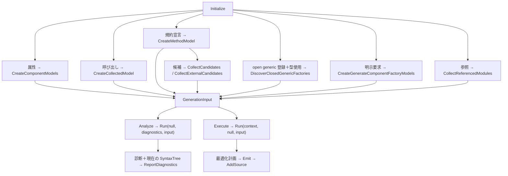
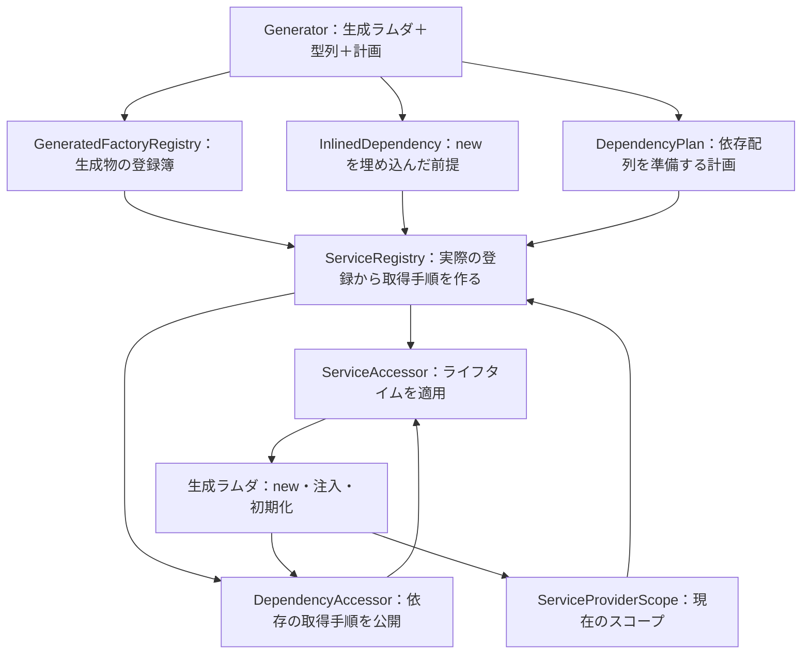

# 📘 DependencyInjectionGenerator 詳細ソースリーディングガイド

## 🗂️ 目次

1. [🧭 この資料の使い方と、Generator の二つの出力](#section-1)
2. [🗺️ 呼び出し関係の全体像](#section-2)
3. [🧱 モデルの契約と、戻り値の読み方](#section-3)
4. [🚦 Initialize と共通の入力補助メソッド](#section-4)
5. [🔎 型と属性を読む共通ユーティリティ](#section-5)
6. [🏗️ CreateFactoryModel：構築方法を作る中心処理](#section-6)
7. [🏷️ 属性入力：ComponentModel と明示的なファクトリ要求](#section-7)
8. [📥 Add / TryAdd / Activate の収集を分岐ごとに読む](#section-8)
9. [🧬 open generic：定義の収集から閉型ファクトリまで](#section-9)
10. [🧩 規約登録：宣言・候補・外部走査を分離する](#section-10)
11. [🔀 Analyze / Execute / Run：二つの実行モードと集約処理](#section-11)
12. [🩺 ReportAnalysisDiagnostics：どの情報をグラフへ接続するか](#section-12)
13. [⚡ BuildInlineTargetMap / BuildEnumerableModels：最適化の前提を作る](#section-13)
14. [🛠️ EmitGeneratedComponents / EmitFactoryRegistration：コードと採用条件を出す](#section-14)
15. [🔌 式を出す補助メソッド：展開木・スロット・scope の接続](#section-15)
16. [📦 enumerable とサービス登録の出力](#section-16)
17. [🔬 通し例：一つの入力を各メソッドのローカル変数まで追う](#section-17)
18. [⚙️ ServiceRegistry：生成ファクトリの採用と実行](#section-18)
19. [📚 全メソッド索引：ソース順から説明へ戻る](#section-19)

<a id="section-1"></a>

## 1. 🧭 この資料の使い方と、Generator の二つの出力

対象は [DependencyInjectionGenerator.cs][source]。コミット `3d25de7`（2026-10-24）の実装を、**呼び出し関係 → メソッドの契約 → 内部の分岐 → 次段へ渡す情報 → 生成コード**の順に読むための資料である。Generator 内の 74 メソッド（補助型内の 2 メソッドを含む）、6 ローカル関数、補助型のコンストラクタを扱う。さらに、指定された7クラスについても、生成情報を渡すタイミングに合わせて状態・コンストラクタ・メソッド・呼び出し関係を詳述する。

ソースと並べて読むときは、各節のソースリンクを開き、節内の番号順にローカル変数と分岐を追う。ファイル上の配置と実行順は一致しないため、最初に第 2 節の呼び出し図を確認する。特定のメソッドから調べる場合は、末尾の全メソッド索引を使う。

説明中の `L58–172` は対象ソースの行範囲。リンクは開始行へ移動する。追加クラスの行番号は、それぞれの節に記載したソースファイルを指す。短いコード例は「抜粋」「概念形」「実出力の簡略表記」を区別する。単語が同じでも、次の三つの「キー」を混同しないこと。

| 用語 | 意味 | 例 |
|---|---|---|
| サービス型 | コンテナへ要求する型 | `ILogger` |
| 実装型の型キー | モデルの比較・辞書検索に使う完全修飾の型表現 | `global::ReadingDemo.ConsoleLogger` |
| keyed service のキー | 同じサービス型を区別する実行時の値 | `"blue"` |

この Generator の出力は二系統ある。

```text
登録宣言 ──→ IServiceCollection に積む登録コード
             「ILogger を要求したら ConsoleLogger を Singleton として使う」

実装型   ──→ GeneratedFactoryRegistry に載せる構築ファクトリ
             「ConsoleLogger をどう new し、注入・初期化するか」
```

登録の単位はサービスとライフタイム、ファクトリの単位は実装型である。同じ実装を複数のサービスへ登録しても、構築方法は共通にできる。`FactoryModel` がライフタイムを持たず、`ComponentModel` や `CollectedModel` が持つ理由がここにある。

Generator は利用者の登録メソッドを実行しない。コンパイル時に見える情報からファクトリと前提条件を出し、実際のコンテナ構成との一致をランタイムで確認する。この境界を前提に、以下の静的解析と最適化を読む。


<a id="section-2"></a>

## 2. 🗺️ 呼び出し関係の全体像

### 2.1 Roslyn が起動する経路

`Initialize` は通常の意味で全解析を順に実行するメソッドではない。Roslyn が入力変更に応じて評価する provider と、出力用コールバックを登録する。以下の矢印は provider のデータ依存を表し、その場で同期的にすべて呼び出す順序ではない。



`Analyze` と `Execute` は別々に `Run` を呼ぶ。**共通部分を一度だけ実行して、その結果を両者が受け取る実装ではない**。一方、増分処理が同値と判断すれば、対応する下流処理は再利用され得る。

### 2.2 入力から共通の構築解析への呼び出し

```text
Initialize
├─ CreateComponentProvider ×3
│  └─ CreateComponentModels
│     ├─ IsReferable / IsObsoleteError
│     ├─ CreateFactoryModel ───────────┐
│     └─ CollectInterfaces            │
├─ IsAddInvocationSyntax              │
│  └─ IsDescriptorArgumentSyntax      │
├─ CreateCollectedModel               │
│  ├─ GetInvokedMethod                │
│  │  └─ IsChainedAfterGeneratedComponents
│  ├─ HasFactoryOrInstanceParameter / ReadTypeOfArgument / ReadDescriptorLifetime
│  ├─ CreateServiceOnlyModel          │
│  └─ CreateCollectedModelCore        │
│     └─ CreateFactoryModel ──────────┤
├─ CreateMethodModel → IsServiceCollection / IsDefinedEnumValue
├─ CollectCandidates → CreateFactoryModel / CollectInterfaces
├─ CollectExternalRequests            │
│  └─ CollectExternalCandidates       │
│     └─ CollectNamespaceCandidates ↔ 再帰
│        └─ CollectTypeCandidates ↔ 入れ子型へ再帰
│           └─ CreateFactoryModel ────┤
├─ CreateOpenGenericModel             │
├─ CreateGenericUsageModel            │
├─ DiscoverClosedGenericFactories     │
│  └─ CreateFactoryModel ─────────────┤
└─ CreateGenerateComponentFactoryModels
   └─ CreateFactoryModel ─────────────┘
```

`CreateFactoryModel` 内部は次の階層になる。

```text
CreateFactoryModel
├─ ToKey / ToName / IsObsoleteError
├─ コンストラクタ引数ごとに CreateDependencyModel
│  └─ ToKey / ToName
├─ GetPublicProperties
│  ├─ ローカル HasAttribute で [Inject] を確認
│  ├─ CreateDependencyModel
│  └─ SelectInjectKey
├─ HasRequiredMemberOtherThan
├─ 実装インターフェイスから Disposable / InitializableInterface を判定
└─ FindPostConstructMethod
```

### 2.3 集約から出力への呼び出し

```text
Analyze ─┐
         ├─ Run
Execute ─┘  ├─ FilterIgnoredInterfaces → IsIgnoredInterface
            ├─ 規約照合：CreateRegex
            ├─ 出力名検査：MakeConventionHintName
            ├─ 診断モード：ReportAnalysisDiagnostics
            │  ├─ Dependencies / Display（ローカル関数）
            │  ├─ IsOpenGenericClosedForm
            │  └─ Visit → Visit（DFS のローカル関数）
            ├─ 実装型ごとにファクトリを重複排除
            └─ 出力モード
               ├─ BuildInlineTargetMap → Add（ローカル関数）
               ├─ BuildEnumerableModels → Append（ローカル関数）
               ├─ EmitGeneratedComponents
               │  ├─ EmitFactoryRegistration
               │  │  ├─ TryCreateInlineNode → 再帰
               │  │  ├─ CollectDependencySlots → 再帰
               │  │  ├─ NeedsScope → 再帰
               │  │  └─ EmitArgument
               │  │     ├─ EmitDependencyResolution
               │  │     └─ EmitInlineNew → EmitArgument
               │  ├─ EmitEnumerableRegistration
               │  │  └─ TryCreateInlineNode / NeedsScope / EmitInlineNew
               │  └─ EmitComponentRegistration
               └─ EmitConventionClass
                  └─ EmitConventionMethod
```

`CollectExternalRequests` から `CreateReferenceCompilation` までの収集系メソッドは、ソース上では `Emit` 節に置かれている。しかし呼び出し元は `Initialize` の入力経路である。`Run` から外部走査を始めるわけではない。


### 2.4 🔗 生成側から指定された7クラスへ渡る情報

Generator が出したラムダは、以下のクラスを経由して使われる。各クラスの詳細は、右列の「読むタイミング」で説明する。

| クラス | Generator と接続する情報 | 詳細を読むタイミング |
|---|---|---|
| [InlinedDependency][rt-InlinedDependency] | 直接 new した依存のサービス型・実装型 | [インライン最適化の前提](#runtime-InlinedDependency) |
| [ServiceAccessor][rt-ServiceAccessor] | 生成ラムダの実行を包むキャッシュ・破棄方針 | [最適化で維持すべきライフタイム](#runtime-ServiceAccessor) |
| [GeneratedFactoryRegistry][rt-GeneratedFactoryRegistry] | Register / RegisterKeyed で渡す型列・計画・ラムダ | [生成ファイルの登録先](#runtime-GeneratedFactoryRegistry) |
| [DependencyPlan][rt-DependencyPlan] | dependencies 配列の各要素をどう準備するか | [Register の依存計画](#runtime-DependencyPlan) |
| [DependencyAccessor][rt-DependencyAccessor] | 生成ラムダが直接呼べる依存の取得手順 | [GetValue(scope) の出力先](#runtime-DependencyAccessor) |
| [ServiceProviderScope][rt-ServiceProviderScope] | 生成コードの scope、Scoped 値の保存、破棄 | [依存解決式の実行環境](#runtime-ServiceProviderScope) |
| [ServiceRegistry][rt-ServiceRegistry] | 実際の登録から取得手順を作り、生成前提と照合 | [生成ファクトリの採用から実行まで](#runtime-ServiceRegistry) |



> 💡 **「登録簿」と「コンテナ」を分ける。** GeneratedFactoryRegistry は実装型ごとの構築コードを共有する。ServiceRegistry は一つのプロバイダーが受け取った実際の登録を扱う。前者にファクトリがあっても、後者にそのサービスの登録があるとは限らない。

<a id="section-3"></a>

## 3. 🧱 モデルの契約と、戻り値の読み方

モデル定義は [Models ディレクトリの GenerationInput][model-input] から関連型をたどれる。モデルをデータの入れ物としてだけでなく、**後段が使ってよい情報の境界**として読む。

### 3.1 登録と構築のモデル

| 型・主要フィールド | 意味と主な利用先 |
|---|---|
| `FactoryModel.ImplementationType / ImplementationTypeName` | 比較用型キーと出力用型名。`Run` の重複排除、各 Emit で使う |
| `EligibleUnkeyed / EligibleKeyed` | それぞれのファクトリを出せるか。`Run` と最適化で判定 |
| `AmbiguousConstructor / InvalidPostConstruct / ConflictingPostConstruct / InvalidInjectProperties` | 構築解析の結果として持ち越す診断材料 |
| `Parameters / InjectProperties` | コンストラクタの引数順とプロパティの代入先。構築式、依存グラフ、スロット計画へ展開 |
| `Disposable / PostConstruct / InitializableInterface` | 破棄・初期化の扱い。`HasInitializer` は後二者から計算 |
| `ComponentModel.Factory / Lifetime / AsType / AsTypeName` | 属性に基づく「構築方法＋登録先＋ライフタイム」 |
| `ComponentModel.KeyLiteral / Tracking / WithInterfaces / Interfaces` | keyed 登録、破棄追跡指定、委譲登録の形 |
| `CollectedModel.Factory?` | 既存呼び出しから構築方法まで判明した場合だけ非 null |
| `CollectedModel.ServiceType / ServiceTypeName / Lifetime? / Kind` | 観測した登録情報と、その利用可能範囲 |
| `FilePath / SpanStart / Location` | 安定した整列、後からの位置復元、診断報告。型識別そのものではない |

`ParameterModel` は型キー・出力型名・`InCompilation`・`IsValueType`・`HasDefaultValue`・依存の `Kind`・`KeyLiteral` を持つ。`PropertyModel` は代入先の `Name` を持ち、既定値フラグは持たない。両者を完全に同じレコードにしないのは、コンストラクタの引数とプロパティ代入で必要な情報が違うためである。

`TypeNameModel(Key, Name)` は、自動登録するインターフェイスの比較用表記と出力表記の組。

### 3.2 規約と参照・ジェネリックのモデル

| 型 | 何を固定し、何を後段へ残すか |
|---|---|
| `MethodModel` | 宣言先 namespace・class、実装用署名、引数名、パターン列、位置を固定。どの型を登録するかはまだ未決定 |
| `PatternModel` | Lifetime、未定義 enum 値、正規表現、Namespace、Assembly、As、WithInterfaces、位置 |
| `CandidateModel` | 名前・namespace・構築方法・出自 Assembly・インターフェイス・参照可能性。どの規約が採用するかは未決定 |
| `ExternalRequest` | Assembly / Pattern / Namespace だけを取り出した外部走査条件 |
| `ExternalScanResult` | 外部候補と見つからなかったアセンブリ名 |
| `OpenGenericModel` | サービス定義キー、単純名、arity、実装定義のメタデータ名、登録位置。閉じた実装型はまだない |
| `ClosedGenericUsageModel` | 名前・arity・ファイル・型構文の span。Roslyn の型シンボルは保持しない |
| `ClosedGenericScanResult` | 生成可能な閉型の FactoryModel、警告候補、サービス定義キー集合 |
| `ClosedGenericWarningModel` | 生成できなかった対象の表示名と位置 |
| `CompilationKeyModel` | アセンブリ名と CompilationOptions。参照専用 Compilation の再作成条件 |

### 3.3 null、空配列、Result の違い

| 戻り方 | 代表例 | 下流の扱い |
|---|---|---|
| `null` | `CreateCollectedModel` の対象外呼び出し | provider の `Where` で除外する |
| 空配列 | `CreateComponentModels` の対象外クラス | `SelectMany` 後に要素を流さない |
| `Results.Success(model)` | 正常な属性・規約解析 | `SelectValue` や `HasValue` を通して値を使う |
| `Results.Error<T>(diagnostic)` | 参照できない属性対象、不正な規約メソッド | モデルの代わりに診断を運ぶ |
| フラグを落とした `FactoryModel` | 既定値つき引数など | 登録情報を残せる入力経路もあるが、生成対象からは外す |

この違いは重要である。たとえば `CreateCollectedModelCore` はファクトリ不適格なら `null` を返すため、「すべての Add 呼び出しが必ず ServiceOnly として残る」とは限らない。一方、属性では不適格な `FactoryModel` を含む `ComponentModel` が残る場合があり、登録コードと診断の材料に使える。

モデルに使う record と `EquatableArray` は、内容が等しければ入力の意味が変わっていないと比較するための仕組みである。Roslyn のシンボルは解析時に使い、構築モデルには文字列・フラグ・配列を渡す。位置も値の一部なので、編集内容によっては位置の変化もモデルの変化になる。

### 3.4 SourceGenerateHelper が受け持つもの

このファイルの中に定義がない主な呼び出しは、次のように読む。

| ヘルパー | この Generator での役割 |
|---|---|
| `Results` / `Result<T>` / `DiagnosticInfo` / `LocationInfo` | 解析値と診断の受け渡し |
| `SelectValue` / `ReportDiagnostics` | 成功値の抽出、保存された診断と現在の SyntaxTree の接続 |
| `ToCSharpExpression` | 属性の定数値を C# 式へ変換。文字列・enum などを出力へ埋め込む |
| `GetImplementationSignature` | partial メソッドの実装側署名を作る |
| `CSharpIdentifier` | キーワードなどを含む識別子を出力用にエスケープ |
| `HintNameBuilder` | 生成ファイルの識別名を作る |
| `SourceBuilder` | 字下げ、スコープ、namespace、using、生成ヘッダーを組み立てる |
| シンボルの `.HasAttribute(...)` / `.IsObsolete(...)` | 属性の判定など。このクラスの static `HasAttribute(attributes, name)` とは別の呼び出し形 |

`SourceBuilder` の Append 群自体を追う前に、その場所で出そうとしている C# の構文単位を把握すると読みやすい。


<a id="section-4"></a>

## 4. 🚦 Initialize と共通の入力補助メソッド

<a id="method-Initialize"></a>

### 4.1 Initialize — provider を組み立てる（[L58–172][src-Initialize]）

**呼び出し元:** Roslyn。**入力:** `IncrementalGeneratorInitializationContext`。**結果:** provider と二つの出力コールバックの登録。戻り値はない。

ソースを次の順に区切って読む。

| 範囲 | ローカル変数 | 入力 → 出力・後段 |
|---|---|---|
| L60–61 | `ignoreInterfacesProvider` | AnalyzerConfigOptions → 除外インターフェイス名 |
| L64–66 | `singleton/scoped/transientProvider` | 三種の属性 → `Result<ComponentModel>` の流れ |
| L69–74 | `collectedProvider` | 呼び出し構文 → `CollectedModel`。null を取り除く |
| L77–83 | `methodProvider` | 規約メソッド → Result の配列。`Collect` がこの時点で入る |
| L86–89 | `candidateProvider` | 規約＋現在の Compilation → ローカル候補 |
| L92–97 | `openGenericProvider` | unbound typeof 登録 → 定義間の対応 |
| L100–105 | `generateComponentFactoryProvider` | 明示属性 → Result の列。`SelectMany` で平らにする |
| L108–113 | `genericUsageProvider` | 使用構文 → 使用位置のモデル |
| L116–117 | `assemblyNameProvider` | アセンブリ名 → 生成 namespace 用の名前 |
| L120–123 | `referenceProvider` | MetadataReferences＋CompilationKey → 参照専用 Compilation |
| L126–128 | `referencedModulesProvider` | 参照専用 Compilation → モジュール型名 |
| L131–134 | `closedFactoriesProvider` | 定義・使用位置・現在の Compilation → 閉型の構築モデル |
| L137–142 | `externalCandidatesProvider` | 規約から抜いた外部要求＋参照専用 Compilation → 外部候補 |
| L144–166 | `source` | 全入力を `GenerationInput` の 12 フィールドへまとめる |
| L168–171 | `diagnosticsProvider / treesProvider` | 診断値＋現在の木の報告と、ソース出力を別々に登録 |

`WithTrackingName("Candidates")` などは処理の追跡名であり、キャッシュを強制する指定ではない。キャッシュの意味は入力・出力値の等価性とデータ依存から決まる。

`source.Left.Left...Right` は `Combine` が作った入れ子の組をほどいているだけである。ここに登録の優先順位や再帰アルゴリズムはない。`GenerationInput` のフィールド順と対比して読む。

最後の二つのコールバックは、概念的には次の分岐である。

```text
GenerationInput ─→ Analyze ─→ DiagnosticInfo[] ─┐
現在の SyntaxTrees ───────────────────────────┴→ ReportDiagnostics
GenerationInput ─→ Execute ─→ AddSource
```

診断を `Distinct()` するのは報告直前。Parser や `Run` が常に一度だけ同じ診断を作ることを前提にしない。

<a id="method-ToNamespace"></a>
<a id="method-SelectIgnoreInterfaces"></a>
<a id="method-CreateComponentProvider"></a>
<a id="method-CreateReferenceCompilation"></a>

### 4.2 入口で使う四つのメソッド

| メソッド・呼び出し元 | 入力・戻り値と内部の判断 | なぜ必要か |
|---|---|---|
| [ToNamespace][src-ToNamespace] ← Initialize | アセンブリ名を `.` で分割。識別子部分に使えない文字を `_` へ置換。空文字・不正な先頭には `_` を足して連結 | ファイル名由来のアセンブリ名を生成 namespace に使える形にする。キーワードのエスケープは出力側でも扱う |
| [SelectIgnoreInterfaces][src-SelectIgnoreInterfaces] ← Initialize | `build_property._DependencyInjectionIgnoreInterface` を取得。未指定・空白なら空配列。URI デコードして `,` / `;` 分割、Trim、空要素除去 | MSBuild のエスケープ済み設定を比較可能な型名の列へ戻す |
| [CreateComponentProvider][src-CreateComponentProvider] ← Initialize ×3 | 属性のメタデータ名と lifetime 文字列を受ける。`ClassDeclarationSyntax or RecordDeclarationSyntax` を入口に、CreateComponentModels の配列を SelectMany | 三つの属性で同じ解析を共有し、複数属性も要素単位で流す |
| [CreateReferenceCompilation][src-CreateReferenceCompilation] ← referenceProvider | MetadataReference の配列と CompilationKey から `CSharpCompilation.Create`。SyntaxTree を渡さない | ソースの無関係な編集と外部参照走査の再計算条件を分ける |

ユーザーが設定する名前は `DependencyInjectionIgnoreInterface` だが、Generator が読むキーには先頭の `_` がある。[BunnyTail.DependencyInjection.targets][targets] がコンパイラへ見せる内部プロパティへ変換しているためである。


<a id="section-5"></a>

## 5. 🔎 型と属性を読む共通ユーティリティ

この節のメソッドは複数経路から呼ばれる。最初に契約を理解し、呼び出し元では「何を保証するために使っているか」を確認する。

<a id="method-ToKey"></a>
<a id="method-ToName"></a>

### 5.1 ToKey / ToName — 比較する表記と出力する表記

[ToKey][src-ToKey] は `KeyFormat`、[ToName][src-ToName] は `SymbolDisplayFormats.FullyQualifiedNullable` で `ITypeSymbol` を文字列化する。

`KeyFormat` は完全修飾形式に `ExpandValueTuple` を加えたもの。表示上の省略・別表記に引きずられず、辞書のキーや `typeof` に使う表現をそろえる。一方、出力用の型名は nullable を含む表記を考慮する。`CreateDependencyModel` は参照型の nullable 注釈を除いてから出力名に変える点も確認する。

**主な呼び出し元:** 構築・登録・規約モデルを作る Parser。`ToKey` の結果は `serviceMap`、`emittedUnkeyed`、`dependencyIndex` などへ伝播する。名前を短縮しただけの補助関数として読み飛ばすと、後の辞書が何を同一視するかを見失う。

<a id="method-IsObsoleteError"></a>
<a id="method-IsReferable"></a>
<a id="method-ContainsTypeParameter"></a>

### 5.2 IsObsoleteError / IsReferable / ContainsTypeParameter — 生成先から使える型か

| メソッド | 正確な判定・主な呼び出し元 |
|---|---|
| [IsObsoleteError][src-IsObsoleteError] | `symbol.IsObsolete(out isError) && isError`。Obsolete 全般ではなく error 指定を識別。属性対象、規約候補、コンストラクタ、注入プロパティ、初期化メソッドなどの判定で使う |
| [IsReferable][src-IsReferable] | 対象から containing type を上へたどる。file-local、型パラメータを含む外側の型なら false。最後に `compilation.IsSymbolAccessibleWithin(symbol, compilation.Assembly)` |
| [ContainsTypeParameter][src-ContainsTypeParameter] | `ITypeParameterSymbol` なら true。`INamedTypeSymbol` なら各 TypeArgument へ再帰。それ以外は false。Add、closed generic、明示要求、参照可能性判定で使う |

`IsReferable` の目的は、別の生成ファイルからその型を書けるかを調べること。同一アセンブリの internal 型なども許容され得るため、「public 以外をすべて除外」とは違う。

`ContainsTypeParameter` の実装が再帰するのは named type の型引数である。任意の型構造をすべて走査する一般的な「閉型判定器」へ拡大解釈しない。

<a id="method-IsDefinedEnumValue"></a>
<a id="method-CreateRegex"></a>
<a id="method-HasAttribute"></a>

### 5.3 IsDefinedEnumValue / CreateRegex / HasAttribute — 無効入力の扱い

[IsDefinedEnumValue][src-IsDefinedEnumValue] は `TypedConstant` を受ける。enum でない場合や値が null の場合は true。enum の全定数と一致を調べ、Flags enum なら全定義値のビット OR に収まる組み合わせも許す。呼び出し元は属性の `Tracking` と規約の `Lifetime` の読み取りであり、無効値を `BTDI0003` の材料にする。

[CreateRegex][src-CreateRegex] は文字列から Regex を作り、`ArgumentException` のとき null を返す。ローカル候補の事前絞り込みと `Run` の最終照合で使う。事前絞り込みで無効パターンを飛ばしても、`Run` で診断を出せるよう、元のパターンはモデルに残す。

このクラスの [HasAttribute][src-HasAttribute] は `ImmutableArray<AttributeData>` を順に見て、`AttributeClass?.ToDisplayString()` と指定名が一致するかを返す。`CreateFactoryModel` の Inject 判定に使う。`symbol.HasAttribute(...)` という SourceGenerateHelper の拡張メソッド呼び出しと区別する。

<a id="method-CollectInterfaces"></a>
<a id="method-FilterIgnoredInterfaces"></a>
<a id="method-IsIgnoredInterface"></a>

### 5.4 CollectInterfaces / FilterIgnoredInterfaces / IsIgnoredInterface — 自動登録候補の整形

**呼び出し関係:**

```text
CreateComponentModels / CollectCandidates / CollectTypeCandidates
    → CollectInterfaces
Run
    → FilterIgnoredInterfaces
        → IsIgnoredInterface
```

[CollectInterfaces][src-CollectInterfaces] は `symbol.Interfaces` を使う。ここで取得するのは直接宣言したインターフェイスだけで、`AllInterfaces` ではない。`IDisposable`、`IAsyncDisposable`、`IInitializable` を除き、型キー・出力名の組にする。

[FilterIgnoredInterfaces][src-FilterIgnoredInterfaces] は候補配列と除外設定を受ける。どちらかが空なら元の配列を返す。要素ごとに [IsIgnoredInterface][src-IsIgnoredInterface] を呼び、一件も減らなければ元の配列を返し、減ったときだけ新しい配列を作る。

`IsIgnoredInterface` は Key と Name の両方から `global::` を除き、除外名と ordinal の完全一致で比較する。ジェネリックは型引数も含む表記で比較する。ワイルドカードや namespace の前方一致ではない。

設定を `Run` で適用することで、型から得る事実とユーザー設定による登録方針を分けている。`As` は明示指定なので、このインターフェイス候補配列の除外では変更しない。


<a id="section-6"></a>

## 6. 🏗️ CreateFactoryModel：構築方法を作る中心処理

<a id="method-CreateFactoryModel"></a>

### 6.1 契約と呼び出し元（[L282–450][src-CreateFactoryModel]）

**入力:** 実装型の `INamedTypeSymbol`、現在のコンパイルの `IAssemblySymbol`。**戻り値:** `FactoryModel`。診断を直接報告せず、判断結果と不備をモデルに記録する。

**呼び出し元:** CreateComponentModels、CreateCollectedModelCore、CreateGenerateComponentFactoryModels、CollectCandidates、CollectTypeCandidates、DiscoverClosedGenericFactories。

型が具象か、生成コードから参照可能かなどの入口の絞り込みは、これらの呼び出し元が担当する。`CreateFactoryModel` はその型の構築内容を共通に調べる。

### 6.2 ステップ 1：コンストラクタの候補と仮定

L284–308 を読む。

1. `implementationType = ToKey(symbol)` で実装型の比較キーを確定する。
2. public な `InstanceConstructors` を引数数の降順に並べる。
3. 先頭を `constructor` にする。候補がなければ null。
4. 先頭二つが同じ最大引数数なら、それぞれの引数型の HashSet を作る。
5. 二つの集合が異なるとき `ambiguous = true` にする。
6. constructor が存在し、曖昧でなく、Obsolete(error) でもなければ非 keyed / keyed の両方を適格として開始する。

ここでの `constructor` は**生成コードが仮定するコンストラクタ**。実行時の登録内容による解決可能性を、この時点で調べているわけではない。

同数候補の比較は先頭二つの型集合である。順序や重複数を比較する処理ではなく、全候補の総当たりでもない。診断の短いメッセージより、この実装上の判定範囲を優先して読む。

### 6.3 ステップ 2：各引数を ParameterModel にする

L309–339。引数順に `CreateDependencyModel` を呼び、得られた型キー・名前・依存種別・キー式・自コンパイル内か・値型かに、`HasExplicitDefaultValue` を加える。

ここで変更する適格フラグには、異なる二つの理由がある。

| 条件 | 変化 | 生成コードとの関係 |
|---|---|---|
| 既定値つき引数 | 両方 false | 常に必須サービス解決へ置き換えると、未登録時に既定値を使う動作が変わる |
| `ServiceKey` または `KeyedInherit` | 非 keyed だけ false | ラムダに解決中の `key` 引数が必要 |
| 明示キー `KeyedExplicit` | この理由では落とさない | キー式を固定して出せるため、非 keyed の生成経路でも扱える |

非適格でも引数列の解析は続ける。後段の診断や構築方法の記録に情報が必要だからである。

### 6.4 ステップ 3：Inject プロパティを集める

L341–380。まず `GetPublicProperties` で候補を取得し、static または Inject なしなら飛ばす。

public setter がない場合は名前を `invalidInjectProperties` に追加し、両方の適格フラグを false にして次へ進む。setter が使える場合は依存情報を作り、`SelectInjectKey` が非 null なら `KeyedExplicit` とそのキー式に置き換えて `PropertyModel` へ追加する。

ここでのプロパティの `Name` は代入先の名前であり、型名ではない。Emit はこの値から `AuditLogger = ...` の左辺を作る。

<a id="method-GetPublicProperties"></a>

### 6.5 GetPublicProperties — 継承と隠蔽（[L452–474][src-GetPublicProperties]）

**呼び出し元:** CreateFactoryModel。**入力 → 戻り値:** 型 → public・非インデクサのプロパティを列挙。

対象型から基底型へ進み、`hidden` に派生側で宣言された public メンバー名を記録する。同名が `hidden` にあれば基底側のプロパティを返さない。

記録するのはプロパティ名だけではなく、public メンバーの名前である。また、その型で見た名前を `declared` にためてから `hidden.UnionWith` するため、現在の型内の列挙と基底型の隠蔽を分けている。static と Inject の絞り込みは呼び出し元で行う。

<a id="method-HasRequiredMemberOtherThan"></a>

### 6.6 HasRequiredMemberOtherThan — new が required 契約を満たすか（[L476–491][src-HasRequiredMemberOtherThan]）

CreateFactoryModel は、選んだコンストラクタに `SetsRequiredMembers` がないときだけ、このメソッドを呼ぶ。

対象型と基底型の required なプロパティ・フィールドについて、注入予定プロパティと同名のものがなければ true。true なら両方の生成適格性を落とす。

出力される object initializer で required を満たせるかを確認するための判定であり、コンストラクタ本体の代入解析ではない。照合はメンバー名に基づく。

### 6.7 ステップ 4：破棄と初期化の性質を記録する

L390–433。ここは `CollectInterfaces` と異なり `symbol.AllInterfaces` を調べる。継承による IDisposable や IInitializable の実装も、構築後の扱いに影響するからである。

`Disposable` はインライン最適化を止める材料になる。生成ファクトリそのものを一律に禁止するフラグではない。

ライフタイム属性から PostConstruct 名を集め、最初の指定を保存する。異なる指定があれば `ConflictingPostConstruct` を立てる。名前があれば FindPostConstructMethod でメソッドの存在・形を調べ、見つからなければ `InvalidPostConstruct` を記録する。

無効 PostConstruct フラグと生成適格性は別である。存在しないという理由だけで適格フラグを false にするコードはここにはない。診断経路と Emit の条件がその情報を使う。見つかったメソッドが Obsolete(error) なら、両方の適格性を落とす。

<a id="method-FindPostConstructMethod"></a>

### 6.8 FindPostConstructMethod — 名前が示す呼び出しを確定する（[L494–516][src-FindPostConstructMethod]）

**呼び出し元:** CreateFactoryModel、CreateGenerateComponentFactoryModels。対象型から基底型へ `GetMembers(name)` を調べ、次の条件を満たす最初の IMethodSymbol を返す。なければ null。

- インスタンスメソッド、引数なし、void、非ジェネリック。
- public、MethodKind が Ordinary。

単に同名のメンバーがあるかの検査ではない。出力予定の `instance.Setup();` が表す形を確認する。

<a id="method-CreateDependencyModel"></a>
<a id="method-SelectInjectKey"></a>

### 6.9 CreateDependencyModel / SelectInjectKey — 解決する値の意味を符号化する

[CreateDependencyModel][src-CreateDependencyModel] の入力は型・その位置の属性・現在のアセンブリ。戻り値は `(Key, Name, Kind, KeyLiteral, InCompilation, IsValueType)`。

先に型キーと名前を作り、ContainingAssembly を SymbolEqualityComparer で比較して `InCompilation` を決める。次に属性を順に調べる。

| 属性 | 戻す Kind / KeyLiteral | 後で生成する式 |
|---|---|---|
| ServiceKey | ServiceKey / null | `(T)key!` |
| FromKeyedServices、引数なし | KeyedInherit / null | `scope.GetRequiredKeyedService<T>(key)` |
| FromKeyedServices(null) | Service / null | 通常のサービス解決 |
| FromKeyedServices(定数) | KeyedExplicit / ToCSharpExpression の結果 | 定数キーを持つ解決 |
| 該当なし | Service / null | 通常のサービス解決 |

[SelectInjectKey][src-SelectInjectKey] は Inject の named argument `Key` だけを読む。未指定または null なら null、値があれば C# 式文字列を返す。MEDI のキー属性はパラメータ向けなので、プロパティのキー指定を別の入口で読む。

### 6.10 最後に返す FactoryModel

L435–450。ここまでの構築情報・適格性・診断フラグを一つにまとめる。この段階では `new` の文字列を組み立てない。

戻り値が呼び出し元の ComponentModel / CollectedModel / CandidateModel に入ると、「どこへ登録するか」と「どう作るか」がつながる。明示要求と閉型発見の場合は、登録モデルを介さずファクトリの集合へ進む。


### 6.11 🔍 構築モデルのフラグをランタイムへつなげて読む

この節で保存したフラグは、後で次の仕組みに接続する。

| Generator の情報 | 生成・実行側で使う場所 |
|---|---|
| Parameters の型列 | [ServiceRegistry.ConstructorMatches](#registry-selection)：実行時に選んだコンストラクタと比較 |
| Disposable | インライン対象から除外。通常の生成は [ServiceAccessor](#runtime-ServiceAccessor) を通して破棄追跡を維持 |
| InjectProperties / PostConstruct | 生成ラムダの構築後処理。不採用時は [BuildPropertyInjections / ResolveInitializer](#registry-fallback) が対応する実行時手順を作る |
| ServiceKey / KeyedInherit / KeyedExplicit | [ServiceProviderScope の keyed 解決](#scope-resolution) と [BuildParameterPlans](#registry-constructors) の解決方式 |

> 🔎 **読みどころ:** Generator が持つ `Disposable` は解析結果であり、実行時の全破棄方針そのものではない。実際に追跡するかは登録の Lifetime・Tracking 設定・実装型を ServiceRegistry が組み合わせて決め、ServiceAccessor が適用する。

<a id="section-7"></a>

## 7. 🏷️ 属性入力：ComponentModel と明示的なファクトリ要求

<a id="method-CreateComponentModels"></a>

### 7.1 CreateComponentModels（[L673–759][src-CreateComponentModels]）

**呼び出し元:** CreateComponentProvider の transform。**入力:** GeneratorAttributeSyntaxContext と lifetime 文字列。**戻り値:** `ImmutableArray<Result<ComponentModel>>`。

処理は「型に一回の解析」と「属性ごとの登録モデル化」に分かれる。

1. TargetSymbol が INamedTypeSymbol でなければ空配列。
2. class 以外、abstract、static、型パラメータありなら空配列。record 構文も入口で拾うが、ここで TypeKind を確認する。
3. 参照不可または型自体が Obsolete(error) なら `BTDI0002` を持つ Error を一件返す。
4. `factory = CreateFactoryModel(...)` と `interfaces = CollectInterfaces(...)` を一度だけ作る。
5. `context.Attributes` を走査し、各属性の named argument を読み取る。
6. 各属性について一つの成功モデル、または属性値の診断を追加する。

| named argument | モデル上の値 | 用途 |
|---|---|---|
| As | ToKey / ToName の二表記 | 登録するサービス型を実装型から置き換える |
| Key | null 以外を C# リテラルにする | AddKeyed と keyed ファクトリ集合の選択 |
| WithInterfaces | bool | 実装への委譲登録を足す |
| Tracking | 1 → Enabled、2 → Disabled、他 → null。未定義値は診断 | tracking 対応の登録拡張へ切り替える |

PostConstruct はこのループで読まない。複数のライフタイム属性にまたがって構築方法へ影響するため、CreateFactoryModel が型全体から読む。

たとえば `[Singleton(As = typeof(ILogger))]` なら、一つの ComponentModel に `Factory(ConsoleLogger)`、`Lifetime="Singleton"`、`AsType=ILogger` が入る。EmitComponentRegistration は AddSingleton の型引数をここから選ぶ。

FactoryModel が非適格であっても、そのことだけで ComponentModel を捨ててはいない。後段はサービス登録を出せるかと、生成ファクトリを出せるかを分けて扱う。

<a id="method-CreateGenerateComponentFactoryModels"></a>

### 7.2 CreateGenerateComponentFactoryModels（[L1270–1328][src-CreateGenerateComponentFactoryModels]）

**呼び出し元:** GenerateComponentFactory 属性 provider。**戻り値:** `Result<FactoryModel>` の配列。ComponentModel は作らない。

```csharp
[assembly: GenerateComponentFactory(typeof(ExternalClient), PostConstruct = "Prepare")]
```

この入力は登録先・ライフタイムを指定しない。「ExternalClient の構築方法を用意する」という要求である。

1. 属性のコンストラクタ引数が一つの named type であることを確認する。読み取れなければその属性を飛ばす。
2. named argument の PostConstruct を別に保存する。
3. abstract / static / class 以外 / unbound / 型パラメータ含有 / 参照不可なら `BTDI0008` の Error。
4. CreateFactoryModel を呼ぶ。`EligibleUnkeyed` が false なら同じ診断にする。この入口は keyed 専用ファクトリの要求ではない。
5. PostConstruct が明示されていれば FindPostConstructMethod で検査し、無効なら `BTDI0201`。
6. 有効なら record の `with` で PostConstruct を上書きし、Invalid / Conflicting フラグを false にする。
7. Success として返す。

上書きされるのは、この入口が返す FactoryModel である。`Run` は実装型の最初のファクトリを採用するため、別経路ですでに同型を採用していた場合まで、常にそのファクトリを置き換える意味ではない。`Run` が別途集める `generatedInitializers` との違いも第 11 節で確認する。


<a id="section-8"></a>

## 8. 📥 Add / TryAdd / Activate の収集を分岐ごとに読む

<a id="method-IsAddInvocationSyntax"></a>
<a id="method-IsDescriptorArgumentSyntax"></a>

### 8.1 IsAddInvocationSyntax / IsDescriptorArgumentSyntax — 安価な入口（[L766–801][src-IsAddInvocationSyntax]）

**呼び出し元:** collectedProvider の predicate。**戻り値:** bool。ここでは SemanticModel を使わない。

IsAddInvocationSyntax は `InvocationExpressionSyntax` かつ式が `MemberAccessExpressionSyntax` のものだけを見る。AddSingleton / AddScoped / AddTransient と Keyed、TryAdd 系、Activate は名前で通す。Add / TryAdd / TryAddEnumerable は IsDescriptorArgumentSyntax へ渡す。

[IsDescriptorArgumentSyntax][src-IsDescriptorArgumentSyntax] は引数一つを要求し、その式の末尾の名前を取り出す。呼び出し式の MemberAccess / SimpleName、new 式の QualifiedName / SimpleName に対応し、Singleton / Scoped / Transient / Describe / ServiceDescriptor の名前なら通す。

この段階の判定は候補の絞り込みである。同名のユーザーメソッドか、DI の overload かは次段で確認する。逆に、外側が単純名だけの呼び出しなど、ここを通らない構文は後段の意味解析にも到達しない。

<a id="method-CreateCollectedModel"></a>

### 8.2 CreateCollectedModel — 三つの大きな分岐（[L823–984][src-CreateCollectedModel]）

**呼び出し元:** collectedProvider の transform。**入力:** GeneratorSyntaxContext。**戻り値:** CollectedModel または null。

まず GetInvokedMethod で呼び出し先を確定し、確定できなければ null。得られた `method.Name` と `method.ContainingType` を軸に、次の順に分岐する。

```text
メソッドを束縛
    ├ Activate
    │   → 対象型を取得 → Core(..., Transient, ActivationOnly)
    ├ Add / TryAdd / TryAddEnumerable
    │   → ServiceDescriptor の生成式を解析
    │      ├ 実装の構築方法を特定できる → Core(..., Direct / FactoryOnly)
    │      └ サービス情報まで → ServiceOnly
    └ Add{Lifetime} / AddKeyed{Lifetime} / TryAdd...
        ├ delegate / instance overload → 非 keyed なら ServiceOnly
        └ 型による登録 → Core(..., Direct / Keyed)
```

### 8.3 分岐 A：Activate（L835–862）

ContainingType が GeneratedServiceProvider、ServiceProviderScope、ITypeActivator のいずれかかを確認する。型引数一つ、または引数一つの `typeof(T)` から対象型を取る。

サービス型・実装型の両方に同じ対象型を渡し、`Lifetime="Transient"`、`Kind=ActivationOnly` として Core へ進む。Transient という文字列を渡していても、サービス登録を追加する意味ではない。Run や各解析は Kind を見て登録前提から除外する。

### 8.4 分岐 B：ServiceDescriptor を受ける登録（L864–920）

外側の ContainingType を `ICollection<ServiceDescriptor>` または ServiceCollectionDescriptorExtensions に限定する。引数式のシンボルが ServiceDescriptor のメソッド／コンストラクタであることを確認し、`serviceKey` パラメータがあれば、この分岐では対象外にする。

lifetime は Singleton / Scoped / Transient というメソッド名から読む。それ以外は ReadDescriptorLifetime へ渡す。

- lifetime 不明、型引数なし、delegate / instance パラメータありのいずれかなら CreateServiceOnlyModel。
- それ以外は、先頭の型引数をサービス、末尾を実装として Core。
- 外側が TryAddEnumerable なら FactoryOnly、それ以外は Direct。

例：

```csharp
services.TryAddEnumerable(ServiceDescriptor.Transient<IHandler, Handler>());
```

Handler の直接構築は作れるが、実行時の重複排除後の構成は構文だけでは決まらない。そのため FactoryOnly とし、単独実装を仮定する最適化や配列の一括生成を成立させない。

ソースコメントには Describe / typeof 形を対象外とする短い説明があるが、現行コードはサービス型と lifetime を読める場合に ServiceOnly として残す分岐を持つ。**構築ファクトリの対象外**と**登録情報すべての対象外**を分けて読む。

### 8.5 分岐 C：Add{Lifetime} 系（L923–983）

メソッド名から `(lifetime, keyed)` を決め、ContainingType を MEDI の ServiceCollectionServiceExtensions / ServiceCollectionDescriptorExtensions または TrackingServiceCollectionExtensions に限定する。

delegate / instance overload なら、非 keyed はサービス情報だけを残し、keyed は null を返す。型による登録なら、ジェネリック overload は先頭・末尾の型引数、非ジェネリック overload はソース引数中の先頭・末尾の typeof の型を使う。一つなら自己登録になる。

この typeof 読み取りは「引数名に基づいてサービスと実装を完全に並べ替える」処理ではなく、構文に現れた typeof の順序を使う。

<a id="method-GetInvokedMethod"></a>
<a id="method-IsChainedAfterGeneratedComponents"></a>

### 8.6 GetInvokedMethod / IsChainedAfterGeneratedComponents — 未生成メソッドの後続を読む（[L986–1016][src-GetInvokedMethod]）

**呼び出し元:** CreateCollectedModel、CreateOpenGenericModel。

通常は `SemanticModel.GetSymbolInfo(invocation).Symbol` が IMethodSymbol ならそれを返す。失敗した場合、受け手の式が `AddGeneratedComponents` につながる呼び出しチェーンかを確認するのが [IsChainedAfterGeneratedComponents][src-IsChainedAfterGeneratedComponents] である。

該当するときだけ、受け手を `default(global::Microsoft.Extensions.DependencyInjection.IServiceCollection)` に置いた仮の式を作り、元の位置で `GetSpeculativeSymbolInfo` する。

```text
元の式：  services.AddGeneratedComponents().AddTransient<Foo>()
仮の式：  default(IServiceCollection).AddTransient<Foo>()
目的：    AddTransient の overload と型引数を確定する
```

AddGeneratedComponents はこの Generator の出力なので、現在の入力コンパイルではまだ束縛できないことがある。その後続まで収集不能になるのを補う限定的な処理であり、ユーザーのソースを書き換えるものではない。

<a id="method-HasFactoryOrInstanceParameter"></a>
<a id="method-ReadTypeOfArgument"></a>
<a id="method-ReadDescriptorLifetime"></a>

### 8.7 overload の意味を読む補助メソッド

| メソッド | 入力と判断 | 利用先 |
|---|---|---|
| [HasFactoryOrInstanceParameter][src-HasFactoryOrInstanceParameter] | `method.OriginalDefinition.Parameters` に delegate、型パラメータ、または serviceKey 以外の object があるか | コンテナが直接 new する登録と、利用者が作る登録を分ける |
| [ReadTypeOfArgument][src-ReadTypeOfArgument] | 引数列の最初の typeof を SemanticModel で型へ解決。なければ null | ServiceOnly のサービス型を補う |
| [ReadDescriptorLifetime][src-ReadDescriptorLifetime] | instance / implementationInstance パラメータがあれば Singleton。その他は ServiceLifetime 型の定数引数を読み、0/1/2 を Singleton/Scoped/Transient へ変換。読めなければ null | Describe / constructor 形などの登録情報を補う |

OriginalDefinition を見る理由は `AddSingleton<T>(T instance)` の T が構築済みシンボルでは具象型に置換されているため。`parameter.Type is ITypeParameterSymbol` で instance overload と見抜くには定義側が必要になる。

ここで読む ServiceLifetime の値は MEDI の enum。規約属性の `Lifetime` は別の enum で、数値の対応も違う。

<a id="method-CreateServiceOnlyModel"></a>
<a id="method-CreateCollectedModelCore"></a>

### 8.8 二つのモデル作成出口（[L1084–1132][src-CreateServiceOnlyModel]）

CreateServiceOnlyModel は service が null、unbound、型パラメータを含む場合に null。それ以外は Factory=null、サービス型二表記、lifetime、ServiceOnly、ファイル・位置を保存する。

[CreateCollectedModelCore][src-CreateCollectedModelCore] は次を確認する。

1. 実装が INamedTypeSymbol。
2. unbound でなく、abstract でなく、class で、型パラメータを含まない。
3. 現在のアセンブリから参照できる。
4. CreateFactoryModel を呼び、Keyed なら EligibleKeyed、それ以外は EligibleUnkeyed を満たす。
5. 満たせば CollectedModel、満たさなければ null。

`Foo<int>` は closed generic なので対象にできるが、`Foo<T>` はここでは出力できない。`As` の変換可能性を証明するような解析は、このメソッドでは行っていない。


<a id="section-9"></a>

## 9. 🧬 open generic：定義の収集から閉型ファクトリまで

この経路だけは、構文ノードを拾った時点ですぐ FactoryModel にしない。`IRepository<> → Repository<>` という対応と、`IRepository<Order>` のような具体的使用を別々に集める。

<a id="method-IsOpenGenericInvocationSyntax"></a>
<a id="method-IsUnboundGenericName"></a>

### 9.1 IsOpenGenericInvocationSyntax / IsUnboundGenericName（[L803–820][src-IsOpenGenericInvocationSyntax]）

**呼び出し元:** openGenericProvider の predicate。

対象は MemberAccess の AddSingleton / AddScoped / AddTransient / 対応する TryAdd で、引数がちょうど二つ、両方が typeof、両方の型構文が unbound generic である場合。

[IsUnboundGenericName][src-IsUnboundGenericName] は GenericName のフラグを読み、QualifiedName の右側、AliasQualifiedName の Name を再帰的に調べる。それ以外は false。

```csharp
services.AddTransient(typeof(IRepository<>), typeof(Repository<>));
```

この形だけを別 provider へ流す。Keyed の open generic 登録、変数に格納された Type、引数形の異なる登録を、この入口が一般化して処理するわけではない。

<a id="method-CreateOpenGenericModel"></a>
<a id="method-DefinitionKey"></a>
<a id="method-TryGetMetadataNameForDefinition"></a>

### 9.2 CreateOpenGenericModel と定義キー（[L1159–1219][src-CreateOpenGenericModel]）

**入力:** GeneratorSyntaxContext。**戻り値:** OpenGenericModel または null。**呼び出し先:** GetInvokedMethod、DefinitionKey、TryGetMetadataNameForDefinition。

1. 束縛したメソッドが対象の Add / TryAdd 名で、型引数なしであることを確認。
2. ContainingType が MEDI の二種の拡張クラスかを確認。
3. 二つの typeof をシンボルへ解決し、両方 unbound、同じ arity かを確認。
4. 実装の ConstructedFrom が非 abstract の class かを確認。
5. 実装定義のメタデータ名が作れれば、定義間の対応と登録位置を返す。

このモデルに lifetime がない点を見る。生成するのは閉じた実装型の作り方で、実際のライフタイムは登録済み descriptor が決める。

[DefinitionKey][src-DefinitionKey] は ConstructedFrom を完全修飾表示し、最初の `<` より前の部分に backtick と arity を付ける。`IRepository<>` と `IRepository<Order>` から同じ定義キーを得るために使う。これは診断側の IsOpenGenericClosedForm と形式を合わせている。

[TryGetMetadataNameForDefinition][src-TryGetMetadataNameForDefinition] は MetadataName を使い、非ジェネリックの containing type があれば `+` でつなぎ、namespace を付ける。外側に arity が 0 でない型があれば null。この名は後で `Compilation.GetTypeByMetadataName` へ渡すため、ソース出力用の型名とは用途が異なる。

<a id="method-GetUsageType"></a>
<a id="method-FindGenericName"></a>
<a id="method-IsGenericUsageSyntax"></a>
<a id="method-CreateGenericUsageModel"></a>

### 9.3 型使用の収集を四つのメソッドに分けて読む

| メソッド | 取得するもの・分岐 |
|---|---|
| [GetUsageType][src-GetUsageType] | TypeOfExpression、Parameter、PropertyDeclaration の TypeSyntax。それ以外は null |
| [FindGenericName][src-FindGenericName] | GenericName 自身、QualifiedName の右側優先で次に左側、Nullable の ElementType、AliasQualifiedName の Name を再帰探索 |
| [IsGenericUsageSyntax][src-IsGenericUsageSyntax] | GetUsageType → FindGenericName が見つかるか。provider の predicate |
| [CreateGenericUsageModel][src-CreateGenericUsageModel] | 同じ型構文から単純名・arity・FilePath・型構文全体の SpanStart/SpanLength を記録 |

使用モデルは型シンボルを保持しない。たとえば `IRepository<Order> repository` から「IRepository、arity 1、このファイルのこの型構文」という情報を作り、実際の Order の型は後で現在の SemanticModel に問い合わせる。

この入口が直接見るのは typeof、パラメータ、プロパティである。`GetRequiredService<IRepository<Order>>()` の型引数だけ、通常のフィールド型、ローカル変数宣言などをすべて収集する処理ではない。外側と内側の全 generic を列挙する形でもない。

<a id="method-DiscoverClosedGenericFactories"></a>

### 9.4 DiscoverClosedGenericFactories — 対応規則を具体化する（[L1898–2004][src-DiscoverClosedGenericFactories]）

**呼び出し元:** Initialize の closedFactoriesProvider。**入力:** open generic 登録配列、型使用配列、現在の Compilation、CancellationToken。**戻り値:** ClosedGenericScanResult。

#### 段階 A：検索表を作る

`registrations` はサービス定義キー → OpenGenericModel。登録を FilePath・SpanStart 順に入れ、同じ定義キーは後のモデルで上書きする。この順序は静的なソース順であり、実際の条件分岐や呼び出し順を実行した結果ではない。

`definitionKeys` は使用がなくても返す。未解決診断が「その閉型には open generic の登録がある」と判定するためである。登録または使用が空なら、このキー集合と空のファクトリ・警告で戻る。

次に単純名と arity の集合 `names`、FilePath → SyntaxTree の辞書 `trees` を作る。同名の複数候補からいきなり SemanticModel へ問い合わせず、安価な情報で先に絞る。

#### 段階 B：保存した位置を現在のシンボルへ戻す

使用を FilePath・SpanStart 順に調べ、各回でキャンセルを確認する。

1. 単純名・arity が登録候補にあるか。
2. ファイルが現在の Compilation にあるか。
3. 保存した span が現在の木の範囲内か。
4. `FindNode(..., getInnermostNodeForTie: true)` が TypeSyntax を返すか。
5. GetTypeInfo が「ジェネリックで、unbound ではない」INamedTypeSymbol になるか。
6. DefinitionKey が registrations にあるか。
7. 型引数に未確定パラメータや Error 型がないか。

位置情報を保存したモデルと現在の木が食い違う場合は、その使用を飛ばす。ここがモデル再利用と現在の意味解析を接続する箇所である。

#### 段階 C：実装定義へ型引数を適用する

`GetTypeByMetadataName` で実装定義を取り、arity を確認し、`definition.Construct(closed.TypeArguments)` で閉じた実装を作る。

```text
registrations[定義キー] = IRepository<> → Repository<>
closed.TypeArguments    = [Order]
closedImplementation    = Repository<Order>
FactoryModel            = Repository<Order> を構築する手順
```

実装型キーが `seen` にあれば重複を飛ばす。参照でき、CreateFactoryModel の EligibleUnkeyed を満たす型を `factories` に追加する。この配列は Run の非 keyed ファクトリ集合へ合流する。閉じたサービス登録の Add 呼び出しは追加しない。

#### ローカル関数 Warn

`Warn(displayName)` は、その使用の直接の型引数に値型がある場合だけ警告候補を追加し、`warned` で表示名の重複を除く。実装定義を取れない、参照できない、生成不適格などの経路で呼ぶ。

戻すのは ClosedGenericWarningModel であり、BTDI0401 を生成するのは後の Run。探索で発見しなかった全使用について警告できるわけではない。


### 9.5 🔗 閉型ファクトリが実行時に見つかる経路

```text
Generator
    DiscoverClosedGenericFactories
        → Repository<Order> のファクトリを Register

ランタイム
    ServiceProviderScope.GetRequiredService<IRepository<Order>>()
        → ServiceRegistry.CreateEntry
        → open generic の descriptor を TryRealizeDescriptor
        → CreateConstructorAccessor
        → MakeClosedGenericType(Repository<>, [Order])
        → CreateFinalAccessor
        → GeneratedFactoryRegistry.TryGet(typeof(Repository<Order>))
```

Generator とランタイムの共通点は、最終的な **閉じた実装型の Type** である。Generator が閉型を出した場合も、実行時側は元の descriptor から実装型を閉じ、コンストラクタと前提を検証する。各段階の分岐は [ServiceRegistry の登録選択](#registry-entry) と [コンストラクタ解析](#registry-constructors) で扱う。

<a id="section-10"></a>

## 10. 🧩 規約登録：宣言・候補・外部走査を分離する

<a id="method-CreateMethodModel"></a>
<a id="method-IsServiceCollection"></a>

### 10.1 CreateMethodModel / IsServiceCollection（[L1335–1423][src-CreateMethodModel]）

**呼び出し元:** methodProvider。**入力:** ComponentRegistration の属性コンテキスト。**戻り値:** Result<MethodModel>。

最初に規約メソッドの契約を確認する。

- static、partial の定義側、拡張メソッドである。
- 引数が一つで、その型と戻り値が非 nullable の IServiceCollection。

[IsServiceCollection][src-IsServiceCollection] は fully qualified metadata name と NullableAnnotation を調べる。条件不成立なら BTDI0001 の Error。この検査をもって、包含クラスのすべての形を一般的に生成可能だと証明するわけではない。実際のクラス出力は EmitConventionClass と対照する。

属性ごとに constructor arguments の lifetime と pattern を読み、named arguments の Namespace / Assembly / As / WithInterfaces を PatternModel にする。enum の未定義値は文字列として `InvalidLifetime` に保存し、この場ではパターンを削除しない。Run が診断してそのパターンを飛ばす。

最後に namespace、包含クラスの単純名、GetImplementationSignature の結果、エスケープ済み引数名、パターン列、位置を保存する。署名を持つ理由は、利用者が宣言した可視性などを保持して partial メソッドの実装を出すためである。

<a id="method-CollectCandidates"></a>

### 10.2 CollectCandidates — 自コンパイルの候補（[L1429–1479][src-CollectCandidates]）

**入力:** 規約メソッドの Result 配列、Compilation、CancellationToken。**戻り値:** EquatableArray<CandidateModel>。

1. 成功したメソッドから Assembly 未指定のパターンだけを取り、有効な Regex を作る。
2. 一つもなければ空配列。規約要求がないときに全ソース型を解析しない。
3. `compilation.GetSymbolsWithName` に「どれかの Regex が名前に一致」を渡して型を探す。
4. named class、非 abstract、非 static、arity 0、Obsolete(error) でない、ソース宣言ありのものを候補にする。
5. CreateFactoryModel、CollectInterfaces、IsReferable の結果と最初の宣言位置を保存する。
6. FilePath・SpanStart 順に整列して返す。

Namespace の最終照合はここでは行わず、Run で行う。IsReferable=false の候補も残すため、「パターンには一致したが生成先から使えない」という診断を後で出せる。

候補の `Assembly=null` は自コンパイル由来を表す。外部の Assembly 名と区別するタグであり、値の欠落を意味しない。

<a id="method-CollectExternalRequests"></a>

### 10.3 CollectExternalRequests — 外部走査に必要な条件だけを切り出す（[L2479–2516][src-CollectExternalRequests]）

成功した規約メソッドの Assembly 指定つきパターンから、`(Assembly, Pattern, Namespace)` の ExternalRequest を作る。完全に同じ要求を除き、Assembly → Pattern → Namespace の ordinal 順に並べる。

Lifetime や As は外部型を探す条件ではないため、このモデルへ入れない。登録方法だけが変わったときに、同じ外部候補走査の結果を再利用できる境界になる。

<a id="method-CollectExternalCandidates"></a>

### 10.4 CollectExternalCandidates — 要求された参照だけを探す（[L2525–2583][src-CollectExternalCandidates]）

**入力:** ExternalRequest、参照専用 Compilation、CancellationToken。**戻り値:** 外部候補と missing assembly 名。

要求が空ならすぐ空結果。各パターンを Regex に変換し、失敗したものは飛ばして Assembly ごとの `requestMap` を作る。このメソッド自身が BTDI0005 を報告するのではなく、Run が元のパターンを診断する。

Assembly 名を ordinal 順に処理し、compilation.References から `IAssemblySymbol.Name` が完全一致する参照を探す。ファイルパスを直接比較したり、任意の DLL をロードしたりする処理ではない。

参照がなければ missing、見つかれば GlobalNamespace から CollectNamespaceCandidates を開始。最後に候補を実装型キーで、missing を名前で整列して返す。

<a id="method-CollectNamespaceCandidates"></a>
<a id="method-CollectTypeCandidates"></a>

### 10.5 CollectNamespaceCandidates / CollectTypeCandidates — 再帰の役割を分ける

[CollectNamespaceCandidates][src-CollectNamespaceCandidates] は namespace のメンバーをたどり、子 namespace には自身を、named type には CollectTypeCandidates を呼ぶ。候補は引数で渡されたリストに追加する。

[CollectTypeCandidates][src-CollectTypeCandidates] は、最初に入れ子型へ再帰してから現在の型を調べる。具象・非 static・非ジェネリック class、Obsolete(error) でない型を、名前 Regex と namespace 条件で絞る。namespace 条件は指定値そのもの、または `指定値 + "."` で始まる子 namespace。

一致し、IsReferable も true のときだけ CreateFactoryModel / CollectInterfaces を実行する。外部候補はこの時点で参照不可型を落とすので、ローカル候補の「参照不可でも候補として残す」挙動とは異なる。

外部候補には Assembly 名、空の FilePath、SpanStart=0 を保存する。自ソースの位置を持たないため、診断が必要な場合は主に規約メソッド側の位置を使う。

<a id="method-CollectReferencedModules"></a>

### 10.6 CollectReferencedModules — 型走査とは別の参照入力（[L2659–2691][src-CollectReferencedModules]）

**呼び出し元:** Initialize の referencedModulesProvider。参照専用 Compilation を受ける。

各参照のアセンブリ属性を読み、ComponentModule 属性の引数が型なら、その完全修飾名を集める。自アセンブリと同名の参照は飛ばし、結果を ordinal 順に並べる。

このメソッドは参照内の全クラスを列挙しない。取得するのは「そのアセンブリの登録コードを呼ぶ型名」である。外部規約走査が新しい登録コードを作るための候補を探す処理なのに対して、こちらは既存モジュールの RegisterComponents を再利用する。

SDK の推移的参照が Compilation に平らに渡ることを利用し、EmitGeneratedComponents は各モジュールの RegisterComponents を直接呼ぶ。ここに再帰的なモジュール探索や、独自の HashSet による全重複除去はない。二重集約を避ける主要な設計は、各 RegisterComponents が自分の分だけを登録することである。


<a id="section-11"></a>

## 11. 🔀 Analyze / Execute / Run：二つの実行モードと集約処理

<a id="method-Analyze"></a>
<a id="method-Execute"></a>

### 11.1 Analyze / Execute の違い（[L1485–1493][src-Analyze]）

| メソッド | 実際の呼び出し | Run が行う仕事 |
|---|---|---|
| [Analyze][src-Analyze] | `Run(null, diagnostics, input)` | 共通の整理、診断収集、ファクトリ集合の整理。その後、出力前に戻る |
| [Execute][src-Execute] | `Run(context, null, input)` | 共通の整理、ファクトリ集合の整理、最適化、ソース出力。診断リストへの追加は行わない |

Analyze は新しい List<DiagnosticInfo> を用意し、Run 後に EquatableArray へ変換する。Execute は式本体で Run を呼ぶだけ。

「Analyze の後に Execute がそのローカル変数を引き継ぐ」関係ではない。それぞれ独立した呼び出しである。

<a id="method-Run"></a>

### 11.2 Run の入力と主要なローカル変数（[L1496–1765][src-Run]）

GenerationInput を 12 個の値へ分解する。主要な変数の寿命と用途は次のとおり。

| 変数 | 内容 | 消費先 |
|---|---|---|
| `componentResults` | 三ライフタイムの Result を連結 | 診断収集と成功値抽出 |
| `components` | 除外設定適用後・整列済みの属性登録 | 診断、ファクトリ採用、最適化、登録出力 |
| `sortedCollected` | 位置順の既存呼び出し情報 | 同上。ただし既存 Add は再出力しない |
| `allCandidates` | ローカル＋外部候補、除外設定適用済み | 規約の最終照合 |
| `conventionMatches` | メソッドと `(候補, 採用パターン)` のリスト | 診断、ファクトリ採用、最適化、規約本体出力 |
| `skippedClasses / firstClasses` | hint name 衝突の記録 | 規約ファイル出力の可否 |
| `unkeyedFactories / keyedFactories` | 出すファクトリの順序つき集合 | EmitGeneratedComponents |
| `emittedUnkeyed / emittedKeyed` | 上記の実装型キー集合 | 重複出力防止 |
| `generatedInitializers` | 明示要求から得た実装型と初期化名 | RegisterInitializer の出力 |

### 11.3 段階 A：成功した入力を整理する（L1500–1527）

methods と componentResults に含まれる診断を `diagnostics?.AddRange` で取り出す。null 条件付きなのはモードを共有するため。

成功したコンポーネントの Interfaces に除外設定を適用し、FilePath・SpanStart 順へ並べる。既存呼び出しも同順に並べる。候補はローカルと外部を連結して Interfaces に除外を適用する。

ここでの整列は再現可能な出力のためである。複数の登録メソッドの実際の呼び出し順、条件分岐、別々の IServiceCollection の区別を再現しているわけではない。

### 11.4 段階 B：規約を候補へ適用する（L1528–1605）

各成功メソッドに `matches` と `matched` を用意する。`matched` はこのメソッド内で採用済みの実装型キー。

パターンごとに次を順に検査する。

1. InvalidLifetime があれば BTDI0003、パターンを飛ばす。
2. Regex が不正なら BTDI0005、飛ばす。
3. 指定 Assembly が missing なら BTDI0006、飛ばす。
4. As と WithInterfaces の併記は BTDI0007。ただし照合は続ける。
5. 候補の Assembly とパターンの Assembly が ordinal で等しいか。
6. 単純名が Regex に一致するか。
7. Namespace が指定されていれば、その namespace または子 namespace か。
8. ここまで一致したら `patternMatched = true`。
9. 候補が参照不可なら BTDI0101。登録対象には追加しない。
10. `matched.Add(実装型)` が true のときだけ matches に追加する。

`patternMatched` と `matched` は違う。一方は「このパターンが何かに一致したか」、他方は「このメソッドでこの型をもう登録したか」である。そのため、前のパターンで採用済みの型に一致するパターンでも、誤って BTDI0102（空振り）にはしない。

同一型が複数パターンに一致した場合は最初の採用パターンの Lifetime / As などを使う。この優先順位はメソッド単位でリセットされる。

### 11.5 段階 C：生成ファイル名の衝突と診断（L1607–1635）

MakeConventionHintName で作った名前順にメソッドの宣言クラスを調べる。`firstClasses` は大文字小文字を区別しない辞書、`skippedClasses` は区別する集合である。

同じ hint name が同じクラスに由来する場合は、同一クラス内の複数メソッドなので問題ない。別クラスなら BTDI0004 を追加し、後から衝突した hint name を出力スキップ対象にする。

ここでは conventionMatches の候補そのものを削除してはいない。ファイル出力を止める処理と、すでに整理したモデルの扱いは別である。

diagnostics が非 null の場合だけ ReportAnalysisDiagnostics を呼ぶ。依存グラフを作るのは診断モードである。

### 11.6 段階 D：ファクトリ集合を作る（L1639–1725）

採用順をソースと照合する。

| 順序 | 入力 | ファクトリへの入り方 |
|---|---|---|
| 1 | 属性 components | KeyLiteral の有無で非 keyed / keyed を選び、対応する Eligible を確認 |
| 2 | sortedCollected | Factory=null は飛ばす。Keyed は keyed 集合、それ以外は非 keyed 集合 |
| 3 | conventionMatches | EligibleUnkeyed の候補 |
| 4 | closedGenerics.Factories | 解析済みの非 keyed ファクトリ |
| 5 | GenerateComponentFactoryTargets | 成功した明示要求の非 keyed ファクトリ |

各集合は実装型キーで `HashSet.Add` し、初めての型だけ List へ追加する。したがって基本は**同じ実装型の先に採用した構築モデルが残る**。非 keyed と keyed は独立した集合なので、同型が両方に存在できる。

明示要求の PostConstruct は別途 `generatedInitializers` に追加する。これは、生成ファクトリが使われないランタイム経路でも初期化名を参照できるよう RegisterInitializer を出すための情報であり、既存 List 内の FactoryModel を置き換える操作ではない。

### 11.7 段階 E：出力モードだけが先へ進む（L1727–1764）

closed generic の警告候補を BTDI0401 に変換した後、次の境界がある。

```csharp
if (context is not { } sourceContext)
{
    return;
}
```

Analyze はここで戻る。Execute は BuildInlineTargetMap と BuildEnumerableModels を呼ぶ。

属性コンポーネント、非 keyed ファクトリ、keyed ファクトリ、enumerable モデル、参照モジュールのいずれかがあれば EmitGeneratedComponents。

規約は `(Namespace, ClassName)` でグループ化し、スキップ対象でなければ EmitConventionClass。一つのクラスの複数メソッドを一つの生成ファイルにまとめる。規約に一致候補がなくても、有効なメソッド定義には services を返す本体を出せる。


<a id="section-12"></a>

## 12. 🩺 ReportAnalysisDiagnostics：どの情報をグラフへ接続するか

<a id="method-ReportAnalysisDiagnostics"></a>

### 12.1 契約と二つの辞書（[L2050–2264][src-ReportAnalysisDiagnostics]）

**呼び出し元:** Run の診断モード。**入力:** 属性登録、収集呼び出し、規約照合結果、open generic 定義キー。**出力:** 渡された diagnostics リストへ追加。

`serviceMap` と `nodes` は役割が違う。

```text
serviceMap: サービス型 → (実装型, lifetime)
nodes:      実装型     → (FactoryModel, lifetime, 診断位置)
```

依存先は `ILogger` のようなサービス型で表されるため、serviceMap で実装型へ変換してから nodes の構築情報へ進む。

属性 → collected → 規約の順に登録を反映する。serviceMap は同じサービス型で後の入力が上書きされる。一方、nodes は同じ実装型の最初の情報を保持する。この違いを、どちらも単純な「最後の登録」として読まない。

| 入力 | 辞書への反映 |
|---|---|
| 非 keyed の属性 | As があればそのサービス型、なければ実装型と必要な委譲インターフェイス |
| collected の Direct / FactoryOnly | サービス型 → 実装型。Factory があれば nodes にも加える |
| collected の ServiceOnly | サービス型 → 空の実装名と lifetime。登録の存在は分かるが構築ノードはない |
| collected の ActivationOnly / Keyed | 登録グラフには入れない |
| 規約結果 | 属性と同様のサービス型選択で追加 |

明示ファクトリ要求や closedGenerics.Factories の全ノードを、このメソッドへ追加しているわけではない。open generic は定義キーを未解決判定の補助に使う。

### 12.2 ローカル関数 Dependencies / Display

`Dependencies(factory)` は、コンストラクタ引数と Inject プロパティのうち `Kind == Service` だけを列挙する。引数については HasDefaultValue を Optional として返し、プロパティは Optional=false。

keyed 解決の辺や、ServiceKey の値そのものをこの非 keyed グラフに混ぜない。

`Display(typeName)` は先頭の `global::` を外して診断に表示するための関数。モデルのキーを書き換えるものではない。

### 12.3 属性コンポーネントを起点とする検査（L2161–2217）

まず各属性コンポーネントの構築モデルを見て、曖昧コンストラクタ、無効／競合 PostConstruct、無効 Inject プロパティ、As と WithInterfaces の競合を診断する。これらは keyed 属性でも検査する。

その後、keyed 属性なら依存チェックを飛ばす。非 keyed の依存については以下。

1. serviceMap に依存がある場合、要求元が Singleton かつ直接依存先が Scoped なら BTDI0303。
2. なければ、自コンパイル内の型・非 Optional・System 名前空間でない・対応する open generic 登録の閉型でない場合に BTDI0302。

この Captive 判定は属性コンポーネントの直接依存に対するもの。Singleton → Transient → Scoped という全経路を推移的に追って判定する実装ではない。

ServiceOnly でも serviceMap に存在すれば「登録がある」という情報として扱える。Factory がないことと、サービスが未登録であることは同義ではない。

<a id="method-IsOpenGenericClosedForm"></a>

### 12.4 IsOpenGenericClosedForm — シンボルなしで定義キーへ戻す（[L2013–2046][src-IsOpenGenericClosedForm]）

**呼び出し元:** 上記の未解決判定。**入力:** 型キーの文字列、open generic 定義キーの集合。

最初の `<` と末尾の `>` を確認し、その中を走査する。内側の `< >` の深さを `depth` で数え、深さ 0 のカンマだけで arity を増やす。その arity と型名の前半から DefinitionKey と同じ形式を作り、集合にあるかを返す。

```text
IRepo<Foo, Pair<Bar, Baz>>
      ↑   ↑ 内側のカンマは数えない
外側の型引数数 = 2
```

Run 以降のモデルには型シンボルがないため、既知の型表示形式を使った文字列の判定になっている。型を Construct する処理はここでは行わない。

### 12.5 ローカル関数 Visit — 循環検出（L2220–2263）

nodes の各実装型を起点に深さ優先探索する。

- `state` の 0／未登録は未訪問、1 は現在探索中、2 は探索完了。
- `stack` は現在の実装型の経路。
- 依存サービスを serviceMap で実装へ解決し、nodes に構築情報がある場合だけ進む。
- 遷移先の state が 1 なら、stack の該当位置から現在までと戻り先を連結して循環の文字列を作る。
- 同じ文字列を `reported` で重複排除し、BTDI0301 を追加する。
- 帰る際に stack から自身を外し、state=2 にする。

既定値つき引数でも、登録された依存への辺が存在すれば DFS はたどる。Optional フラグを使うのは上の未解決診断であり、この DFS がすべての Optional を除外するわけではない。

### 12.6 診断 ID を出す場所から逆引きする

定義は [Diagnostics.cs][diagnostic-definitions]。いくつかのソースコメントには以前の番号が残るため、実際に参照する Diagnostics プロパティとこの定義を確認する。

| ID | 既定の重大度 | 主な作成場所・意味 |
|---|---|---|
| BTDI0001 | Error | CreateMethodModel：登録メソッドの契約不成立 |
| BTDI0002 | Error | CreateComponentModels：属性対象が参照不可等 |
| BTDI0003 | Error | 属性 Tracking / 規約 Lifetime の未定義 enum 値 |
| BTDI0004 | Error | Run：規約クラスの出力名衝突 |
| BTDI0005 | Warning | Run：無効な Regex |
| BTDI0006 | Warning | Run：指定参照アセンブリなし |
| BTDI0007 | Warning | Run／ReportAnalysisDiagnostics：As と WithInterfaces の競合 |
| BTDI0008 | Warning | CreateGenerateComponentFactoryModels：対象が生成条件を満たさない |
| BTDI0101 | Warning | Run：一致したローカル候補を参照できない |
| BTDI0102 | Warning | Run：パターンに一致する候補なし |
| BTDI0201 | Error | 属性コンポーネント／明示要求の初期化メソッドが不正 |
| BTDI0202 | Error | 属性コンポーネントの初期化名が競合 |
| BTDI0203 | Error | 属性コンポーネントの Inject プロパティに public setter がない |
| BTDI0204 | Warning | 属性コンポーネントのコンストラクタの曖昧さ |
| BTDI0301 | Error | Visit：非 keyed 依存グラフの循環 |
| BTDI0302 | Warning | 属性コンポーネントの限定された未解決判定 |
| BTDI0303 | Warning | 属性 Singleton から Scoped への直接依存 |
| BTDI0401 | Warning | Run：発見した値型引数つき閉型を生成できない |

`Results.Error<T>` は「成功モデルの代わりに診断を返す」という結果の形であり、DiagnosticSeverity.Error と同義ではない。たとえば BTDI0008 の既定重大度は Warning である。


<a id="section-13"></a>

## 13. ⚡ BuildInlineTargetMap / BuildEnumerableModels：最適化の前提を作る

<a id="method-BuildInlineTargetMap"></a>

### 13.1 BuildInlineTargetMap の入力と内部状態（[L2311–2445][src-BuildInlineTargetMap]）

**呼び出し元:** Run の出力モード。**入力:** 属性登録、collected、規約結果。**戻り値:** InlineTargetMap。

| 変数 | 内容 |
|---|---|
| `factories` | 実装型 → FactoryModel |
| `candidates` | サービス型 → 最初の `(Impl, Lifetime, Direct)` |
| `conflicted` | そのサービスに異なる登録内容も観測したことを記録 |
| `targets` | インライン new に置ける Transient のサービス型 → FactoryModel |
| `singletonTargets` | 共有インスタンス用スロットにできるサービス型 → Singleton 実装型 |

### 13.2 ローカル関数 Add と三つの入力

`Add(service, impl, lifetime, direct)` は、初回なら candidates に保存。二回目以降は、実装・lifetime・direct のどれかが違えば conflicted に追加する。同じ内容の重複を一律に禁止する判定ではない。

各入力は**出力される登録形**に対応させて追加する。

| 登録情報 | Add へ渡す意味 |
|---|---|
| 非 keyed 属性／規約の As | As サービス → 実装、direct=true |
| As なしの自己登録 | 実装 → 実装、direct=true |
| WithInterfaces の委譲分 | interface → 実装、direct=false |
| collected の Direct | サービス → 実装、direct=true |
| FactoryOnly または Factory=null | direct=false。単独実装の仮定を成立させない |
| Keyed / ActivationOnly | 非 keyed の登録前提へ入れない |

「FactoryOnly はファクトリを作るから direct」と読まないこと。実装の構築方法が分かることと、実行時にこの登録構成を固定してよいことは別である。

### 13.3 対象の確定

conflicted または非 direct を除き、FactoryModel があり EligibleUnkeyed の候補を見る。

Singleton は singletonTargets へ入れる。Inject、初期化、Disposable があっても、この条件では除外しない。インスタンスの生成と付随処理は依存先自身のアクセサに任せ、できた Singleton を再利用するからである。

Transient は Inject なし・Disposable でない・HasInitializer でない場合に targets へ入れる。Scoped はいずれにも入れない。

この違いが、`new Child()` を直接埋めることと、既存の共有値を受け取ることの違いを表している。

<a id="method-InlineTargetMap"></a>
<a id="method-GetTarget"></a>
<a id="method-GetSingletonTarget"></a>

### 13.4 InlineTargetMap と二つの検索メソッド（L2284–2303）

コンストラクタは上記二つの辞書を保持するだけ。[GetTarget][src-GetTarget] は Transient の FactoryModel、[GetSingletonTarget][src-GetSingletonTarget] は Singleton の実装型キーを返し、なければ null。

これらは「任意のサービスの登録を探す API」ではない。条件を通過済みの最適化候補だけを返す。

<a id="method-TryCreateInlineNode"></a>

### 13.5 TryCreateInlineNode — 平らな候補から展開木へ（[L2449–2469][src-TryCreateInlineNode]）

**呼び出し元:** EmitFactoryRegistration、EmitEnumerableRegistration、自身。**入力:** サービス型キー、InlineTargetMap、展開中の実装型 stack。

1. GetTarget で候補がなければ null。
2. 対象実装が stack にあれば null。無限展開を防ぐ。
3. 実装を stack に積み、コンストラクタ引数数と同じ長さの `InlineNode?[]` を作る。
4. 通常の Service 引数だけ再帰的に展開する。
5. stack を戻し、`InlineNode(ServiceType, Factory, Parameters)` を返す。

null の子は展開できなかった依存であり、エラーそのものではない。後でスロットや scope 経由の解決になる。循環をコンパイル診断として報告する仕事は Visit に分かれている。

```text
A → B → C がすべて展開可能：
InlineNode(A)
    Parameters[0] = InlineNode(B)
        Parameters[0] = InlineNode(C)

B の先が Scoped：
InlineNode(A)
    Parameters[0] = InlineNode(B)
        Parameters[0] = null → Scoped のアクセサスロット
```

InlineNode が持つ ServiceType は、Factory.ImplementationType と同じとは限らない。前者は「何を解決するはずだったか」、後者は「どの型を new するか」である。

<a id="method-BuildEnumerableModels"></a>

### 13.6 BuildEnumerableModels — 単独取得と複数取得では前提が違う（[L1775–1894][src-BuildEnumerableModels]）

**呼び出し元:** Run。戻り値は `(ElementServiceType, ElementServiceTypeName, Elements)` のリスト。

`lists` はサービス型 → 登録順の `(Factory?, Lifetime?)`、`order` はサービス型が初めて現れた順番。ローカル関数 `Append` は初回にリストと order を作り、毎回要素を末尾へ追加する。

入力は属性 → collected → 規約の順。自己登録と As は実体の Factory、WithInterfaces の委譲は null を追加する。Keyed / ActivationOnly は除外。FactoryOnly と Factory=null の呼び出しは、null 要素を追加して構成を固定できないことを残す。

最後に各サービスのリストを調べる。

- 二件未満なら生成しない。
- 一件でも Factory=null、Transient 以外、非適格、Inject あり、Disposable、初期化ありなら、そのサービスの配列生成をしない。
- 全件通れば、登録順の FactoryModel 列を返す。

単独取得では異なる実装の複数登録はインライン化の衝突になるが、IEnumerable は複数実装こそが目的である。そのため BuildInlineTargetMap の一意性判定を流用せず、別のモデル構築にしている。

実行時の追加・削除・並べ替え・TryAdd の結果までここで確定するわけではない。EmitEnumerableRegistration が実装型列も出し、ランタイムが実際の構成と照合する。


<a id="runtime-InlinedDependency"></a>

### 13.7 🧾 InlinedDependency — 省略した依存解決の証拠を残す

ソースは [Internal/InlinedDependency.cs][rt-InlinedDependency]。public sealed な小さなデータクラスであり、コンストラクタ以外に処理はない。

| メンバー | 保存する値 | 例 |
|---|---|---|
| ServiceType | 本来コンテナへ要求するはずだった型 | `typeof(IFormatter)` |
| ImplementationType | その場へ直接 new した実装型 | `typeof(Formatter)` |
| コンストラクタ | 上記二値を読み取り専用プロパティへ保存 | `new InlinedDependency(typeof(IFormatter), typeof(Formatter))` |

**作成元:** EmitFactoryRegistration が C# の new 式として出力する。実体が作られるのは生成 ModuleInitializer の実行時。

**保存先:** GeneratedFactoryRegistry.Entry / KeyedEntry の InlinedDependencies。

**消費先:** [ServiceRegistry.InlinedDependenciesMatch](#registry-inline-check)。ServiceType から実際の取得手順を取得し、ImplementationType から期待する生成エントリを引いて比較する。

```text
本来：GetRequiredService<IFormatter>()
変換：new Formatter()

残す前提：
    IFormatter の実際の解決が、
    Formatter の想定した生成ファクトリを使う Transient であること
```

Lifetime フィールドがないのは、この前提の検証側が ResultCache.None、つまり Transient の取得手順を要求するため。単に `ImplementationType == Formatter` という型名だけで検証を終えるわけではない。

> 💡 **DependencyPlan との違い:** InlinedDependency は「省略した取得処理が正しかったか」を確認する材料。DependencyPlan は「残った取得処理に必要な値・アクセサをどう渡すか」を指示する材料である。

<a id="runtime-ServiceAccessor"></a>

### 13.8 🧰 ServiceAccessor — 構築コードへライフタイムを適用する

ソースは [Accessors/ServiceAccessor.cs][rt-ServiceAccessor]。抽象基底クラスで、派生クラスの `Create(scope)` を「何回呼ぶか」「どこに値を保存するか」「誰が破棄するか」で包む。

**作成元:** ServiceRegistry が実際の descriptor と生成ファクトリの採否から具体的な派生アクセサを作る。

**呼び出し元:** ServiceRegistry の解決処理、DependencyAccessor、他のアクセサ。

| フィールド・メンバー | 役割 |
|---|---|
| Cache | ResultCache.None / Root / Scoped。構築方法と独立したライフタイム方針 |
| Slot | Scoped 値を保存する scope.slots の添字。非 Scoped は通常 -1 |
| trackDisposable | 作ったオブジェクトを破棄追跡へ渡すか |
| rootCached | このアクセサが保持する Singleton のキャッシュ値 |
| コンストラクタ | Cache / Slot / trackDisposable を保存。サービス自体は作らない |
| Create(scope) | 派生クラスが実装する実際の構築処理 |

FactoryAccessor は生成ラムダまたはユーザーの factory を呼び、DependencyFactoryAccessor は依存配列も渡す。ConstructorAccessor はランタイムで選んだコンストラクタを呼ぶ。いずれも、この基底のライフタイム処理を利用できる。

<a id="accessor-getvalue"></a>

### 13.9 🔀 GetValue — 三つのライフタイム分岐

[GetValue（L24–45）][rt-ServiceAccessor-GetValue] の分岐を、生成ラムダが呼ばれる回数と対応づける。

| Cache | 読み取りと未生成時の処理 | 構築結果の保存先 |
|---|---|---|
| None | 毎回 Create(scope)。追跡が有効なら scope.CaptureDisposable(value) | ここでは保持しない |
| Root | rootCached があれば復元して返す。なければ CreateRoot | **アクセサ自身の rootCached** |
| Scoped | scope.GetSlot(Slot) があれば復元して返す。なければ CreateScoped | **現在の scope.slots[Slot]** |

「Singleton は root scope の slots に保存する」と読むのは正確ではない。Singleton の値を保持するフィールドは ServiceAccessor.rootCached。root scope は作成時の依存解決・同期・破棄の所有者として使う。

> 🔎 **最適化との接点:** Disposable な Transient を直接 new すると、None 分岐の CaptureDisposable を飛ばしてしまう。そのため BuildInlineTargetMap はその型をインライン対象から除外する。一方、Singleton インスタンススロットは依存先の GetValue を一度通して取得するため、注入・初期化・破棄追跡を依存先に任せられる。

<a id="accessor-createcached"></a>

### 13.10 🔒 CreateRoot / CreateScoped — 初回構築と公開

[CreateRoot（L48–70）][rt-ServiceAccessor-CreateRoot] は、要求元が子スコープでも `storage = scope.RootScope` を使う。

1. storage.Sync を lock。
2. rootCached を再確認。他スレッドが作っていればその値を返す。
3. storage.CheckDisposed。
4. `Create(storage)`。Singleton の依存も root の文脈で構築する。
5. 追跡対象なら storage.CaptureDisposableUnderLock。
6. WrapSlotValue した値を Volatile.Write で rootCached へ公開。

[CreateScoped（L73–94）][rt-ServiceAccessor-CreateScoped] は現在の scope.Sync を lock し、同じ Slot の値を再確認してから CheckDisposed → Create(scope) → 必要な破棄追跡 → SetSlotUnderLock の順に進む。

lock の内側で再確認するのは、最初の未生成判定から lock 取得までの間に別の呼び出しが構築した可能性があるため。通常のキャッシュ読み取りと初回構築を分けている。

両経路は null の構築結果も専用 sentinel で包んで保存する。「未生成」と「生成した結果が null」を区別する必要があるためで、詳細は [ServiceProviderScope のスロット管理](#scope-slots) で確認する。

> 💡 **呼び出し境界:** GetValue は virtual。ConstantAccessor や ServiceProviderAccessor のように取得自体を上書きする派生型もある。この基底の三分岐が、すべての特殊アクセサに必ずそのまま適用されるとは限らない。

<a id="section-14"></a>

## 14. 🛠️ EmitGeneratedComponents / EmitFactoryRegistration：コードと採用条件を出す

<a id="method-EmitGeneratedComponents"></a>

### 14.1 EmitGeneratedComponents のファイル構造（[L2697–2823][src-EmitGeneratedComponents]）

**呼び出し元:** Run。**入力:** 出力コンテキスト、アセンブリ名、属性登録、非 keyed / keyed ファクトリ、enumerable、最適化マップ、参照モジュール、明示初期化名。**出力:** `context.AddSource("GeneratedComponents.g.cs", builder)`。

ソースを次の単位で読む。

1. SourceBuilder に自動生成ヘッダー、nullable、既存の Obsolete 警告抑制指定を出す。
2. 属性コンポーネントがあれば assembly の ComponentModule 属性を出す。
3. アセンブリ名由来の namespace と `GeneratedComponents` クラスを開始。
4. ModuleInitializer の `InitializeGeneratedFactories` を開始。
5. 非 keyed → keyed → enumerable の順に個別の登録 Emit を呼ぶ。
6. generatedInitializers を `GeneratedFactoryRegistry.RegisterInitializer` として出す。
7. ModuleInitializer を閉じる。
8. 属性コンポーネントがあれば RegisterComponents を出す。
9. 属性コンポーネントまたは参照モジュールがあれば AddGeneratedComponents を出す。
10. クラスを閉じて AddSource。

ここでファクトリ登録とサービス登録の**実行時期**を区別する。

```text
モジュール初期化
    → GeneratedFactoryRegistry.Register*
    → 構築方法を登録（この時点ではサービスの new を実行しない）

利用者が AddGeneratedComponents / 規約メソッドを呼ぶ
    → IServiceCollection へ ServiceDescriptor を追加

利用者がサービスを要求
    → ランタイムが適切な構築方法を採用してインスタンス化
```

<a id="method-EmitFactoryRegistration"></a>

### 14.2 EmitFactoryRegistration の契約（[L2949–3155][src-EmitFactoryRegistration]）

**呼び出し元:** EmitGeneratedComponents。**入力:** SourceBuilder、FactoryModel、keyed フラグ、InlineTargetMap。**出力:** GeneratedFactoryRegistry の一つの Register / RegisterKeyed 呼び出し。

このメソッドは単に完成済みのコードを整形するだけではない。**依存の展開木、採用前提、依存スロット、ラムダの引数・ローカル変数**をここで決める。

### 14.3 段階 A：引数とプロパティの展開木を作る（L2957–2979）

`stack` を現在の実装型一つで初期化し、Parameters と InjectProperties に対応する `parameterNodes` / `propertyNodes` を作る。

各依存が Service の場合だけ TryCreateInlineNode を呼ぶ。明示 keyed、キー継承、ServiceKey は通常のキー解決を維持する。

root の実装を最初から stack に積むのは、依存をたどって自分自身へ戻る展開を防ぐため。注入プロパティの右辺にも適格な Transient を直接 new できる。一方、その Inject を持つ root 自身を他の型へインライン化してよいかは、BuildInlineTargetMap の別の条件で決まる。

### 14.4 段階 B：インライン化の前提を集める（L2981–2990）

parameterNodes と propertyNodes の非 null 要素を調べ、ServiceType ごとに `assumed` で重複を除いて `assumptions` に入れる。

保存するのはトップレベルの展開前提だけで、展開木全ノードの平坦な一覧ではない。各展開先の実装が採用する生成ファクトリ自身にも前提があり、ランタイムがその採用を確認することで内側も検証する設計になっている。

たとえば `Root → Branch → Leaf` を直接展開すると、Root は Branch の前提を登録し、Branch 自身の生成エントリが Leaf の前提を持つ。

### 14.5 段階 C：展開しなかった依存へスロットを割り当てる（L2992–3006）

`dependencyIndex` はサービス型キー → `(Slot, Accessor)`、`dependencyList` は登録する DependencyPlan の順序である。

引数を先に、プロパティを後に CollectDependencySlots へ渡す。同じサービス型は最初のスロットを再利用する。インライン化されたノードの内部にも残った通常依存があれば、再帰的にスロットへ入る。

keyed ファクトリでも、依存の Kind が Service ならスロット化する。`keyed` は「このファクトリをどの呼び出し形で登録するか」であり、「すべての依存が keyed」という意味ではない。

`emitDependencyIndex` はスロットがあれば辞書、ゼロ件なら null。この違いがラムダのシグネチャと解決式に渡る。

### 14.6 段階 D：Register の引数を出す（L3008–3075）

引数の順に、情報が何から来るかを読む。

| Register に渡すもの | 作成元・条件 |
|---|---|
| 実装型の typeof | FactoryModel.ImplementationType。レジストリ検索キー |
| コンストラクタ引数型列 | Parameters の ServiceType。0 件なら Type.EmptyTypes |
| InlinedDependency の配列 | assumptions の ServiceType と実装型。前提またはスロットがあるときに引数を出す |
| DependencyPlan の配列 | dependencyList。スロットがあるときに出す |
| ファクトリラムダ | keyed とスロットの有無で引数を決める |

スロットだけがありインライン前提がない場合でも、InlinedDependency の位置に空配列 `[]` が出る。これは Register の overload に渡す引数位置をそろえるためである。

コンストラクタ引数型列は元の Parameters 全体から作る。インライン化された依存も消さない。実行時に選ばれたコンストラクタとの比較に必要だからである。

DependencyPlan は二種類ある。

```csharp
new DependencyPlan(typeof(ILogger), typeof(ConsoleLogger)) // Singleton 実装を仮定
new DependencyPlan(typeof(RequestContext))                 // アクセサだけを要求
```

### 14.7 段階 E：ラムダの形を選ぶ（L3077–3085）

| keyed | スロットあり | ラムダの引数 |
|---|---|---|
| false | false | `provider` |
| false | true | `provider, dependencies` |
| true | false | `provider, key` |
| true | true | `provider, key, dependencies` |

ラムダは static。Generator が持っていた Roslyn の状態やローカル変数を実行時へキャプチャするものではない。

引数なし・Inject なし・初期化なしなら、`static provider => new Impl()` の式形式で終わる。それ以外はブロック形式を生成する。

### 14.8 段階 F：構築、注入、初期化を順に出す（L3088–3153）

1. 全引数とプロパティについて NeedsScope を調べ、一つでも必要なら `var scope = (ServiceProviderScope)provider;` を出す。
2. `var instance = new Impl(...)` を開始し、引数ごとに EmitArgument。
3. 注入があれば object initializer を開き、エスケープしたプロパティ名と EmitArgument の右辺を出す。
4. PostConstruct が指定され、有効なら `instance.Method();`。
5. PostConstruct が指定されておらず IInitializable を実装していれば、インターフェイスへキャストして Initialize。
6. `return instance;` を出す。

Inject がある場合、new の終端はすぐにセミコロンにせず initializer へ続ける。`terminator` と `EndScope(semicolon: true)` はその構文上の調整である。

PostConstruct が存在するが無効な場合は、その呼び出しを出さない。else-if の構造なので、この場合に IInitializable へ自動的に切り替わるわけでもない。通常は対応する診断で不備を報告する。

ラムダや型・メソッドのスコープが入れ子になるため、最後には IndentLevel を明示的に戻して `});` を出す箇所がある。この調整は生成する C# のスコープのためで、サービスの実行時スコープとは無関係である。


<a id="runtime-GeneratedFactoryRegistry"></a>

### 14.9 🗃️ GeneratedFactoryRegistry — 生成コードの登録簿

ソースは [Internal/GeneratedFactoryRegistry.cs][rt-GeneratedFactoryRegistry]。生成ファイルは利用者のアセンブリへ出力されるため、ここで使うクラスや Register API は public。一方、実行エンジンが読む Entry や TryGet は internal である。

#### 保存する三種類のエントリ

| 型・フィールド | 内容 | どこで使うか |
|---|---|---|
| Entry.ConstructorParameterTypes | Generator が仮定したコンストラクタ型列 | ConstructorMatches |
| Entry.InlinedDependencies | 直接 new の前提 | InlinedDependenciesMatch |
| Entry.Dependencies | 依存配列の準備計画 | TryResolveDependencies |
| Entry.Factory | `Func<IServiceProvider, object>` | 通常の FactoryAccessor |
| Entry.DependencyFactory | `Func<IServiceProvider, object?[], object>` | DependencyFactoryAccessor |
| KeyedEntry | 上記と同種の情報。ラムダには key 引数もある | KeyedFactoryAccessor / KeyedDependencyFactoryAccessor |
| EnumerableEntry | ElementImplementationTypes と配列生成 Factory | CreateEnumerableAccessor |

Entry の二つのコンストラクタは、通常 Factory と DependencyFactory のどちらかを保存する。通常形では Dependencies を空配列にし、DependencyFactory は null。依存配列形では DependencyFactory を保存し、Factory は null。この nullable フィールドの違いで CreateFinalAccessor が採用するアクセサを分ける。KeyedEntry も同じ構造で、依存配列形のフィールド名は KeyedDependencyFactory。

#### 四つの辞書

| 辞書 | キー | 値 |
|---|---|---|
| Map | 実装型 Type | 非 keyed の Entry |
| KeyedMap | 実装型 Type | KeyedEntry |
| EnumerableMap | 要素サービス型 Type | EnumerableEntry |
| InitializerMap | 実装型 Type | 初期化メソッド名 |

ConcurrentDictionary を使い、IdentityTypeComparer は Type を ReferenceEquals と RuntimeHelpers.GetHashCode で比較する。型名の文字列をキーにする Generator のモデル辞書とは異なり、ここでは実行時の Type オブジェクトをキーにする。

KeyedMap のキーも **実装型だけ**であり、`"blue"` のような service key ではない。同じ構築コードに、実際の取得時の key を引数として渡せるためである。

<a id="factory-registry-register"></a>

#### Register / RegisterKeyed の overload

[Register 群（L103–127）][rt-GeneratedFactoryRegistry-Register] と第 14.6 節の出力を並べて読む。

1. `(implementationType, constructorTypes, factory)` は空の InlinedDependency 配列を渡して次の overload へ委譲。
2. `(..., inlinedDependencies, factory)` は通常 Entry を作る。
3. `(..., inlinedDependencies, dependencies, dependencyFactory)` は依存配列形 Entry を作る。

RegisterKeyed も同じ三段階。RegisterEnumerable は要素型へ EnumerableEntry、RegisterInitializer は実装型へメソッド名を登録する。

代入は `Map[implementationType] = new Entry(...)` であり、同じキーを再登録すると置き換える。Generator.Run 内の「同じ実装型の最初のモデルを残す」重複排除とは別の話である。生成済み ModuleInitializer の実行時に、登録簿へ何が保存されるかをここで確定する。

<a id="factory-registry-lookup"></a>

#### TryGet / TryGetKeyed / TryGetEnumerable / TryGetInitializer

[検索メソッド（L143–150）][rt-GeneratedFactoryRegistry-TryGet] は対応する辞書の TryGetValue を呼ぶだけ。ここではコンストラクタを選択せず、サービスが実際に登録済みかも確認しない。

- CreateFinalAccessor が非 keyed / keyed の生成エントリを検索。
- CreateEnumerableAccessor が要素型の配列生成エントリを検索。
- ResolveInitializer が明示要求で登録された初期化名を検索。
- InlinedDependenciesMatch / TryResolveDependencies が期待する依存先ファクトリを検索。

> 💡 **寿命の違い:** これらは static な構築コードの登録簿で、プロバイダーのインスタンスをまたいで利用される。サービスの Singleton インスタンスをこの辞書へ保存するわけではない。インスタンスとそのキャッシュは、各プロバイダーの ServiceRegistry / ServiceAccessor 側にある。

<a id="runtime-DependencyPlan"></a>

### 14.10 📋 DependencyPlan — dependencies 配列の準備方法

ソースは [Internal/DependencyPlan.cs][rt-DependencyPlan]。保存するプロパティは ServiceType と nullable な ImplementationType。UseAccessor は `ImplementationType is null` から計算する。

| コンストラクタ | UseAccessor | 指示すること |
|---|---|---|
| `DependencyPlan(serviceType)` | true | このサービスを取得できるアクセサを配列へ渡す |
| `DependencyPlan(serviceType, implementationType)` | false | 想定した実装を使う Singleton の取得経路を確認し、解決したインスタンスを配列へ渡す |

これは型の依存関係全体を表すグラフではない。EmitFactoryRegistration でインライン化を決めた後に残った通常依存について、**ラムダへ渡す object 配列の各位置をどう準備するか**を表す。

実装型を持たない計画が情報不足とは限らない。その場合は「実装を固定せず、現在のコンテナにある取得手順を呼ぶ」という意図的な指定である。

```text
Generator：dependencyList
    [0] = (ILogger, ConsoleLogger)
    [1] = (RequestContext, null)
        ↓ ModuleInitializer
DependencyPlan[]
    [0].UseAccessor = false
    [1].UseAccessor = true
        ↓ ServiceRegistry.TryResolveDependencies
ServiceAccessor[] accessors
DependencyAccessor?[] handles
        ↓ DependencyFactoryAccessor.FillDependencies
object?[] dependencies
    [0] = ConsoleLogger の Singleton インスタンス
    [1] = RequestContext 用の DependencyAccessor
```

最初の TryResolveDependencies は「取得手順」を準備する段階であり、そこで全インスタンスを作るわけではない。実際に配列を埋める時点と GetValue(scope) の呼び出しは、次節と [実行時の依存配列準備](#registry-dependency-plans) でつなげて読む。

<a id="section-15"></a>

## 15. 🔌 式を出す補助メソッド：展開木・スロット・scope の接続

<a id="method-CollectDependencySlots"></a>

### 15.1 CollectDependencySlots（[L2928–2946][src-CollectDependencySlots]）

**呼び出し元:** EmitFactoryRegistration、自身。**入力:** 依存 Kind、型キー、対応する InlineNode、最適化マップ、スロット辞書、計画リスト。**結果:** 辞書とリストを更新する。

node が null の場合、通常の Service で、まだ同じ型のスロットがなければ追加する。

```text
implementation = map.GetSingletonTarget(typeName)
Slot           = dependencyIndex.Count
Accessor       = implementation が null
dependencyList += (typeName, implementation)
```

node がある場合は、その型の値をスロットにしない。型は直接 new するので、各コンストラクタ引数に再帰して**展開木の葉に残る依存**を探す。

`typeName` という引数名だが、呼び出し元が渡しているのは主に ServiceType の比較キーである。EmitDependencyResolution が同じキーで辞書を引くため、表示用の短縮名に変えてはならない。

<a id="method-NeedsScope"></a>

### 15.2 NeedsScope（[L2887–2919][src-NeedsScope]）

**呼び出し元:** EmitFactoryRegistration、EmitEnumerableRegistration、自身。**結果:** 実際の式が `scope` を参照するか。

| 葉の種類 | 戻り値 | 理由 |
|---|---|---|
| ServiceKey | false | `key` 引数だけを使う |
| KeyedExplicit / KeyedInherit | true | scope で keyed 解決する |
| Service、対応スロットなし | true | scope.GetRequiredService を使う |
| Service、アクセサスロット | true | GetValue(scope) を使う |
| Service、インスタンススロット | false | 配列の共有値を読むだけ |

InlineNode がある場合は各子へ再帰し、一つでも true なら true。node 自身の new に scope が必要なのではなく、内側の依存解決が必要とするかを調べる。

この判定を出力後に文字列検索で行わず、同じ展開木とスロット情報から行うことで、実際に使わないローカル変数の出力を避ける。

<a id="method-EmitArgument"></a>
<a id="method-EmitInlineNew"></a>

### 15.3 EmitArgument / EmitInlineNew（[L3227–3259][src-EmitArgument]）

[EmitArgument][src-EmitArgument] は式出力の振り分け役。node がなければ EmitDependencyResolution、あれば [EmitInlineNew][src-EmitInlineNew]。

EmitInlineNew は `new {実装型名}(` を書き、各引数について子 node と元の ParameterModel を EmitArgument へ渡す。つまり二つのメソッドが相互に呼び出し合って式木を出す。

```text
EmitArgument(node=Branch)
    → EmitInlineNew(Branch)
        → EmitArgument(node=Leaf)
            → EmitInlineNew(Leaf)
        → EmitArgument(node=null, RequestContext)
            → EmitDependencyResolution
```

同じ Transient 型でも使用位置ごとに new を出す。共通部分式として一つのインスタンスへまとめない。取得ごとに新しいオブジェクトを返す意味を保つためである。

<a id="method-EmitDependencyResolution"></a>

### 15.4 EmitDependencyResolution（[L2830–2880][src-EmitDependencyResolution]）

**呼び出し元:** EmitArgument。**入力:** 型キー・出力型名・Kind・キー式・値型フラグ・スロット辞書。**出力:** 一つの C# 式。

最初に Kind の switch を読む。

```text
ServiceKey     → (T)key!
KeyedExplicit  → scope.GetRequiredKeyedService<T>(固定キー式)
KeyedInherit   → scope.GetRequiredKeyedService<T>(key)
Service        → スロットがあるかを調べる
```

通常の Service では、スロットなしなら `scope.GetRequiredService<T>()`。スロットがある場合は Accessor と IsValueType の組み合わせで出力する。

| スロット | 型 | 出力形（名前空間省略） |
|---|---|---|
| インスタンス | 参照型 | `Unsafe.As<T>(dependencies[i])!` |
| インスタンス | 値型 | `(T)dependencies[i]!` |
| アクセサ | 参照型 | `Unsafe.As<DependencyAccessor>(dependencies[i])!.GetValue<T>(scope)` |
| アクセサ | 値型 | `(T)Unsafe.As<DependencyAccessor>(dependencies[i])!.GetValue(scope)` |

IsValueType が必要なのは、参照型の Unsafe.As と boxing された値のキャストを使い分けるためである。

依存の取得先は sealed な ServiceProviderScope の直接呼び出しとして出す。通常の MEDI 拡張メソッドを毎回経由する形ではない。配列の内容はランタイム側の計画に従って準備するので、この式だけを取り出して任意の object 配列へ適用できるものとは読まない。


<a id="runtime-DependencyAccessor"></a>

### 15.5 🔌 DependencyAccessor — 検索済みの取得手順を生成コードへ公開する

ソースは [Internal/DependencyAccessor.cs][rt-DependencyAccessor]。ServiceAccessor は internal な実行エンジンの基底クラスだが、生成ラムダは別アセンブリへ出力される。そこで public な DependencyAccessor が、生成コードから呼べる小さな入口になる。

| フィールド・メンバー | 契約 |
|---|---|
| accessor | ServiceRegistry が確定した ServiceAccessor |
| serviceType | 取得結果が null のとき、例外に表示する要求サービス型 |
| internal コンストラクタ | 上記二値を保存。ここではサービスを取得しない |
| `GetValue<T>(scope) where T : class` | 保持する accessor.GetValue(scope) を呼び、null を拒否して Unsafe.As<T> で返す |
| `GetValue(scope)` | 同じ取得・null 検査を行い object を返す。値型の生成式はこちらを使ってキャストする |
| ThrowNoService | 必須サービスを得られなかった場合の InvalidOperationException |

**作成元:** ServiceRegistry.TryResolveDependencies の UseAccessor=true の分岐。

**呼び出し元:** EmitDependencyResolution が生成した `GetValue<T>(scope)` または非ジェネリック GetValue。

```text
通常の依存解決：
    scope.GetRequiredService<RequestContext>()
        → サービス型の検索
        → 対象 ServiceAccessor.GetValue(scope)
        → null なら例外

アクセサスロット：
    dependencies[i] の DependencyAccessor.GetValue<RequestContext>(scope)
        → 保持済み ServiceAccessor.GetValue(scope)
        → null なら例外
```

省略するのは毎回のサービス型検索であり、ServiceAccessor のライフタイム処理ではない。同じ DependencyAccessor を複数スコープから呼んでも、渡した scope に従って Scoped の保存先が変わる。

> 🔎 **null の意味:** ServiceRegistry にアクセサが存在することと、そのアクセサが今回 non-null の値を返すことは別である。ユーザーの factory が null を返す場合などもあるため、DependencyAccessor は取得後に必須サービスとしての null 検査を行う。

<a id="runtime-ServiceProviderScope"></a>

### 15.6 🧭 ServiceProviderScope — 生成ラムダが実行されるスコープ

ソースは [ServiceProviderScope.cs][rt-ServiceProviderScope]。IServiceScope と IServiceProvider、keyed／required の解決インターフェイス、ITypeActivator、同期・非同期の破棄をまとめて実装する。

生成ラムダの `provider` はこのスコープとして渡されるため、Emit は必要に応じて `(ServiceProviderScope)provider` を出す。

| 状態・プロパティ | 意味 |
|---|---|
| provider | 所有する GeneratedServiceProvider。RootScope へ戻る経路を持つ |
| registry | このスコープが解決に使う ServiceRegistry。破棄時には DisposedSentinel へ置換 |
| slots | このスコープ専用の Scoped インスタンス保存配列 |
| disposables | このスコープが引き受けた破棄対象の順序つきリスト |
| disposed | このスコープの破棄開始状態 |
| IsRootScope / RootScope | 自分がルートか。子なら provider.RootScope を返す |
| Sync | キャッシュの初回構築と破棄リストを同期するロック対象 |
| ServiceProvider | `this`。IServiceScope.ServiceProvider からも同じスコープへ戻る |

コンストラクタは provider、provider.Registry、isRootScope を保存する。子スコープを作っても ServiceRegistry は同じものを参照し、slots と disposables は各スコープで別に持つ。

> 💡 **二種類の配列:** `scope.slots[ServiceAccessor.Slot]` はコンテナの Scoped 保存領域。`dependencies[dependencyIndex]` は一つの生成ファクトリへ渡す依存配列。前者の添字は ServiceRegistry.NextSlot、後者の添字は Generator.CollectDependencySlots が割り当てる。添字の空間も保存目的も別である。

<a id="scope-resolution"></a>

### 15.7 🔎 GetService / GetRequiredService / keyed 解決

[解決メソッド（L51–122）][rt-ServiceProviderScope-Resolve] は薄い入口だが、生成コードが依存する意味を持っている。

| メソッド | 呼び出し先と結果 |
|---|---|
| GetService(Type) | registry.ResolveType(type, this)。未登録や null 結果を許容 |
| GetRequiredService(Type) | GetService の結果が null なら ThrowNoService |
| GetKeyedService(Type, key) | key=null なら通常 GetService。その他は必要な AnyKey 検査後に registry.ResolveKeyed |
| GetRequiredKeyedService(Type, key) | GetKeyedService の結果が null なら ThrowNoKeyedService |
| 各ジェネリック overload | typeof(T) を非ジェネリック版へ渡し、戻り値を T へ変換 |

GetKeyedService は `KeyedService.AnyKey` を、構築済み IEnumerable<T> の要求に限って許す。IsEnumerableService がこの形を確認し、それ以外は ThrowAnyKeyNotEnumerable。通常のキー値に対するワイルドカード登録の選択は、後の ServiceRegistry が受け持つ。

ThrowNoKeyedService は key=null の場合に通常の未登録メッセージを使い、非 null ならキーも含める。各 Throw メソッドは例外経路を分離する補助で、別の解決方式を試す処理ではない。

通常の GetService は毎回先頭で CheckDisposed を呼んでいない。破棄時に registry を DisposedSentinel に置き換えることで、公開の解決入口を失効させる。キャッシュ構築時のチェックは ServiceAccessor の初回構築経路に置かれている。

<a id="scope-slots"></a>

### 15.8 🗂️ WrapSlotValue / GetSlot / SetSlotUnderLock

[スロット処理（L145–167）][rt-ServiceProviderScope-Slots] は、Scoped 値の保持と、Singleton の rootCached に使う null 表現を提供する。

```text
配列要素／rootCached が null       → まだ構築していない
NullSentinel オブジェクト          → 構築した結果が null
それ以外のオブジェクト            → 構築したサービス
```

WrapSlotValue は null を static な NullSentinel に変える。UnwrapSlotValue は ReferenceEquals で sentinel か判定し、null へ戻す。これにより、null を返す factory を解決のたびに初回構築として呼び直すことを避ける。

GetSlot は slots をローカルに読み、添字が範囲内ならその要素、範囲外なら null。符号なしの境界比較なので、負の添字も範囲外として扱う。

SetSlotUnderLock は必要なときだけ配列を拡張し、既存要素をコピーする。サイズは添字を含む 8 要素単位へ広げる。値を WrapSlotValue して保存するが、**このメソッド自身は lock を取らない**。呼び出し元の CreateScoped が scope.Sync を保持している。

Slot はサービス型のハッシュではなく、ServiceRegistry が割り当てる取得手順用の番号。同じ Scoped アクセサを別の scope から呼ぶと、同じ番号でも別々の slots 配列へアクセスする。

<a id="scope-disposal"></a>

### 15.9 ♻️ 破棄追跡と Dispose / DisposeAsync

CheckDisposed は disposed フラグを見て ObjectDisposedException を投げる。CaptureDisposable は IDisposable または IAsyncDisposable の値だけを扱い、Sync を lock して CaptureDisposableUnderLock へ渡す。

CaptureDisposableUnderLock は次の順に処理する。

1. 破棄可能でなければ何もしない。
2. すでに disposed なら、IDisposable を実装していればその場で Dispose を呼び、ObjectDisposedException へ進む。ここで async-only の値を await する処理はない。
3. 未破棄なら、必要になった時点で disposables リストを作り、値を末尾へ追加する。

リストはこの箇所では参照による重複排除をしない。登録・アクセサ側がどのタイミングで Capture を呼ぶかと併せて読む。

[Dispose（L212–246）／DisposeAsync（L248–280）][rt-ServiceProviderScope-Dispose] は、まず Sync の中で状態だけを切り替える。

```text
すでに disposed → return
そうでなければ：
    disposed = true
    registry = ServiceRegistry.DisposedSentinel
    disposables をローカルへ移す
    フィールド側は null にする
    lock を解放
        ↓
リストの末尾からユーザーの Dispose を呼ぶ
```

ユーザーの破棄コードを lock の外で呼び、構築・捕捉の逆順で破棄する。同期 Dispose は IDisposable を優先し、IAsyncDisposable しかない値には DisposeAsync の利用を求める InvalidOperationException。DisposeAsync は IAsyncDisposable を優先して await し、なければ IDisposable.Dispose を呼ぶ。

ここには全例外を集約して最後に投げる処理はない。途中の破棄呼び出しが例外になれば、その経路はそこで終了する。また、各スコープは自分のリストを処理し、子スコープの一覧を再帰的に列挙する構造ではない。

> 🔎 **責務の境界:** 公開の解決入口の無効化、キャッシュ初回構築時の CheckDisposed、破棄対象の捕捉時チェックを組み合わせている。保持済みの内部アクセサに対する任意の呼び出しまで、GetValue の毎回先頭で統一チェックする設計ではない。

<a id="scope-activation"></a>

### 15.10 🏭 Activate — 登録しない生成にもスコープを渡す

[Activate（L128–139）][rt-ServiceProviderScope-Activate] は CheckDisposed の後に registry.Activate(type, this) を呼ぶ。ジェネリック overload は typeof(T) に委譲する。

CreateCollectedModel が ActivationOnly としてファクトリだけ用意した対象も、この経路から CreateFinalAccessor の共通処理へ到達する。対象自身は登録なしの都度生成・破棄非追跡だが、コンストラクタが要求する登録済みの依存は、この scope を使って通常どおり取得する。詳細は [ServiceRegistry の activation 経路](#registry-activation) へ続く。

<a id="section-16"></a>

## 16. 📦 enumerable とサービス登録の出力

<a id="method-EmitEnumerableRegistration"></a>

### 16.1 EmitEnumerableRegistration（[L3160–3222][src-EmitEnumerableRegistration]）

**呼び出し元:** EmitGeneratedComponents。**入力:** 要素サービス型のキー・名前、順序つきの FactoryModel 列、InlineTargetMap。**出力:** RegisterEnumerable 一件。

各要素のコンストラクタ引数について Service だけ TryCreateInlineNode し、要素を表す InlineNode を作る。各引数に NeedsScope を適用して、ラムダ内の scope 宣言が必要かも決める。

出力は、要素サービス型、要素の実装型配列、配列を new するラムダ。

```csharp
// 実出力の構造を示す概念形
GeneratedFactoryRegistry.RegisterEnumerable(
    typeof(IHandler),
    [typeof(FirstHandler), typeof(SecondHandler)],
    static provider =>
    {
        return new IHandler[]
        {
            new FirstHandler(),
            new SecondHandler(),
        };
    });
```

各要素の式は EmitInlineNew で出す。個別ファクトリの EmitFactoryRegistration と異なり、この経路では依存スロット配列を作らず、NeedsScope / EmitInlineNew に null のスロット辞書を渡す。インライン化できなかった通常依存は scope.GetRequiredService になる。

要素の実装型配列は、実際の登録順と採用される生成ファクトリをランタイムが照合するための情報。配列の内容だけを出すのではない。

<a id="method-EmitComponentRegistration"></a>

### 16.2 EmitComponentRegistration（[L3262–3322][src-EmitComponentRegistration]）

**呼び出し元:** EmitGeneratedComponents の RegisterComponents 本体。**入力:** 一つの ComponentModel。**出力:** 一つ以上のサービス登録文。

まず Tracking があれば `DisposableTracking.Enabled / Disabled` の式と TrackingServiceCollectionExtensions を選ぶ。指定なしなら MEDI の ServiceCollectionServiceExtensions を選ぶ。

次の分岐順が登録の意味を決める。

| 優先順 | 条件 | 出すコードの概念形・その後 |
|---|---|---|
| 1 | KeyLiteral あり | `AddKeyed{Lifetime}<As?, Impl>(services, key, tracking?)`。return |
| 2 | AsTypeName あり | `Add{Lifetime}<As, Impl>(services, tracking?)`。return |
| 3 | それ以外 | `Add{Lifetime}<Impl>(services, tracking?)` |
| 4 | 3 の後で WithInterfaces=true | 各 interface を Impl の解決へ委譲する登録を追加 |

委譲登録の概念形：

```csharp
services.AddSingleton<Impl>();
services.AddSingleton<IService>(
    static provider => ((ServiceProviderScope)provider).GetRequiredService<Impl>());
```

As は自己登録にサービスを追加する指定ではなく、登録先の置き換え。Keyed の分岐と As の分岐は早期 return するため、その後の WithInterfaces 出力には進まない。

Singleton / Scoped の委譲なら、対応する実装登録で共有するインスタンスへ到達する。Transient は解決のたびに作るので、別々の解決間で同じ実体を共有することを保証するものではない。

このメソッドは CollectedModel を受け取らない。利用者がすでに書いた Add 呼び出しを再生成して重ねる処理ではない。

<a id="method-MakeConventionHintName"></a>

### 16.3 MakeConventionHintName（[L3364–3370][src-MakeConventionHintName]）

**呼び出し元:** Run の衝突検査とクラス別出力。

HintNameBuilder に namespace と class 名を渡し、GeneratedComponents.g.cs と大文字小文字を無視して同じなら、追加の `"Registration"` を付けた名前を作り直す。

通常の規約クラス同士の衝突を全部このメソッドで解決するわけではない。予約された共通ファイル名との衝突回避と、Run の BTDI0004 検査は分担されている。

<a id="method-EmitConventionClass"></a>
<a id="method-EmitConventionMethod"></a>

### 16.4 EmitConventionClass / EmitConventionMethod（[L3325–3406][src-EmitConventionClass]）

EmitConventionClass は namespace・class 名・hint name・同じクラスのメソッドと照合結果を受ける。ヘッダーと namespace、`partial class` を出し、各メソッドを [EmitConventionMethod][src-EmitConventionMethod] へ渡し、AddSource する。

ここで出すのは部分クラスの一部であり、利用者が持つ宣言とコンパイラが結合する。包含型の階層を再帰的に再生成するコードや、一般的なジェネリック包含クラスの再構築処理は、このメソッドにはない。

EmitConventionMethod は MethodModel.Signature をそのまま入口に使い、保存した ParameterName を本文で使う。候補ごとの登録分岐は次の順。

1. As があれば `Add{Lifetime}<As, Impl>(引数名)`、次の候補へ。
2. なければ実装型の自己登録。
3. WithInterfaces があれば、実装型解決へ委譲するインターフェイス登録。
4. 全候補後に `return 引数名;`。

規約の PatternModel は Key / Tracking を持たないため、属性登録の EmitComponentRegistration の全分岐を共通化して呼んでいるわけではない。似ている二つの出力メソッドを、同じ機能範囲と読み替えないこと。

規約メソッドの本体は利用者が呼んだときに登録を追加する。`AddGeneratedComponents` が全規約メソッドを自動で呼び出す仕組みではない。


### 16.5 🔗 生成した enumerable の型列を検証する場所

EmitEnumerableRegistration が RegisterEnumerable に渡した実装型配列は、[ServiceRegistry.IsEnumerableElementsMatch](#registry-enumerable) が読む。実際の descriptor から作った要素アクセサを同じ順序で並べ、件数と各位置の生成 delegate・Transient キャッシュ方式を比較する。

> 💡 **Generator とランタイムの分担:** Generator は「この配列生成を使える構成」を出力する。ServiceRegistry は「今回のコンテナがその構成か」を確かめる。利用者が登録を追加しても、以前の要素数で固定した配列を無条件に返す仕組みではない。

<a id="section-17"></a>

## 17. 🔬 通し例：一つの入力を各メソッドのローカル変数まで追う

以下はアセンブリ名を ReadingDemo とした例。説明中のモデルの型表記は短縮しているが、実際の Key / Name は原則として完全修飾の表記である。

### 17.1 入力

```csharp
namespace ReadingDemo;

using BunnyTail.DependencyInjection;

public interface ILogger;

[Singleton(As = typeof(ILogger))]
public sealed class ConsoleLogger : ILogger;

[Transient]
public sealed class Formatter;

[Scoped]
public sealed class RequestContext;

[Transient(PostConstruct = nameof(Initialize))]
public sealed class OrderService(ILogger logger, Formatter formatter, RequestContext context)
{
    public ILogger Logger { get; } = logger;
    public Formatter Formatter { get; } = formatter;
    public RequestContext Context { get; } = context;

    [Inject]
    public ILogger AuditLogger { get; set; } = default!;

    public bool Ready { get; private set; }

    public void Initialize() => Ready = true;
}
```

### 17.2 CreateComponentModels → CreateFactoryModel

CreateComponentProvider は属性を見つけるたびに CreateComponentModels を呼ぶ。各クラスに属性一つなので ComponentModel は四件。

| 対象 | ComponentModel の登録情報 | FactoryModel の構築情報 |
|---|---|---|
| ConsoleLogger | Lifetime=Singleton、AsType=ILogger | Parameters=[]、InjectProperties=[] |
| Formatter | Lifetime=Transient、AsType=null | Parameters=[]、InjectProperties=[] |
| RequestContext | Lifetime=Scoped、AsType=null | Parameters=[]、InjectProperties=[] |
| OrderService | Lifetime=Transient、AsType=null | Parameters=[ILogger, Formatter, RequestContext]、InjectProperties=[AuditLogger:ILogger]、PostConstruct=Initialize |

OrderService の CreateFactoryModel 内での遷移を詳しく見る。

```text
constructors
    → public OrderService(ILogger, Formatter, RequestContext) を選ぶ

parameters[0]
    → ServiceType = ILogger
      Kind = Service
      HasDefaultValue = false
      InCompilation = true
      IsValueType = false
parameters[1], [2]
    → Formatter / RequestContext を同様に記録

GetPublicProperties
    → AuditLogger は public、Inject あり、public setter あり
    → InjectProperties に一件追加
    → Key 指定なしなので Kind=Service

postConstruct
    → "Initialize"
FindPostConstructMethod
    → public void Initialize() が見つかる

eligibleUnkeyed / eligibleKeyed
    → ともに true
disposable
    → false
HasInitializer
    → true
```

モデルは OrderService の生成を許可する。ただし Inject と初期化を持つため、OrderService 自身を別の依存へ直接インライン展開する条件は満たさない。root のファクトリを生成することと、その型をインライン対象にすることの違いが見える。

### 17.3 Run と診断用の辞書

components は元ソースの位置順になる。unkeyedFactories には四つの実装型が入り、keyedFactories は空。

ReportAnalysisDiagnostics の辞書は概念的に次の形。

```text
serviceMap
    ILogger        → (ConsoleLogger, Singleton)
    Formatter      → (Formatter, Transient)
    RequestContext → (RequestContext, Scoped)
    OrderService   → (OrderService, Transient)

nodes
    ConsoleLogger  → Factory(ConsoleLogger)
    Formatter      → Factory(Formatter)
    RequestContext → Factory(RequestContext)
    OrderService   → Factory(OrderService)
```

OrderService の三引数と注入プロパティはすべて serviceMap で解決でき、循環もない。OrderService は Transient なので、RequestContext が Scoped でもこの Captive 診断の条件には該当しない。

### 17.4 BuildInlineTargetMap

```text
targets
    Formatter → Factory(Formatter)

singletonTargets
    ILogger → ConsoleLogger
```

RequestContext は Scoped なのでどちらにも入らない。OrderService は Transient でも Inject と初期化があるため targets に入らない。

「マップにない = 解決不能」ではない。マップが表すのは、インライン生成または Singleton インスタンス固定が可能な対象だけである。

### 17.5 EmitFactoryRegistration 内の展開計画

OrderService を出すとき、stack の初期値は `[OrderService]`。各依存へ TryCreateInlineNode した結果：

```text
parameterNodes[0] = null                    // ILogger は Singleton
parameterNodes[1] = InlineNode(Formatter)   // 子引数なし
parameterNodes[2] = null                    // RequestContext は Scoped
propertyNodes[0]  = null                    // AuditLogger も ILogger

assumptions
    (Formatter → Formatter)
```

続く CollectDependencySlots は、引数順・プロパティ順で次の値を作る。

```text
dependencyIndex
    ILogger        → (Slot=0, Accessor=false)
    RequestContext → (Slot=1, Accessor=true)

dependencyList
    [0] = (ILogger, ConsoleLogger)
    [1] = (RequestContext, null)
```

Formatter は new されるのでスロットなし。AuditLogger は既存の ILogger スロットを再利用する。NeedsScope は RequestContext のアクセサに対して true となるため、scope ローカルを出す。

### 17.6 実際の出力形と、各値の使われ方

以下はこの入力の実出力から、名前空間修飾を省き、配列の改行を調整したもの。

```csharp
GeneratedFactoryRegistry.Register(
    typeof(OrderService),
    [typeof(ILogger), typeof(Formatter), typeof(RequestContext)],
    [
        new InlinedDependency(typeof(Formatter), typeof(Formatter))
    ],
    [
        new DependencyPlan(typeof(ILogger), typeof(ConsoleLogger)),
        new DependencyPlan(typeof(RequestContext))
    ],
    static (provider, dependencies) =>
    {
        var scope = (ServiceProviderScope)provider;
        var instance = new OrderService(
            Unsafe.As<ILogger>(dependencies[0])!,
            new Formatter(),
            Unsafe.As<DependencyAccessor>(dependencies[1])!.GetValue<RequestContext>(scope))
        {
            AuditLogger = Unsafe.As<ILogger>(dependencies[0])!,
        };
        instance.Initialize();
        return instance;
    });
```

入力情報を出力へ対応づける。

| 情報 | 出力の場所 |
|---|---|
| 選択したコンストラクタの元の引数列 | Register の第二引数。インライン化しても三つとも残る |
| parameterNodes[1] | `new Formatter()` |
| assumptions | `InlinedDependency(Formatter, Formatter)` |
| dependencyList[0] | Singleton 実装を含む DependencyPlan |
| dependencyIndex[ILogger].Slot | 二か所の `dependencies[0]` |
| dependencyIndex[RequestContext].Accessor | DependencyAccessor.GetValue(scope) |
| InjectProperties[0].Name | `AuditLogger = ...` |
| PostConstruct | object initializer の後の `instance.Initialize()` |

同じ EmitFactoryRegistration が出す ConsoleLogger / Formatter / RequestContext のファクトリは、引数なしの `static provider => new T()` である。Singleton / Scoped の保持処理をそのラムダに埋め込むわけではない。

### 17.7 同時に出るサービス登録

EmitComponentRegistration は同じ components から次を出す（拡張メソッド形式の簡略表記）。

```csharp
services.AddSingleton<ILogger, ConsoleLogger>();
services.AddTransient<Formatter>();
services.AddScoped<RequestContext>();
services.AddTransient<OrderService>();
```

この二系統の出力を分けて読むと、Register の第二引数や DependencyPlan はサービス登録の代用品ではなく、構築ファクトリの採用・実行に必要な情報だと分かる。

### 17.8 条件を一つ変えた場合の追い方

| 入力の変更 | 変わる判断 | 出力への影響 |
|---|---|---|
| Formatter を Scoped にする | BuildInlineTargetMap の Transient 対象外 | new Formatter がアクセサスロット経由になる |
| Formatter に Inject を追加 | CreateFactoryModel の InjectProperties が非空 | Formatter の生成は可能でも、OrderService へのインライン化はしない |
| 同じ ILogger への factory delegate 登録を追加 | collected に ServiceOnly、最適化では direct=false が混じる | 固定 Singleton 実装の前提を置かず、ILogger はアクセサスロットになる |
| ILogger 引数を FromKeyedServices("blue") にする | Kind=KeyedExplicit | その引数はスロット・インライン対象外で、scope に固定キーを渡す |
| ServiceKey 引数を追加する | EligibleUnkeyed=false | 通常の属性登録だけでは、その型の非 keyed ファクトリを採用しない |
| OrderService の引数に既定値を付ける | 両方の Eligible=false | 属性のサービス登録は残り得るが、その生成ファクトリは出さない |

同じ型への追加登録の意味は実際の実行順にも依存する。上表は Generator がソースから観測した情報でどう保守的に計画を変えるかを示している。


### 17.9 🔬 指定7クラスを通る初回解決・再解決・別スコープ

第 17.6 節の生成結果を、実行側のフィールドと対応づけて追う。

#### ① ModuleInitializer：構築コードを保存する

GeneratedFactoryRegistry.Map の OrderService エントリに、コンストラクタ型列、InlinedDependency(Formatter → Formatter)、DependencyPlan 二件、DependencyFactory ラムダが入る。この時点では OrderService も依存サービスも new していない。

#### ② ServiceRegistry：取得手順を採用する

実際にサービス登録した後、プロバイダーの構築時または初回解決時に OrderService の descriptor を実現する。

- CreateConstructorAccessor が実際の三引数を解決できることを確認。
- CreateFinalAccessor が生成側の型列と照合。
- InlinedDependenciesMatch が Formatter の実際のアクセサと生成エントリ、Cache=None を比較。
- TryResolveDependencies が ILogger の Singleton 取得手順と、RequestContext の Scoped 取得手順を得る。
- 後者には DependencyAccessor を作り、DependencyFactoryAccessor に二つの配列を渡す。

```text
OrderService 用の DependencyFactoryAccessor
    Cache = None
    dependencyAccessors[0] = ILogger の Root アクセサ
    dependencyAccessors[1] = RequestContext の Scoped アクセサ
    dependencyHandles[0] = null
    dependencyHandles[1] = new DependencyAccessor(RequestContext のアクセサ, 型)
    resolved = null
```

#### ③ scope A：最初の OrderService を取得する

```text
scope A.GetRequiredService<OrderService>()
    → ServiceRegistry.ResolveType
    → OrderService 用アクセサ.GetValue(scope A)
        → Cache=None なので Create(scope A)
        → FillDependencies(scope A)
            [0] Root アクセサ.GetValue(root scope)
                → rootCached が空なら ConsoleLogger を構築・保存
            [1] RequestContext 用 DependencyAccessor をそのまま保存
        → 生成ラムダ(provider=scope A, dependencies)
            logger     = dependencies[0]
            formatter  = new Formatter()
            context    = dependencies[1].GetValue<RequestContext>(scope A)
                → RequestContext 用 ServiceAccessor.GetValue(scope A)
                → scope A.slots[k] が空なら構築・保存
            AuditLogger = dependencies[0]
            Initialize()
```

`k` は ServiceRegistry.NextSlot で割り当てた番号。`dependencies[1]` の `1` と一致する必要はない。

#### ④ scope A でもう一度、次に scope B で取得する

| 対象 | scope A で二回目 | scope B で取得 |
|---|---|---|
| OrderService | Cache=None なので新しいインスタンス | 新しいインスタンス |
| Formatter | インライン new がもう一度実行される | 同様に新しいインスタンス |
| ILogger | 再利用する dependencies[0] の Singleton | 同じプロバイダーの同じ Singleton |
| RequestContext | scope A.slots[k] の既存値 | scope B.slots[k] の別の値を構築 |
| AuditLogger | その OrderService の Logger と同じ値 | 同様に Logger と同じ値 |

取得手順と依存配列は共有できても、Scoped 値は渡されたスコープで決まる。この点が DependencyAccessor と ServiceAccessor を分ける理由である。

#### ⑤ 破棄するとき

この例のクラス自体は IDisposable / IAsyncDisposable を実装しないので、破棄リストに値を追加しない。仮に RequestContext が IDisposable を実装すれば、その Scoped アクセサが作成時に scope A または B の disposables へ捕捉し、各スコープの破棄で処理する。ConsoleLogger が破棄可能なら root scope が所有する。

Formatter が破棄可能になれば Generator 側のインライン条件から外れ、アクセサ経由の作成と追跡に変わる。生成側の最適化条件がランタイムの所有権を維持するために必要だと、ここまでの流れから確認できる。

<a id="section-18"></a>

## 18. ⚙️ ServiceRegistry：生成ファクトリの採用と実行

<a id="runtime-ServiceRegistry"></a>

### 18.1 ⚙️ ServiceRegistry — 実際の登録を取得手順へ変換する

ソースは [Internal/ServiceRegistry.cs][rt-ServiceRegistry]。生成コードと実際の IServiceCollection を結び付ける実行エンジンである。ここでは「実現する」という語を、**descriptor から繰り返し使う ServiceAccessor を組み立てること**に使う。サービスインスタンスを毎回作る処理とは区別する。

```text
ServiceDescriptor
    ↓ ServiceRegistry：登録選択・コンストラクタ選択・生成条件の照合
ServiceAccessor
    ↓ ServiceAccessor.GetValue(scope)：キャッシュ・破棄追跡
生成ラムダまたは互換経路
    ↓
サービスインスタンス
```

GeneratedFactoryRegistry は実装型ごとの構築コードを共有するが、ServiceRegistry はプロバイダーごとに持つ実際の登録・取得手順を管理する。この違いが、同じ Generator 出力を異なるコンテナ構成でも利用できる理由である。

<a id="registry-state"></a>

### 18.2 🗂️ 状態を「登録」「取得手順」「検索」「値」に分ける

| フィールド | 保存するもの | 何と区別するか |
|---|---|---|
| descriptors | 受け取った登録の順序つきスナップショット | Generator が観測したソース順ではなく、実際に渡された順序 |
| exactMap | ServiceIdentifier → 同じ型・キーへの descriptor のリスト | 一件へ潰さない。単独解決と IEnumerable で使い方が違う |
| keyedServiceTypes | keyed 登録のあるサービス型 | AnyKey に対する IsService の判定材料 |
| entries | ServiceIdentifier → 実現済みアクセサ、または null | サービスインスタンスの辞書ではない |
| descriptorAccessors | AccessorCacheKey → descriptor ごとのアクセサ | 同じ登録から単独取得と列挙で別キャッシュを作らないため |
| typeTable / keyedTable | 通常・keyed の高速な検索表 | 未実現の要求は遅い経路へ進む |
| activationTable | 登録なし Activate 用の型 → アクセサ | 通常のサービス登録用 entries とは独立 |
| realizationStack | スレッドごとの実現中 ServiceIdentifier 列 | 実行時の循環検出 |
| slotCounter | Scoped アクセサへ配る番号 | Generator の dependencyIndex とは独立 |
| tableSync / warmupCompleted | 検索表の更新同期と構築状態 | 各 scope の初回インスタンス構築ロックとは別 |
| trackTransientDisposables / trackingOverrides | 実際の破棄追跡方針 | FactoryModel.Disposable だけでは方針は確定しない |
| disposedSentinel | 破棄済み解決先を表す特殊インスタンスのフラグ | 各スコープ自身の disposed とは別 |

> 💡 **同じ実装型でも別インスタンスになり得る。** `AddSingleton<IA, Impl>()` と `AddSingleton<IB, Impl>()` は別 descriptor なので別アクセサ・別 rootCached を持てる。GeneratedFactoryRegistry が Impl の構築コードを一件だけ持つことは、両登録のインスタンス共有を意味しない。WithInterfaces の委譲登録は、実装型の登録を解決し直すことで共有先を明示する。

<a id="registry-constructor"></a>

### 18.3 🚦 コンストラクタとウォームアップ

[通常のコンストラクタ（L77–160）][rt-ServiceRegistry-Constructor] は次の順で進む。

1. 破棄追跡オプションを保存し、override があれば辞書をコピーする。
2. 検索表を空で用意する。
3. source を descriptors 配列へコピーし、exactMap に型・キーごとに積む。
4. IServiceProvider、IServiceScopeFactory、IServiceProviderIsService、IServiceProviderIsKeyedService、ITypeActivator の組み込みアクセサを entries へ入れる。
5. 登録キーを走査して GetEntry し、実現できたアクセサを検索表の初期要素へ加える。
6. 完成した検索表を保存し、warmupCompleted=true。

ウォームアップでは open generic 定義、AnyKey 登録、組み込みの非 keyed 型を別扱いにして飛ばす。GetEntry 中の InvalidOperationException はこのループでは捕捉して次へ進む。したがって、プロバイダー構築の成功が全サービスを実際に生成できることの完全な検証にはならない。

ここで主に組み立てるのは取得手順で、GetValue によるユーザーのコンストラクタ実行ではない。GeneratedServiceProvider が Registry を作ってから RootScope を作る順序とも対応する。

private な引数なしコンストラクタは [DisposedSentinel（L66–75）][rt-ServiceRegistry-Sentinel] 用。空の表と disposedSentinel=true を持ち、破棄した ServiceProviderScope の公開解決経路を失効させる。

NextSlot は Interlocked.Increment によりプロバイダー内で番号を割り当てる。配列そのものの確保は各 ServiceProviderScope が必要時に行う。

<a id="registry-lookup"></a>

### 18.4 🔎 GetEntry / ResolveType / ResolveKeyed と遅い経路

[入口（L287–347）][rt-ServiceRegistry-GetEntry] の違いを確認する。

| メソッド | 返すもの | 処理 |
|---|---|---|
| GetEntry(id) | ServiceAccessor? | 高速表の Get、見つからなければ GetEntrySlow |
| ResolveType(type, scope) | サービス値 | typeTable.TryResolve、見つからなければ GetEntrySlow → GetValue(scope) |
| ResolveKeyed(type, key, scope) | サービス値 | keyedTable.TryResolve、以降は同様 |

「GetEntry したらサービスが作られる」とは限らない。依存計画を組み立てる処理はアクセサを受け取り、必要な時点で GetValue する。

GetEntrySlow は次の順で進む。

1. disposedSentinel なら ObjectDisposedException。
2. entries に記録があれば返す。non-null なら PromoteEntry も試みる。
3. realizationStack に同じ ServiceIdentifier がないかを確認。
4. 現在の id を stack に積み、CreateEntry。
5. entries.GetOrAdd で採用する取得手順を確定し、non-null なら PromoteEntry。
6. 成功・失敗にかかわらず finally で stack を戻す。

null も entries の結果として扱い、見つからなかった要求を再利用する。実際の登録はコンストラクタでスナップショット化しているため、この辞書を後からユーザーの ServiceCollection へ同期する処理ではない。

CreateCircularDependencyException は stack の循環区間を型の表示名へ変換して例外を作る。Generator の Visit による静的診断とは別に、実際の登録から取得手順を実現する際にも循環を検出する。

PromoteEntry は tableSync の中で、ウォームアップ完了後だけ不足しているエントリを高速表へ追加し、表の参照を Volatile.Write で公開する。closed generic など、初めて要求された時点で分かった取得手順を次回の検索に使えるようにする。

> 🔍 **高速表についての補足:** FixedServiceTable の TryResolve は通常アクセサを呼び、Root の結果は検索ノードにも保持して後続の呼び出しを短縮する。したがって高速経路の全要求が毎回 ServiceAccessor.GetValue へ到達するとは限らない。キャッシュの意味を決める基準は、採用されたアクセサの Cache である。

<a id="registry-entry"></a>

### 18.5 🧭 CreateEntry — 登録選択の優先順

[CreateEntry（L388–448）][rt-ServiceRegistry-CreateEntry] は ServiceIdentifier から対象 descriptor を選ぶ。

1. 要求自体が generic 定義なら null。
2. 型・キーが完全一致する exactMap のリストがあれば、末尾の descriptor を TryRealizeDescriptor。
3. 非 null の具体的キーに対しては、同じサービス型の AnyKey 登録を探す。
4. 構築済み generic なら、IEnumerable<T> を CreateEnumerableAccessor へ渡す。
5. その他の generic では、その定義型とキーの open generic 登録を末尾から試す。
6. 必要なら open generic の AnyKey 登録も同様に試す。
7. 該当しなければ null。

完全一致の登録では末尾一件を選ぶ。一方、open generic のリストは、型を閉じられず TryRealizeDescriptor が null を返す場合に、前の登録を続けて試す。この分岐の違いを、すべて単純な「末尾だけ」とまとめない。

通常の具体的キー要求に対する AnyKey はワイルドカード登録の候補。ServiceProviderScope が制限する「AnyKey 自体を指定して列挙する要求」とは場面が異なる。

<a id="registry-descriptor"></a>

### 18.6 🧱 TryRealizeDescriptor / CreateAccessor — 登録方式とライフタイム

[TryRealizeDescriptor（L454–473）][rt-ServiceRegistry-TryRealizeDescriptor] はまず effectiveKey を決める。keyed の AnyKey 登録なら今回要求されたキー、それ以外の keyed 登録なら descriptor のキー、通常登録なら null。

AccessorCacheKey に descriptor・要求された閉型サービス・effectiveKey を入れ、descriptorAccessors にあれば再利用。なければ CreateAccessor し、non-null の取得手順を GetOrAdd で保存する。

AccessorCacheKey の Equals は descriptor と serviceType を参照同一性、キーを値の Equals で比較する。GetHashCode も descriptor / Type の RuntimeHelpers.GetHashCode とキーのハッシュを組み合わせる。open generic の同じ descriptor でも、閉じた型やキーが違えば取得手順を分けられる。

[CreateAccessor（L475–517）][rt-ServiceRegistry-CreateAccessor] は、最初に Lifetime を Root / Scoped / None へ変換する。

| descriptor の内容 | 作る取得手順 | 生成ファクトリとの関係 |
|---|---|---|
| ImplementationInstance | ConstantAccessor | 渡された値を返す。生成ファクトリで作り直さない |
| ImplementationFactory | FactoryAccessor | ユーザーの delegate を保持する |
| ImplementationType | CreateConstructorAccessor へ | コンストラクタ選択後に生成ファクトリを採用できる |
| keyed の instance / factory / type | 対応する keyed 経路 | factory には effectiveKey を渡す |

Scoped の factory 登録には NextSlot を割り当てる。外部から渡された instance は ConstantAccessor の経路で、コンテナが new した値と同じ破棄追跡には入れない。

ResolveTransientTracking は、TrackingServiceDescriptor の明示指定 → 実装型 override → サービス型 override → 全体設定の順で調べる。Root / Scoped はこの Transient 用の解除設定とは別で、追跡を有効にして作る。型による生成では CreateFinalAccessor が実装型の IDisposable / IAsyncDisposable 判定も加える。

<a id="registry-constructors"></a>

### 18.7 🏗️ CreateConstructorAccessor / BuildParameterPlans — 実行時の構築方法を確定する

[CreateConstructorAccessor（L553–631）][rt-ServiceRegistry-CreateConstructorAccessor] は、open generic 実装なら MakeClosedGenericType で要求サービスの型引数を適用する。MakeGenericType の ArgumentException はここで捕捉し null を返すため、前節の open generic 候補選択が次の登録を試せる。

Scoped なら Slot を割り当て、public コンストラクタを取得する。

- コンストラクタがない値型は ValueTypeAccessor。通常の参照型なら例外。
- 一つなら BuildParameterPlans(..., throwOnMiss:true) し、CreateFinalAccessor。
- 複数なら引数数の降順に並べ、BuildParameterPlans(..., false) が成功する候補を調べる。
- 最初に成功した候補を best とし、後の成功候補の引数型集合が bestTypes の部分集合なら best を維持。そうでなければ曖昧なコンストラクタとして例外。
- 全候補が不成立なら例外。選べれば CreateFinalAccessor。

ここでは実際のサービス登録に対して BuildParameterPlans を行う。Generator が public コンストラクタの最大引数数を仮定する処理との差を、ConstructorMatches で吸収する。

[BuildParameterPlans（L875–944）][rt-ServiceRegistry-BuildParameterPlans] は、引数順に次を組み立てる。

| 引数 | 成功時の ParameterPlan | 不成立時 |
|---|---|---|
| ServiceKey、実キーあり | キーが引数型に適合すれば FromServiceKey | キー型不一致は例外 |
| ServiceKey、実キーなし | 利用できる既定値があれば FromConstant | 必須なら例外または null |
| FromKeyedServices | LookupMode に応じて継承キーか明示キーで GetEntry → FromService | 取得手順がなければ既定値を試す |
| 通常引数 | key=null で GetEntry → FromService | 同上 |
| 未登録だが既定値あり | FromConstant | 生成ファクトリの必須解決と意味が違うため、後の採用条件に影響 |

throwOnMiss=false が抑えるのは未解決の引数を候補不成立として返す経路である。キー型不一致や依存グラフの循環など、内部で起きる全例外を握りつぶす指定ではない。

> 💡 **三種類の Plan を混同しない。** ParameterModel は Generator が得た引数の事実。DependencyPlan は生成ラムダの依存配列の準備指示。ここで作る ParameterPlan は、実際のコンストラクタへアクセサ・定数・サービスキーのどれを渡すかという実行時の手順である。

<a id="registry-selection"></a>

### 18.8 ✅ CreateFinalAccessor — 生成ファクトリを採用する分岐

[CreateFinalAccessor（L679–728）][rt-ServiceRegistry-CreateFinalAccessor] は、選択済みの実装型・コンストラクタ・ParameterPlan・key・Cache・Slot・破棄方針を受け取る。このメソッド自身が最初からコンストラクタ候補を並べ直すわけではない。

非 keyed では、次がすべて成立すれば生成エントリを利用する。

1. GeneratedFactoryRegistry.TryGet(implType) が成功。
2. ConstructorMatches で引数型の個数と順序が一致。
3. IsAllPlansAreServices で全引数がサービス取得である。
4. InlinedDependenciesMatch が成功。
5. 依存配列形なら TryResolveDependencies も成功。

keyed では TryGetKeyed を使い、引数の条件を IsAllPlansAreServicesOrServiceKey にする。キー値を直接受ける引数も許すためである。

ConstructorMatches は各 ParameterType を ReferenceEquals で比較する。単に引数数だけが同じでよいわけではない。IsAllPlansAreServices は ParameterPlan.IsService、keyed 版は IsService または IsServiceKey を検査する。未登録を既定値で埋める FromConstant はこれらを通らず、必須サービス解決の生成ラムダを使わない。

| 採用したエントリ | 戻すアクセサ |
|---|---|
| Entry.Factory | FactoryAccessor |
| Entry.DependencyFactory | DependencyFactoryAccessor |
| KeyedEntry.Factory | KeyedFactoryAccessor |
| KeyedEntry.KeyedDependencyFactory | KeyedDependencyFactoryAccessor |
| 条件不成立 | 注入・初期化を解析し、ConstructorAccessor |

ここで最終的な track は `trackDisposable && IsDisposableType(implType)`。IsDisposableType は IDisposable または IAsyncDisposable の実装を調べる。

> 🔍 **「不一致」と「解決失敗」を区別する。** 検証が false を返す場合は互換経路へ進む。一方、内部の GetEntry で循環などの例外が発生した場合まで、このメソッドがすべて捕捉して別経路で再試行するわけではない。

<a id="registry-inline-check"></a>

### 18.9 🧾 InlinedDependenciesMatch / UsesGeneratedFactory

[InlinedDependenciesMatch（L763–776）][rt-ServiceRegistry-InlinedDependenciesMatch] は InlinedDependency を順に読み、次を照合する。

```text
実際：
    GetEntry(ServiceIdentifier(dependency.ServiceType, null))

期待：
    GeneratedFactoryRegistry.TryGet(dependency.ImplementationType)

比較：
    UsesGeneratedFactory(実際のアクセサ, 期待エントリ, ResultCache.None)
```

[UsesGeneratedFactory（L810–818）][rt-ServiceRegistry-UsesGeneratedFactory] が許すのは二つの形だけ。

- FactoryAccessor で Cache が要求値と一致し、Factory delegate が Entry.Factory と参照同一。
- DependencyFactoryAccessor で Cache が一致し、Factory delegate が Entry.DependencyFactory と参照同一。

同じ実装型を返すユーザー factory、ConstantAccessor、互換経路の ConstructorAccessor は、この判定では同じものとしない。生成した `new` を使うことによって、ユーザーの独自処理や別ライフタイムを飛ばさないためである。

展開先の GetEntry は、その型の生成ファクトリを採用する際にも内部の依存を検証する。このつながりによって、Generator がトップレベルの InlinedDependency だけを記録しても、さらに内側の展開条件へ検証をつなげられる。

<a id="registry-dependency-plans"></a>

### 18.10 📋 TryResolveDependencies — 計画を実行用配列へ変換する

[TryResolveDependencies（L779–808）][rt-ServiceRegistry-TryResolveDependencies] は DependencyPlan[] を受け、同じ長さの ServiceAccessor[] と DependencyAccessor?[] を出す。

各位置で、ServiceType を非 keyed の ServiceIdentifier として GetEntry する。

| 計画 | 検証と保存 |
|---|---|
| UseAccessor=true | アクセサがなければ false。あれば accessors[i] に保存し、handles[i] に new DependencyAccessor(accessor, ServiceType) |
| UseAccessor=false | ImplementationType の生成エントリを検索。UsesGeneratedFactory(..., ResultCache.Root) が不成立なら false。成功なら accessors[i] へ保存し、handles[i] は null のまま |

UseAccessor=false は「何らかの Singleton 値ならよい」ではなく、想定した実装の生成ファクトリを使う Root の取得手順かを確認する。UseAccessor=true は実装型を仮定せず、現在のコンテナで取得手順があることを確認する。

このメソッドは基本的にアクセサを準備しており、配列に全サービスの値を詰めて返すわけではない。

#### 🔗 DependencyFactoryAccessor で実際の dependencies[] にする

生成ラムダの呼び出しには [DependencyFactoryAccessor.cs][rt-DependencyFactoryAccessor] が必要になる。ここは指定7クラスを結ぶ補助として読む。

```csharp
// 実装の中心部分の抜粋
var dependencies = resolved ?? FillDependencies(scope);
return Factory(scope, dependencies);
```

FillDependencies の各要素は次の式で埋める。

```csharp
array[i] = dependencyHandles[i]
    ?? dependencyAccessors[i].GetValue(scope.RootScope);
```

handle があれば、その取得用オブジェクトを保存する。handle が null なら、検証済みの Singleton を root scope で取得して値を保存する。完成した配列は resolved へ Volatile.Write し、以後の生成ラムダ呼び出しで再利用する。

KeyedDependencyFactoryAccessor も同じ配列準備を行い、ラムダには保持した実キーを追加で渡す。Scoped 依存を含む場合でも再利用するのは handle であり、Scoped インスタンスではない。

同時の初回呼び出しで FillDependencies が複数回走る可能性はあるが、Singleton の作成回数を制御するのは依存先 ServiceAccessor の Root 経路である。配列の再利用と依存インスタンスのライフタイムを別々に読む。

<a id="registry-fallback"></a>

### 18.11 🛠️ BuildPropertyInjections / ResolveInitializer — 不採用時の構築後処理

生成条件が成立しないとき、CreateFinalAccessor は注入プロパティと初期化を実行時情報から作り直す。

[BuildPropertyInjections（L847–873）][rt-ServiceRegistry-BuildPropertyInjections] は public instance プロパティから InjectAttribute を探す。public setter がなければ例外。注入先の型と inject.Key で GetEntry し、取得手順がなければ例外。取得できれば PropertyInfo と ParameterPlan.FromService を組み合わせた PropertyInjection を作る。注入がなければ共有の EmptyPropertyInjections を返す。

[ResolveInitializer（L636–673）][rt-ServiceRegistry-ResolveInitializer] は次の順。

1. 型のライフタイム属性から最初の non-null PostConstruct 名を探す。
2. GeneratedFactoryRegistry.TryGetInitializer に登録があれば、その名前で上書きする。
3. 名前があれば public instance・引数なしのメソッドを探し、void・非 generic 定義かを確認する。不正なら例外。
4. 明示名を使う場合は `(method, false)`。名前がなければ IInitializable の実装有無を返す。

ConstructorAccessor はコンストラクタ実行 → PropertyInjection による SetValue → PostConstruct または IInitializable.Initialize の順で構築する。生成ラムダと同じ順序の処理を、実行時に組み立てた手順で実行する。

> 💡 **RegisterInitializer の意味:** GenerateComponentFactory の明示要求で初期化名を別登録するのは、生成ファクトリが使われなかった場合にもこの ResolveInitializer から同じ名前を参照できるようにするためである。

<a id="registry-enumerable"></a>

### 18.12 📦 CreateEnumerableAccessor / AddEnumerableItem / IsEnumerableElementsMatch

[CreateEnumerableAccessor（L950–1015）][rt-ServiceRegistry-CreateEnumerableAccessor] は exactMap の末尾一件ではなく、descriptors の登録順を走査して要素を集める。

- key=null：通常の非 keyed 登録だけ。
- 具体的 key：その key と等しい keyed 登録。ただし AnyKey 登録そのものは除く。
- KeyedService.AnyKey：具体的キーを持つ keyed 登録を列挙し、AnyKey 登録は除く。

AddEnumerableItem はサービス型の完全一致、または要素型が閉型で descriptor がその generic 定義の場合に TryRealizeDescriptor し、non-null のアクセサを追加する。同じ descriptor の再利用なので、単独取得と列挙で Scoped / Singleton を共有すべき部分を別々に作らずに済む。

要素アクセサの Cache から、列挙結果の Cache も決める。None が一つでもあれば None、そうでなく Scoped があれば Scoped、それ以外は Root。要素ゼロは None。

生成配列ファクトリを使う条件は、非 keyed、結果 Cache=None、TryGetEnumerable 成功、IsEnumerableElementsMatch 成功。

IsEnumerableElementsMatch は件数の一致後、各位置の期待実装型から生成エントリを取り、実際の要素アクセサが同じ生成 delegate と Cache=None を使うかを確認する。型集合だけでなく、**位置ごとの取得手順**を比較するため、順序や追加登録の変化も検出できる。

成立すれば生成配列ラムダを FactoryAccessor(None, trackDisposable:false) で包む。不成立なら通常の EnumerableAccessor に戻り、要素ごとの取得処理を使う。

<a id="registry-activation"></a>

### 18.13 🏭 Activate / AddActivationAccessor / CreateActivationAccessor

[activation 経路（L176–228）][rt-ServiceRegistry-Activate] は通常登録とは別の activationTable を使う。

Activate は型でアクセサを引き、なければ AddActivationAccessor。取得したアクセサに GetValue(scope) し、null なら型の activation 失敗として例外を投げる。

AddActivationAccessor は取得手順の作成を lock の外で行い、tableSync の中で既存値を再確認する。別スレッドが先に公開していればそれを返し、なければ自分の手順を公開する。

CreateActivationAccessor は interface、abstract、generic 定義を拒否し、CreateConstructorAccessor を `ResultCache.None, serviceKey:null, trackDisposable:false` で呼ぶ。型チェックのこの列挙を、任意の型に対する完全な事前検証と読み替えない。

生成ファクトリの採用・注入・初期化・依存解決は共通の経路を使う。対象自身の登録を exactMap へ追加せず、その型の通常の Singleton 登録を置き換えることもない。

<a id="registry-query"></a>

### 18.14 🩺 IsService / CreateFactoryReport — 照会と構築を区別する

[IsService（L1059–1111）][rt-ServiceRegistry-IsService] は登録の存在に基づく照会で、GetValue しない。generic 定義の要求は false。ソースに列挙された組み込み型、AnyKey と keyedServiceTypes、完全一致、AnyKey 登録、IEnumerable<T>、open generic 登録を順に確認する。

これはコンストラクタの全依存を実現して成功を保証する API ではない。また、組み込み型の明示チェックは IServiceProvider／IServiceScopeFactory／二つの IsService インターフェイスを列挙しており、コンストラクタで entries に入れるすべての組み込みアクセサと同一の条件式ではない。

CreateFactoryReport は開発用の診断情報を作る。exactMap の各サービスについて末尾 descriptor を見て、実装型を持たない登録や open generic 定義を NotApplicable とする。その他は GetEntry を試し、取得したアクセサの具体型で Generated / RuntimeFallback / Unresolvable / NotApplicable を分類する。

activationTable にすでに実現された型も報告へ加える。まだ Activate したことのない任意の型を探索して一覧化する処理ではない。報告処理は GetEntry による取得手順の実現を伴うことがあるが、サービスの全インスタンスを作って検査するものではない。

### 18.15 🔍 ソースから読み取れる範囲を区別する

| 読み違えやすい点 | 現行実装として確認すべきこと |
|---|---|
| Generator が DI の全実行順を知る | ソースの位置で整列した観測情報。呼び出し・条件分岐・複数 collection の実行解析ではない |
| 最大引数コンストラクタが必ず使われる | 生成時の仮定。実行時選択と照合して採用する |
| ファクトリがあればサービス登録もある | 明示要求、Activate、既存 Add の収集は登録コードを新たに出さない |
| FactoryModel が適格なら必ずインライン化できる | Inject、初期化、破棄、ライフタイム、登録の一意性という追加条件がある |
| 規約候補を全型から無条件に解析する | 有効な規約の名前条件で先に絞り、外部は要求された参照だけを走査 |
| 見える generic 使用をすべて生成する | 対応する登録形と typeof／パラメータ／プロパティの探索範囲に限る |
| key 付きの登録も同じ依存グラフで証明する | 診断や非 keyed 最適化では区別し、keyed の辺は同じマップへ混ぜない |
| Emit は文字列化だけ | 展開木、依存スロット、scope の要否なども EmitFactoryRegistration 内で決める |
| 生成コードであるため全工程がリフレクション不要 | ランタイムの選択・検証と互換経路が存在する |

これらはすべて、どの段階でどの情報が存在しているかから説明できる。コンパイル時に確定しない部分を、生成コードの採用条件として明示的に残している。

### 18.16 🧪 実装の挙動を確認するテスト

| 読んだメソッド・概念 | 既存テスト |
|---|---|
| 属性モデルから登録・ファクトリまで | [GeneratorOutputTests][test-output]：GeneratedSourceMatchesHandWrittenPrototype |
| CreateCollectedModel の Direct | 同上：FactoryIsCollectedFromAddInvocation、ExpandedAddShapesGenerateFactories |
| ServiceOnly とインライン前提 | 同上：FactoryRegistrationOfSameServiceIsNotInlined、InstanceRegistrationIsNotTreatedAsSelfRegistration |
| Activate / 明示要求の登録なし生成 | 同上：FactoryIsCollectedFromActivateInvocation、GenerateComponentFactoryEmitsFactoryWithoutRegistration |
| 規約の As・委譲・クラス単位出力 | 同上：ConventionAsReplacesServiceType、ConventionRegistersDirectInterfacesOnly、ConventionMethodsOnSameClassShareOneOutputFile |
| keyed と Inject のキー | 同上：KeyedFactoryIsGeneratedWithServiceKeyInjection、LiteralKeyedInjectPropertyKeepsTheUnkeyedFactory |
| インライン・enumerable | 同上：TransientDependenciesAreInlined、EnumerableFactoryIsGeneratedForAllTransientElements |
| closed generic | 同上：ClosedGenericFactoriesAreDiscoveredFromConstructorDependencies、ClosedGenericFactoriesAreGeneratedFromOpenGenericRegistrations |
| 参照モジュール | 同上：ReferencedModulesAreAggregatedIntoAddGeneratedComponents |
| 診断の入口と適用範囲 | [DiagnosticTests][test-diagnostics] |
| 実行時の前提一致・不一致 | [GeneratedRegistryTests][test-registry]：GeneratedFactoryIsUsedWhenConstructorMatches、FallsBackToReflectionWhenConstructorMismatches、InlinedFactoryFallsBackWhenDependencyLifetimeDiffers |
| モデルの増分再利用 | [PipelineCacheTests][test-cache]：UnrelatedEditKeepsModelCached、UnrelatedEditKeepsReferenceScanCached、UnrelatedEditKeepsCandidatesUnchanged |
| ServiceAccessor の初回キャッシュ構築 | [RuntimeBehaviorTests][rt-test-runtime]：ConcurrentFirstResolutionCreatesSingletonOnce、ConcurrentFirstResolutionCreatesScopedOncePerScope |
| 破棄の所有者と順序 | 同上：ScopedDisposablesAreDisposedInReverseCreationOrder、TransientDisposablesAreTrackedByTheResolvingScope、SingletonDisposablesAreDisposedWithTheRootProvider |
| 非同期破棄と公開解決の失効 | 同上：AsyncDisposablesAreDisposedInReverseCreationOrder、ResolvingFromDisposedScopeThrows |
| Tracking の優先順位 | [DisposableTrackingTests][rt-test-tracking]：GlobalDisableKeepsSingletonAndScopedDisposal、DescriptorSettingBeatsTypeOverride |
| 登録なし activation の所有権と scope | [TypeActivatorTests][rt-test-activation]：ActivateCreatesCallerOwnedInstance、ActivateFromScopeUsesScopedDependencies |

入力と出力を左右に並べる実例には、[テストの Components.cs][test-components] と [ComponentRegistration.expected.txt][test-expected] も使える。

第 17 節の入力例は別プロジェクトで実際にコンパイルし、生成結果と実行動作を確認している。Singleton の共有、Scoped の同一スコープ内共有と別スコープ分離、Transient の都度生成、プロパティ注入と初期化を検証済み。掲載した出力例は、完全修飾名と空白の違いを除いて実際の生成結果と一致する。

### 18.17 🧩 Generator プロジェクト側の補足

[Generator の csproj][generator-project] は netstandard2.0 の Roslyn component で、Microsoft.CodeAnalysis.CSharp と SourceGenerateHelper を参照する。GetDependencyTargetPaths は Generator の依存 DLL を analyzer の参照経路に渡すための設定であり、サービス登録の生成ロジックではない。

[Assembly.cs][generator-assembly] はテストへの InternalsVisibleTo と、record 等に必要な IsExternalInit の互換定義を持つ。モデルの値比較を読む際の補足になるが、provider の処理フローへ参加するものではない。


<a id="section-19"></a>

## 19. 📚 全メソッド索引：ソース順から説明へ戻る

以下は Roslyn の構文木から抽出した現行ファイルのメソッド宣言一覧。名前を押すと本資料の詳細説明へ、行範囲を押すとソースの先頭行へ進む。「呼び出し元」は本 Generator 内の呼び出しであり、Initialize 内の provider コールバックから呼ばれるものも含む。

| メソッド | ソース | 呼び出し元 |
|---|---|---|
| [Initialize](#method-Initialize) | [L58–172][src-Initialize] | Roslyn |
| [ToNamespace](#method-ToNamespace) | [L174–189][src-ToNamespace] | `Initialize` |
| [SelectIgnoreInterfaces](#method-SelectIgnoreInterfaces) | [L195–207][src-SelectIgnoreInterfaces] | `Initialize` |
| [CreateComponentProvider](#method-CreateComponentProvider) | [L209–215][src-CreateComponentProvider] | `Initialize` |
| [ToKey](#method-ToKey) | [L217–218][src-ToKey] | `CreateFactoryModel`、`CreateDependencyModel`、`CollectInterfaces`、`CreateComponentModels`、`CreateServiceOnlyModel`、`CreateCollectedModelCore`、`CreateMethodModel`、`DiscoverClosedGenericFactories` |
| [ToName](#method-ToName) | [L220–221][src-ToName] | `CreateFactoryModel`、`CreateDependencyModel`、`CollectInterfaces`、`CreateComponentModels`、`CreateServiceOnlyModel`、`CreateCollectedModelCore`、`CreateMethodModel`、`DiscoverClosedGenericFactories` |
| [IsObsoleteError](#method-IsObsoleteError) | [L223–224][src-IsObsoleteError] | `CreateFactoryModel`、`CreateComponentModels`、`CollectCandidates`、`CollectTypeCandidates` |
| [IsReferable](#method-IsReferable) | [L226–237][src-IsReferable] | `CreateComponentModels`、`CreateCollectedModelCore`、`CreateGenerateComponentFactoryModels`、`CollectCandidates`、`DiscoverClosedGenericFactories`、`CollectTypeCandidates` |
| [IsDefinedEnumValue](#method-IsDefinedEnumValue) | [L239–264][src-IsDefinedEnumValue] | `CreateComponentModels`、`CreateMethodModel` |
| [CreateRegex](#method-CreateRegex) | [L266–276][src-CreateRegex] | `CollectCandidates`、`Run` |
| [CreateFactoryModel](#method-CreateFactoryModel) | [L282–450][src-CreateFactoryModel] | `CreateComponentModels`、`CreateCollectedModelCore`、`CreateGenerateComponentFactoryModels`、`CollectCandidates`、`DiscoverClosedGenericFactories`、`CollectTypeCandidates` |
| [GetPublicProperties](#method-GetPublicProperties) | [L452–474][src-GetPublicProperties] | `CreateFactoryModel` |
| [HasRequiredMemberOtherThan](#method-HasRequiredMemberOtherThan) | [L476–491][src-HasRequiredMemberOtherThan] | `CreateFactoryModel` |
| [FindPostConstructMethod](#method-FindPostConstructMethod) | [L494–516][src-FindPostConstructMethod] | `CreateFactoryModel`、`CreateGenerateComponentFactoryModels` |
| [CreateDependencyModel](#method-CreateDependencyModel) | [L519–553][src-CreateDependencyModel] | `CreateFactoryModel` |
| [SelectInjectKey](#method-SelectInjectKey) | [L557–576][src-SelectInjectKey] | `CreateFactoryModel` |
| [CollectInterfaces](#method-CollectInterfaces) | [L579–587][src-CollectInterfaces] | `CreateComponentModels`、`CollectCandidates`、`CollectTypeCandidates` |
| [FilterIgnoredInterfaces](#method-FilterIgnoredInterfaces) | [L593–614][src-FilterIgnoredInterfaces] | `Run` |
| [IsIgnoredInterface](#method-IsIgnoredInterface) | [L617–630][src-IsIgnoredInterface] | `FilterIgnoredInterfaces` |
| [HasAttribute](#method-HasAttribute) | [L633–644][src-HasAttribute] | `CreateFactoryModel` |
| [ContainsTypeParameter](#method-ContainsTypeParameter) | [L647–666][src-ContainsTypeParameter] | `IsReferable`、`ContainsTypeParameter`、`CreateServiceOnlyModel`、`CreateCollectedModelCore`、`CreateGenerateComponentFactoryModels`、`DiscoverClosedGenericFactories` |
| [CreateComponentModels](#method-CreateComponentModels) | [L673–759][src-CreateComponentModels] | `CreateComponentProvider` |
| [IsAddInvocationSyntax](#method-IsAddInvocationSyntax) | [L766–783][src-IsAddInvocationSyntax] | `Initialize` |
| [IsDescriptorArgumentSyntax](#method-IsDescriptorArgumentSyntax) | [L785–801][src-IsDescriptorArgumentSyntax] | `IsAddInvocationSyntax` |
| [IsOpenGenericInvocationSyntax](#method-IsOpenGenericInvocationSyntax) | [L803–812][src-IsOpenGenericInvocationSyntax] | `Initialize` |
| [IsUnboundGenericName](#method-IsUnboundGenericName) | [L814–820][src-IsUnboundGenericName] | `IsOpenGenericInvocationSyntax`、`IsUnboundGenericName` |
| [CreateCollectedModel](#method-CreateCollectedModel) | [L823–984][src-CreateCollectedModel] | `Initialize` |
| [GetInvokedMethod](#method-GetInvokedMethod) | [L986–1001][src-GetInvokedMethod] | `CreateCollectedModel`、`CreateOpenGenericModel` |
| [IsChainedAfterGeneratedComponents](#method-IsChainedAfterGeneratedComponents) | [L1003–1016][src-IsChainedAfterGeneratedComponents] | `GetInvokedMethod` |
| [HasFactoryOrInstanceParameter](#method-HasFactoryOrInstanceParameter) | [L1019–1034][src-HasFactoryOrInstanceParameter] | `CreateCollectedModel` |
| [ReadTypeOfArgument](#method-ReadTypeOfArgument) | [L1036–1052][src-ReadTypeOfArgument] | `CreateCollectedModel` |
| [ReadDescriptorLifetime](#method-ReadDescriptorLifetime) | [L1054–1082][src-ReadDescriptorLifetime] | `CreateCollectedModel` |
| [CreateServiceOnlyModel](#method-CreateServiceOnlyModel) | [L1084–1097][src-CreateServiceOnlyModel] | `CreateCollectedModel` |
| [CreateCollectedModelCore](#method-CreateCollectedModelCore) | [L1100–1132][src-CreateCollectedModelCore] | `CreateCollectedModel` |
| [DefinitionKey](#method-DefinitionKey) | [L1141–1147][src-DefinitionKey] | `CreateOpenGenericModel`、`DiscoverClosedGenericFactories` |
| [FindGenericName](#method-FindGenericName) | [L1149–1156][src-FindGenericName] | `FindGenericName`、`IsGenericUsageSyntax`、`CreateGenericUsageModel` |
| [CreateOpenGenericModel](#method-CreateOpenGenericModel) | [L1159–1219][src-CreateOpenGenericModel] | `Initialize` |
| [TryGetMetadataNameForDefinition](#method-TryGetMetadataNameForDefinition) | [L1224–1240][src-TryGetMetadataNameForDefinition] | `CreateOpenGenericModel` |
| [IsGenericUsageSyntax](#method-IsGenericUsageSyntax) | [L1243–1244][src-IsGenericUsageSyntax] | `Initialize` |
| [GetUsageType](#method-GetUsageType) | [L1246–1252][src-GetUsageType] | `IsGenericUsageSyntax`、`CreateGenericUsageModel` |
| [CreateGenericUsageModel](#method-CreateGenericUsageModel) | [L1254–1263][src-CreateGenericUsageModel] | `Initialize` |
| [CreateGenerateComponentFactoryModels](#method-CreateGenerateComponentFactoryModels) | [L1270–1328][src-CreateGenerateComponentFactoryModels] | `Initialize` |
| [CreateMethodModel](#method-CreateMethodModel) | [L1335–1420][src-CreateMethodModel] | `Initialize` |
| [IsServiceCollection](#method-IsServiceCollection) | [L1422–1423][src-IsServiceCollection] | `CreateMethodModel` |
| [CollectCandidates](#method-CollectCandidates) | [L1429–1479][src-CollectCandidates] | `Initialize` |
| [Analyze](#method-Analyze) | [L1485–1490][src-Analyze] | `Initialize` |
| [Execute](#method-Execute) | [L1492–1493][src-Execute] | `Initialize` |
| [Run](#method-Run) | [L1496–1765][src-Run] | `Analyze`、`Execute` |
| [BuildEnumerableModels](#method-BuildEnumerableModels) | [L1775–1894][src-BuildEnumerableModels] | `Run` |
| [DiscoverClosedGenericFactories](#method-DiscoverClosedGenericFactories) | [L1898–2004][src-DiscoverClosedGenericFactories] | `Initialize` |
| [IsOpenGenericClosedForm](#method-IsOpenGenericClosedForm) | [L2013–2046][src-IsOpenGenericClosedForm] | `ReportAnalysisDiagnostics` |
| [ReportAnalysisDiagnostics](#method-ReportAnalysisDiagnostics) | [L2050–2264][src-ReportAnalysisDiagnostics] | `Run` |
| [GetTarget](#method-GetTarget) | [L2298–2299][src-GetTarget] | `TryCreateInlineNode` |
| [GetSingletonTarget](#method-GetSingletonTarget) | [L2301–2302][src-GetSingletonTarget] | `CollectDependencySlots` |
| [BuildInlineTargetMap](#method-BuildInlineTargetMap) | [L2311–2445][src-BuildInlineTargetMap] | `Run` |
| [TryCreateInlineNode](#method-TryCreateInlineNode) | [L2449–2469][src-TryCreateInlineNode] | `TryCreateInlineNode`、`EmitFactoryRegistration`、`EmitEnumerableRegistration` |
| [CollectExternalRequests](#method-CollectExternalRequests) | [L2479–2516][src-CollectExternalRequests] | `Initialize` |
| [CollectExternalCandidates](#method-CollectExternalCandidates) | [L2525–2583][src-CollectExternalCandidates] | `Initialize` |
| [CollectNamespaceCandidates](#method-CollectNamespaceCandidates) | [L2586–2599][src-CollectNamespaceCandidates] | `CollectExternalCandidates`、`CollectNamespaceCandidates` |
| [CollectTypeCandidates](#method-CollectTypeCandidates) | [L2602–2649][src-CollectTypeCandidates] | `CollectNamespaceCandidates`、`CollectTypeCandidates` |
| [CollectReferencedModules](#method-CollectReferencedModules) | [L2659–2691][src-CollectReferencedModules] | `Initialize` |
| [CreateReferenceCompilation](#method-CreateReferenceCompilation) | [L2693–2694][src-CreateReferenceCompilation] | `Initialize` |
| [EmitGeneratedComponents](#method-EmitGeneratedComponents) | [L2697–2823][src-EmitGeneratedComponents] | `Run` |
| [EmitDependencyResolution](#method-EmitDependencyResolution) | [L2830–2880][src-EmitDependencyResolution] | `EmitArgument` |
| [NeedsScope](#method-NeedsScope) | [L2887–2919][src-NeedsScope] | `NeedsScope`、`EmitFactoryRegistration`、`EmitEnumerableRegistration` |
| [CollectDependencySlots](#method-CollectDependencySlots) | [L2928–2946][src-CollectDependencySlots] | `CollectDependencySlots`、`EmitFactoryRegistration` |
| [EmitFactoryRegistration](#method-EmitFactoryRegistration) | [L2949–3155][src-EmitFactoryRegistration] | `EmitGeneratedComponents` |
| [EmitEnumerableRegistration](#method-EmitEnumerableRegistration) | [L3160–3222][src-EmitEnumerableRegistration] | `EmitGeneratedComponents` |
| [EmitArgument](#method-EmitArgument) | [L3227–3237][src-EmitArgument] | `EmitFactoryRegistration`、`EmitInlineNew` |
| [EmitInlineNew](#method-EmitInlineNew) | [L3244–3259][src-EmitInlineNew] | `EmitEnumerableRegistration`、`EmitArgument` |
| [EmitComponentRegistration](#method-EmitComponentRegistration) | [L3262–3322][src-EmitComponentRegistration] | `EmitGeneratedComponents` |
| [EmitConventionClass](#method-EmitConventionClass) | [L3325–3362][src-EmitConventionClass] | `Run` |
| [MakeConventionHintName](#method-MakeConventionHintName) | [L3364–3370][src-MakeConventionHintName] | `Run` |
| [EmitConventionMethod](#method-EmitConventionMethod) | [L3373–3406][src-EmitConventionMethod] | `EmitConventionClass` |

### 19.1 🧩 補助型のコンストラクタとローカル関数

| 項目 | ソース位置 | 詳細説明 |
|---|---|---|
| `InlineTargetMap` のコンストラクタ | [L2292–2296][src-InlineTargetMap] | [二つの辞書を保持する補助型](#method-InlineTargetMap) |
| `BuildEnumerableModels.Append` | [L1783–1793][src-local-BuildEnumerableModels-Append] | [BuildEnumerableModels の説明](#method-BuildEnumerableModels) |
| `DiscoverClosedGenericFactories.Warn` | [L1959–1965][src-local-DiscoverClosedGenericFactories-Warn] | [DiscoverClosedGenericFactories の説明](#method-DiscoverClosedGenericFactories) |
| `ReportAnalysisDiagnostics.Dependencies` | [L2138–2155][src-local-ReportAnalysisDiagnostics-Dependencies] | [ReportAnalysisDiagnostics の説明](#method-ReportAnalysisDiagnostics) |
| `ReportAnalysisDiagnostics.Display` | [L2157–2157][src-local-ReportAnalysisDiagnostics-Display] | [ReportAnalysisDiagnostics の説明](#method-ReportAnalysisDiagnostics) |
| `ReportAnalysisDiagnostics.Visit` | [L2230–2263][src-local-ReportAnalysisDiagnostics-Visit] | [ReportAnalysisDiagnostics の説明](#method-ReportAnalysisDiagnostics) |
| `BuildInlineTargetMap.Add` | [L2320–2333][src-local-BuildInlineTargetMap-Add] | [BuildInlineTargetMap の説明](#method-BuildInlineTargetMap) |

ローカル関数の `Add` は BuildInlineTargetMap、`Append` は BuildEnumerableModels の中にある。IServiceCollection の Add や SourceBuilder の Append と同じ名前でも、役割と対象は別である。


### 19.2 🔗 追加7クラスのメンバー索引

各表は今回の対象ファイルから抽出したメソッド・コンストラクタ・プロパティをまとめている。同名 overload の行範囲は同じ行に並べ、説明リンクは実装の詳細を読む節へ移動する。フィールドの意味は各クラスの状態表で扱う。

#### 📍 ServiceProviderScope

| メンバー | ソース範囲 | 詳細説明 |
|---|---|---|
| `ServiceProviderScope.IsRootScope` | [L32–32][rt-index-ServiceProviderScope-ServiceProviderScope-IsRootScope-32] | [処理と呼び出し関係](#runtime-ServiceProviderScope) |
| `ServiceProviderScope.RootScope` | [L34–34][rt-index-ServiceProviderScope-ServiceProviderScope-RootScope-34] | [処理と呼び出し関係](#runtime-ServiceProviderScope) |
| `ServiceProviderScope.Sync` | [L36–36][rt-index-ServiceProviderScope-ServiceProviderScope-Sync-36] | [処理と呼び出し関係](#runtime-ServiceProviderScope) |
| `ServiceProviderScope.ServiceProvider` | [L38–38][rt-index-ServiceProviderScope-ServiceProviderScope-ServiceProvider-38] | [処理と呼び出し関係](#runtime-ServiceProviderScope) |
| `ServiceProviderScope.ServiceProviderScope` | [L40–45][rt-index-ServiceProviderScope-ServiceProviderScope-ServiceProviderScope-40] | [処理と呼び出し関係](#runtime-ServiceProviderScope) |
| `ServiceProviderScope.GetService` | [L51–51][rt-index-ServiceProviderScope-ServiceProviderScope-GetService-51]、[L112–113][rt-index-ServiceProviderScope-ServiceProviderScope-GetService-112] | [処理と呼び出し関係](#scope-resolution) |
| `ServiceProviderScope.GetRequiredService` | [L53–62][rt-index-ServiceProviderScope-ServiceProviderScope-GetRequiredService-53]、[L115–116][rt-index-ServiceProviderScope-ServiceProviderScope-GetRequiredService-115] | [処理と呼び出し関係](#scope-resolution) |
| `ServiceProviderScope.GetKeyedService` | [L64–77][rt-index-ServiceProviderScope-ServiceProviderScope-GetKeyedService-64]、[L118–119][rt-index-ServiceProviderScope-ServiceProviderScope-GetKeyedService-118] | [処理と呼び出し関係](#scope-resolution) |
| `ServiceProviderScope.GetRequiredKeyedService` | [L79–88][rt-index-ServiceProviderScope-ServiceProviderScope-GetRequiredKeyedService-79]、[L121–122][rt-index-ServiceProviderScope-ServiceProviderScope-GetRequiredKeyedService-121] | [処理と呼び出し関係](#scope-resolution) |
| `ServiceProviderScope.IsEnumerableService` | [L90–91][rt-index-ServiceProviderScope-ServiceProviderScope-IsEnumerableService-90] | [処理と呼び出し関係](#scope-resolution) |
| `ServiceProviderScope.ThrowNoService` | [L93–96][rt-index-ServiceProviderScope-ServiceProviderScope-ThrowNoService-93] | [処理と呼び出し関係](#scope-resolution) |
| `ServiceProviderScope.ThrowNoKeyedService` | [L98–105][rt-index-ServiceProviderScope-ServiceProviderScope-ThrowNoKeyedService-98] | [処理と呼び出し関係](#scope-resolution) |
| `ServiceProviderScope.ThrowAnyKeyNotEnumerable` | [L107–110][rt-index-ServiceProviderScope-ServiceProviderScope-ThrowAnyKeyNotEnumerable-107] | [処理と呼び出し関係](#scope-resolution) |
| `ServiceProviderScope.Activate` | [L128–133][rt-index-ServiceProviderScope-ServiceProviderScope-Activate-128]、[L135–139][rt-index-ServiceProviderScope-ServiceProviderScope-Activate-135] | [処理と呼び出し関係](#scope-activation) |
| `ServiceProviderScope.WrapSlotValue` | [L145–145][rt-index-ServiceProviderScope-ServiceProviderScope-WrapSlotValue-145] | [処理と呼び出し関係](#scope-slots) |
| `ServiceProviderScope.UnwrapSlotValue` | [L147–147][rt-index-ServiceProviderScope-ServiceProviderScope-UnwrapSlotValue-147] | [処理と呼び出し関係](#scope-slots) |
| `ServiceProviderScope.GetSlot` | [L149–153][rt-index-ServiceProviderScope-ServiceProviderScope-GetSlot-149] | [処理と呼び出し関係](#scope-slots) |
| `ServiceProviderScope.SetSlotUnderLock` | [L155–167][rt-index-ServiceProviderScope-ServiceProviderScope-SetSlotUnderLock-155] | [処理と呼び出し関係](#scope-slots) |
| `ServiceProviderScope.CheckDisposed` | [L173–173][rt-index-ServiceProviderScope-ServiceProviderScope-CheckDisposed-173] | [処理と呼び出し関係](#scope-disposal) |
| `ServiceProviderScope.CaptureDisposable` | [L175–186][rt-index-ServiceProviderScope-ServiceProviderScope-CaptureDisposable-175] | [処理と呼び出し関係](#scope-disposal) |
| `ServiceProviderScope.CaptureDisposableUnderLock` | [L188–206][rt-index-ServiceProviderScope-ServiceProviderScope-CaptureDisposableUnderLock-188] | [処理と呼び出し関係](#scope-disposal) |
| `ServiceProviderScope.Dispose` | [L212–246][rt-index-ServiceProviderScope-ServiceProviderScope-Dispose-212] | [処理と呼び出し関係](#scope-disposal) |
| `ServiceProviderScope.DisposeAsync` | [L248–280][rt-index-ServiceProviderScope-ServiceProviderScope-DisposeAsync-248] | [処理と呼び出し関係](#scope-disposal) |

#### 📍 ServiceAccessor

| メンバー | ソース範囲 | 詳細説明 |
|---|---|---|
| `ServiceAccessor.ServiceAccessor` | [L17–22][rt-index-ServiceAccessor-ServiceAccessor-ServiceAccessor-17] | [処理と呼び出し関係](#runtime-ServiceAccessor) |
| `ServiceAccessor.GetValue` | [L24–45][rt-index-ServiceAccessor-ServiceAccessor-GetValue-24] | [処理と呼び出し関係](#accessor-getvalue) |
| `ServiceAccessor.CreateRoot` | [L47–70][rt-index-ServiceAccessor-ServiceAccessor-CreateRoot-47] | [処理と呼び出し関係](#accessor-createcached) |
| `ServiceAccessor.CreateScoped` | [L72–94][rt-index-ServiceAccessor-ServiceAccessor-CreateScoped-72] | [処理と呼び出し関係](#accessor-createcached) |
| `ServiceAccessor.Create` | [L96–96][rt-index-ServiceAccessor-ServiceAccessor-Create-96] | [処理と呼び出し関係](#runtime-ServiceAccessor) |

#### 📍 ServiceRegistry

| メンバー | ソース範囲 | 詳細説明 |
|---|---|---|
| `ServiceRegistry.ServiceRegistry` | [L66–75][rt-index-ServiceRegistry-ServiceRegistry-ServiceRegistry-66]、[L77–160][rt-index-ServiceRegistry-ServiceRegistry-ServiceRegistry-77] | [処理と呼び出し関係](#registry-constructor) |
| `ServiceRegistry.NextSlot` | [L166–166][rt-index-ServiceRegistry-ServiceRegistry-NextSlot-166] | [処理と呼び出し関係](#registry-constructor) |
| `ServiceRegistry.Activate` | [L176–189][rt-index-ServiceRegistry-ServiceRegistry-Activate-176] | [処理と呼び出し関係](#registry-activation) |
| `ServiceRegistry.AddActivationAccessor` | [L193–209][rt-index-ServiceRegistry-ServiceRegistry-AddActivationAccessor-193] | [処理と呼び出し関係](#registry-activation) |
| `ServiceRegistry.CreateActivationAccessor` | [L211–228][rt-index-ServiceRegistry-ServiceRegistry-CreateActivationAccessor-211] | [処理と呼び出し関係](#registry-activation) |
| `ServiceRegistry.CreateFactoryReport` | [L230–280][rt-index-ServiceRegistry-ServiceRegistry-CreateFactoryReport-230] | [処理と呼び出し関係](#registry-query) |
| `ServiceRegistry.GetEntry` | [L286–291][rt-index-ServiceRegistry-ServiceRegistry-GetEntry-286] | [処理と呼び出し関係](#registry-lookup) |
| `ServiceRegistry.ResolveType` | [L293–297][rt-index-ServiceRegistry-ServiceRegistry-ResolveType-293] | [処理と呼び出し関係](#registry-lookup) |
| `ServiceRegistry.ResolveKeyed` | [L299–303][rt-index-ServiceRegistry-ServiceRegistry-ResolveKeyed-299] | [処理と呼び出し関係](#registry-lookup) |
| `ServiceRegistry.GetEntrySlow` | [L305–347][rt-index-ServiceRegistry-ServiceRegistry-GetEntrySlow-305] | [処理と呼び出し関係](#registry-lookup) |
| `ServiceRegistry.PromoteEntry` | [L349–374][rt-index-ServiceRegistry-ServiceRegistry-PromoteEntry-349] | [処理と呼び出し関係](#registry-lookup) |
| `ServiceRegistry.CreateCircularDependencyException` | [L377–385][rt-index-ServiceRegistry-ServiceRegistry-CreateCircularDependencyException-377] | [処理と呼び出し関係](#registry-lookup) |
| `ServiceRegistry.CreateEntry` | [L388–448][rt-index-ServiceRegistry-ServiceRegistry-CreateEntry-388] | [処理と呼び出し関係](#registry-entry) |
| `ServiceRegistry.TryRealizeDescriptor` | [L454–473][rt-index-ServiceRegistry-ServiceRegistry-TryRealizeDescriptor-454] | [処理と呼び出し関係](#registry-descriptor) |
| `ServiceRegistry.CreateAccessor` | [L475–517][rt-index-ServiceRegistry-ServiceRegistry-CreateAccessor-475] | [処理と呼び出し関係](#registry-descriptor) |
| `ServiceRegistry.ResolveTransientTracking` | [L519–541][rt-index-ServiceRegistry-ServiceRegistry-ResolveTransientTracking-519] | [処理と呼び出し関係](#registry-descriptor) |
| `ServiceRegistry.MakeClosedGenericType` | [L543–547][rt-index-ServiceRegistry-ServiceRegistry-MakeClosedGenericType-543] | [処理と呼び出し関係](#registry-constructors) |
| `ServiceRegistry.CreateConstructorAccessor` | [L553–631][rt-index-ServiceRegistry-ServiceRegistry-CreateConstructorAccessor-553] | [処理と呼び出し関係](#registry-constructors) |
| `ServiceRegistry.IsDisposableType` | [L633–633][rt-index-ServiceRegistry-ServiceRegistry-IsDisposableType-633] | [処理と呼び出し関係](#registry-selection) |
| `ServiceRegistry.ResolveInitializer` | [L635–673][rt-index-ServiceRegistry-ServiceRegistry-ResolveInitializer-635] | [処理と呼び出し関係](#registry-fallback) |
| `ServiceRegistry.CreateFinalAccessor` | [L679–728][rt-index-ServiceRegistry-ServiceRegistry-CreateFinalAccessor-679] | [処理と呼び出し関係](#registry-selection) |
| `ServiceRegistry.IsAllPlansAreServices` | [L731–743][rt-index-ServiceRegistry-ServiceRegistry-IsAllPlansAreServices-731] | [処理と呼び出し関係](#registry-selection) |
| `ServiceRegistry.IsAllPlansAreServicesOrServiceKey` | [L747–759][rt-index-ServiceRegistry-ServiceRegistry-IsAllPlansAreServicesOrServiceKey-747] | [処理と呼び出し関係](#registry-selection) |
| `ServiceRegistry.InlinedDependenciesMatch` | [L763–776][rt-index-ServiceRegistry-ServiceRegistry-InlinedDependenciesMatch-763] | [処理と呼び出し関係](#registry-inline-check) |
| `ServiceRegistry.TryResolveDependencies` | [L779–808][rt-index-ServiceRegistry-ServiceRegistry-TryResolveDependencies-779] | [処理と呼び出し関係](#registry-dependency-plans) |
| `ServiceRegistry.UsesGeneratedFactory` | [L810–818][rt-index-ServiceRegistry-ServiceRegistry-UsesGeneratedFactory-810] | [処理と呼び出し関係](#registry-inline-check) |
| `ServiceRegistry.ConstructorMatches` | [L820–838][rt-index-ServiceRegistry-ServiceRegistry-ConstructorMatches-820] | [処理と呼び出し関係](#registry-selection) |
| `ServiceRegistry.BuildPropertyInjections` | [L846–873][rt-index-ServiceRegistry-ServiceRegistry-BuildPropertyInjections-846] | [処理と呼び出し関係](#registry-fallback) |
| `ServiceRegistry.BuildParameterPlans` | [L875–944][rt-index-ServiceRegistry-ServiceRegistry-BuildParameterPlans-875] | [処理と呼び出し関係](#registry-constructors) |
| `ServiceRegistry.CreateEnumerableAccessor` | [L950–1015][rt-index-ServiceRegistry-ServiceRegistry-CreateEnumerableAccessor-950] | [処理と呼び出し関係](#registry-enumerable) |
| `ServiceRegistry.IsEnumerableElementsMatch` | [L1017–1033][rt-index-ServiceRegistry-ServiceRegistry-IsEnumerableElementsMatch-1017] | [処理と呼び出し関係](#registry-enumerable) |
| `ServiceRegistry.AddEnumerableItem` | [L1035–1053][rt-index-ServiceRegistry-ServiceRegistry-AddEnumerableItem-1035] | [処理と呼び出し関係](#registry-enumerable) |
| `ServiceRegistry.IsService` | [L1059–1111][rt-index-ServiceRegistry-ServiceRegistry-IsService-1059] | [処理と呼び出し関係](#registry-query) |
| `AccessorCacheKey.AccessorCacheKey` | [L1123–1128][rt-index-ServiceRegistry-AccessorCacheKey-AccessorCacheKey-1123] | [処理と呼び出し関係](#registry-descriptor) |
| `AccessorCacheKey.Equals` | [L1130–1133][rt-index-ServiceRegistry-AccessorCacheKey-Equals-1130]、[L1135–1135][rt-index-ServiceRegistry-AccessorCacheKey-Equals-1135] | [処理と呼び出し関係](#registry-descriptor) |
| `AccessorCacheKey.GetHashCode` | [L1137–1142][rt-index-ServiceRegistry-AccessorCacheKey-GetHashCode-1137] | [処理と呼び出し関係](#registry-descriptor) |

#### 📍 GeneratedFactoryRegistry

| メンバー | ソース範囲 | 詳細説明 |
|---|---|---|
| `Entry.Entry` | [L28–34][rt-index-GeneratedFactoryRegistry-Entry-Entry-28]、[L36–42][rt-index-GeneratedFactoryRegistry-Entry-Entry-36] | [処理と呼び出し関係](#runtime-GeneratedFactoryRegistry) |
| `KeyedEntry.KeyedEntry` | [L59–65][rt-index-GeneratedFactoryRegistry-KeyedEntry-KeyedEntry-59]、[L67–73][rt-index-GeneratedFactoryRegistry-KeyedEntry-KeyedEntry-67] | [処理と呼び出し関係](#runtime-GeneratedFactoryRegistry) |
| `EnumerableEntry.EnumerableEntry` | [L84–88][rt-index-GeneratedFactoryRegistry-EnumerableEntry-EnumerableEntry-84] | [処理と呼び出し関係](#runtime-GeneratedFactoryRegistry) |
| `GeneratedFactoryRegistry.Register` | [L103–104][rt-index-GeneratedFactoryRegistry-GeneratedFactoryRegistry-Register-103]、[L106–109][rt-index-GeneratedFactoryRegistry-GeneratedFactoryRegistry-Register-106]、[L111–114][rt-index-GeneratedFactoryRegistry-GeneratedFactoryRegistry-Register-111] | [処理と呼び出し関係](#factory-registry-register) |
| `GeneratedFactoryRegistry.RegisterKeyed` | [L116–117][rt-index-GeneratedFactoryRegistry-GeneratedFactoryRegistry-RegisterKeyed-116]、[L119–122][rt-index-GeneratedFactoryRegistry-GeneratedFactoryRegistry-RegisterKeyed-119]、[L124–127][rt-index-GeneratedFactoryRegistry-GeneratedFactoryRegistry-RegisterKeyed-124] | [処理と呼び出し関係](#factory-registry-register) |
| `GeneratedFactoryRegistry.RegisterEnumerable` | [L129–132][rt-index-GeneratedFactoryRegistry-GeneratedFactoryRegistry-RegisterEnumerable-129] | [処理と呼び出し関係](#factory-registry-register) |
| `GeneratedFactoryRegistry.RegisterInitializer` | [L134–137][rt-index-GeneratedFactoryRegistry-GeneratedFactoryRegistry-RegisterInitializer-134] | [処理と呼び出し関係](#factory-registry-register) |
| `GeneratedFactoryRegistry.TryGet` | [L143–143][rt-index-GeneratedFactoryRegistry-GeneratedFactoryRegistry-TryGet-143] | [処理と呼び出し関係](#factory-registry-lookup) |
| `GeneratedFactoryRegistry.TryGetInitializer` | [L145–146][rt-index-GeneratedFactoryRegistry-GeneratedFactoryRegistry-TryGetInitializer-145] | [処理と呼び出し関係](#factory-registry-lookup) |
| `GeneratedFactoryRegistry.TryGetEnumerable` | [L148–148][rt-index-GeneratedFactoryRegistry-GeneratedFactoryRegistry-TryGetEnumerable-148] | [処理と呼び出し関係](#factory-registry-lookup) |
| `GeneratedFactoryRegistry.TryGetKeyed` | [L150–150][rt-index-GeneratedFactoryRegistry-GeneratedFactoryRegistry-TryGetKeyed-150] | [処理と呼び出し関係](#factory-registry-lookup) |
| `IdentityTypeComparer.Equals` | [L156–156][rt-index-GeneratedFactoryRegistry-IdentityTypeComparer-Equals-156] | [処理と呼び出し関係](#runtime-GeneratedFactoryRegistry) |
| `IdentityTypeComparer.GetHashCode` | [L158–158][rt-index-GeneratedFactoryRegistry-IdentityTypeComparer-GetHashCode-158] | [処理と呼び出し関係](#runtime-GeneratedFactoryRegistry) |

#### 📍 DependencyAccessor

| メンバー | ソース範囲 | 詳細説明 |
|---|---|---|
| `DependencyAccessor.DependencyAccessor` | [L16–20][rt-index-DependencyAccessor-DependencyAccessor-DependencyAccessor-16] | [処理と呼び出し関係](#runtime-DependencyAccessor) |
| `DependencyAccessor.GetValue` | [L22–33][rt-index-DependencyAccessor-DependencyAccessor-GetValue-22]、[L35–45][rt-index-DependencyAccessor-DependencyAccessor-GetValue-35] | [処理と呼び出し関係](#runtime-DependencyAccessor) |
| `DependencyAccessor.ThrowNoService` | [L47–50][rt-index-DependencyAccessor-DependencyAccessor-ThrowNoService-47] | [処理と呼び出し関係](#runtime-DependencyAccessor) |

#### 📍 DependencyPlan

| メンバー | ソース範囲 | 詳細説明 |
|---|---|---|
| `DependencyPlan.ServiceType` | [L8–8][rt-index-DependencyPlan-DependencyPlan-ServiceType-8] | [処理と呼び出し関係](#runtime-DependencyPlan) |
| `DependencyPlan.ImplementationType` | [L10–10][rt-index-DependencyPlan-DependencyPlan-ImplementationType-10] | [処理と呼び出し関係](#runtime-DependencyPlan) |
| `DependencyPlan.UseAccessor` | [L12–12][rt-index-DependencyPlan-DependencyPlan-UseAccessor-12] | [処理と呼び出し関係](#runtime-DependencyPlan) |
| `DependencyPlan.DependencyPlan` | [L14–17][rt-index-DependencyPlan-DependencyPlan-DependencyPlan-14]、[L19–23][rt-index-DependencyPlan-DependencyPlan-DependencyPlan-19] | [処理と呼び出し関係](#runtime-DependencyPlan) |

#### 📍 InlinedDependency

| メンバー | ソース範囲 | 詳細説明 |
|---|---|---|
| `InlinedDependency.ServiceType` | [L8–8][rt-index-InlinedDependency-InlinedDependency-ServiceType-8] | [処理と呼び出し関係](#runtime-InlinedDependency) |
| `InlinedDependency.ImplementationType` | [L10–10][rt-index-InlinedDependency-InlinedDependency-ImplementationType-10] | [処理と呼び出し関係](#runtime-InlinedDependency) |
| `InlinedDependency.InlinedDependency` | [L12–16][rt-index-InlinedDependency-InlinedDependency-InlinedDependency-12] | [処理と呼び出し関係](#runtime-InlinedDependency) |


[source]: D:/GitHub/Generator2-DependencyInjection/BunnyTail.DependencyInjection.Generator/DependencyInjectionGenerator.cs
[model-input]: D:/GitHub/Generator2-DependencyInjection/BunnyTail.DependencyInjection.Generator/Models/GenerationInput.cs
[targets]: D:/GitHub/Generator2-DependencyInjection/BunnyTail.DependencyInjection.targets
[diagnostic-definitions]: D:/GitHub/Generator2-DependencyInjection/BunnyTail.DependencyInjection.Generator/Diagnostics.cs
[runtime-final]: D:/GitHub/Generator2-DependencyInjection/BunnyTail.DependencyInjection/Internal/ServiceRegistry.cs:679
[runtime-registry]: D:/GitHub/Generator2-DependencyInjection/BunnyTail.DependencyInjection/Internal/GeneratedFactoryRegistry.cs
[test-output]: D:/GitHub/Generator2-DependencyInjection/BunnyTail.DependencyInjection.Tests/GeneratorOutputTests.cs
[test-diagnostics]: D:/GitHub/Generator2-DependencyInjection/BunnyTail.DependencyInjection.Tests/DiagnosticTests.cs
[test-registry]: D:/GitHub/Generator2-DependencyInjection/BunnyTail.DependencyInjection.Tests/GeneratedRegistryTests.cs
[test-cache]: D:/GitHub/Generator2-DependencyInjection/BunnyTail.DependencyInjection.Tests/PipelineCacheTests.cs
[test-components]: D:/GitHub/Generator2-DependencyInjection/BunnyTail.DependencyInjection.Tests/Components/Components.cs
[test-expected]: D:/GitHub/Generator2-DependencyInjection/BunnyTail.DependencyInjection.Tests/Expected/ComponentRegistration.expected.txt
[generator-project]: D:/GitHub/Generator2-DependencyInjection/BunnyTail.DependencyInjection.Generator/BunnyTail.DependencyInjection.Generator.csproj
[generator-assembly]: D:/GitHub/Generator2-DependencyInjection/BunnyTail.DependencyInjection.Generator/Assembly.cs
[src-Initialize]: D:/GitHub/Generator2-DependencyInjection/BunnyTail.DependencyInjection.Generator/DependencyInjectionGenerator.cs:58
[src-ToNamespace]: D:/GitHub/Generator2-DependencyInjection/BunnyTail.DependencyInjection.Generator/DependencyInjectionGenerator.cs:174
[src-SelectIgnoreInterfaces]: D:/GitHub/Generator2-DependencyInjection/BunnyTail.DependencyInjection.Generator/DependencyInjectionGenerator.cs:195
[src-CreateComponentProvider]: D:/GitHub/Generator2-DependencyInjection/BunnyTail.DependencyInjection.Generator/DependencyInjectionGenerator.cs:209
[src-ToKey]: D:/GitHub/Generator2-DependencyInjection/BunnyTail.DependencyInjection.Generator/DependencyInjectionGenerator.cs:217
[src-ToName]: D:/GitHub/Generator2-DependencyInjection/BunnyTail.DependencyInjection.Generator/DependencyInjectionGenerator.cs:220
[src-IsObsoleteError]: D:/GitHub/Generator2-DependencyInjection/BunnyTail.DependencyInjection.Generator/DependencyInjectionGenerator.cs:223
[src-IsReferable]: D:/GitHub/Generator2-DependencyInjection/BunnyTail.DependencyInjection.Generator/DependencyInjectionGenerator.cs:226
[src-IsDefinedEnumValue]: D:/GitHub/Generator2-DependencyInjection/BunnyTail.DependencyInjection.Generator/DependencyInjectionGenerator.cs:239
[src-CreateRegex]: D:/GitHub/Generator2-DependencyInjection/BunnyTail.DependencyInjection.Generator/DependencyInjectionGenerator.cs:266
[src-CreateFactoryModel]: D:/GitHub/Generator2-DependencyInjection/BunnyTail.DependencyInjection.Generator/DependencyInjectionGenerator.cs:282
[src-GetPublicProperties]: D:/GitHub/Generator2-DependencyInjection/BunnyTail.DependencyInjection.Generator/DependencyInjectionGenerator.cs:452
[src-HasRequiredMemberOtherThan]: D:/GitHub/Generator2-DependencyInjection/BunnyTail.DependencyInjection.Generator/DependencyInjectionGenerator.cs:476
[src-FindPostConstructMethod]: D:/GitHub/Generator2-DependencyInjection/BunnyTail.DependencyInjection.Generator/DependencyInjectionGenerator.cs:494
[src-CreateDependencyModel]: D:/GitHub/Generator2-DependencyInjection/BunnyTail.DependencyInjection.Generator/DependencyInjectionGenerator.cs:519
[src-SelectInjectKey]: D:/GitHub/Generator2-DependencyInjection/BunnyTail.DependencyInjection.Generator/DependencyInjectionGenerator.cs:557
[src-CollectInterfaces]: D:/GitHub/Generator2-DependencyInjection/BunnyTail.DependencyInjection.Generator/DependencyInjectionGenerator.cs:579
[src-FilterIgnoredInterfaces]: D:/GitHub/Generator2-DependencyInjection/BunnyTail.DependencyInjection.Generator/DependencyInjectionGenerator.cs:593
[src-IsIgnoredInterface]: D:/GitHub/Generator2-DependencyInjection/BunnyTail.DependencyInjection.Generator/DependencyInjectionGenerator.cs:617
[src-HasAttribute]: D:/GitHub/Generator2-DependencyInjection/BunnyTail.DependencyInjection.Generator/DependencyInjectionGenerator.cs:633
[src-ContainsTypeParameter]: D:/GitHub/Generator2-DependencyInjection/BunnyTail.DependencyInjection.Generator/DependencyInjectionGenerator.cs:647
[src-CreateComponentModels]: D:/GitHub/Generator2-DependencyInjection/BunnyTail.DependencyInjection.Generator/DependencyInjectionGenerator.cs:673
[src-IsAddInvocationSyntax]: D:/GitHub/Generator2-DependencyInjection/BunnyTail.DependencyInjection.Generator/DependencyInjectionGenerator.cs:766
[src-IsDescriptorArgumentSyntax]: D:/GitHub/Generator2-DependencyInjection/BunnyTail.DependencyInjection.Generator/DependencyInjectionGenerator.cs:785
[src-IsOpenGenericInvocationSyntax]: D:/GitHub/Generator2-DependencyInjection/BunnyTail.DependencyInjection.Generator/DependencyInjectionGenerator.cs:803
[src-IsUnboundGenericName]: D:/GitHub/Generator2-DependencyInjection/BunnyTail.DependencyInjection.Generator/DependencyInjectionGenerator.cs:814
[src-CreateCollectedModel]: D:/GitHub/Generator2-DependencyInjection/BunnyTail.DependencyInjection.Generator/DependencyInjectionGenerator.cs:823
[src-GetInvokedMethod]: D:/GitHub/Generator2-DependencyInjection/BunnyTail.DependencyInjection.Generator/DependencyInjectionGenerator.cs:986
[src-IsChainedAfterGeneratedComponents]: D:/GitHub/Generator2-DependencyInjection/BunnyTail.DependencyInjection.Generator/DependencyInjectionGenerator.cs:1003
[src-HasFactoryOrInstanceParameter]: D:/GitHub/Generator2-DependencyInjection/BunnyTail.DependencyInjection.Generator/DependencyInjectionGenerator.cs:1019
[src-ReadTypeOfArgument]: D:/GitHub/Generator2-DependencyInjection/BunnyTail.DependencyInjection.Generator/DependencyInjectionGenerator.cs:1036
[src-ReadDescriptorLifetime]: D:/GitHub/Generator2-DependencyInjection/BunnyTail.DependencyInjection.Generator/DependencyInjectionGenerator.cs:1054
[src-CreateServiceOnlyModel]: D:/GitHub/Generator2-DependencyInjection/BunnyTail.DependencyInjection.Generator/DependencyInjectionGenerator.cs:1084
[src-CreateCollectedModelCore]: D:/GitHub/Generator2-DependencyInjection/BunnyTail.DependencyInjection.Generator/DependencyInjectionGenerator.cs:1100
[src-DefinitionKey]: D:/GitHub/Generator2-DependencyInjection/BunnyTail.DependencyInjection.Generator/DependencyInjectionGenerator.cs:1141
[src-FindGenericName]: D:/GitHub/Generator2-DependencyInjection/BunnyTail.DependencyInjection.Generator/DependencyInjectionGenerator.cs:1149
[src-CreateOpenGenericModel]: D:/GitHub/Generator2-DependencyInjection/BunnyTail.DependencyInjection.Generator/DependencyInjectionGenerator.cs:1159
[src-TryGetMetadataNameForDefinition]: D:/GitHub/Generator2-DependencyInjection/BunnyTail.DependencyInjection.Generator/DependencyInjectionGenerator.cs:1224
[src-IsGenericUsageSyntax]: D:/GitHub/Generator2-DependencyInjection/BunnyTail.DependencyInjection.Generator/DependencyInjectionGenerator.cs:1243
[src-GetUsageType]: D:/GitHub/Generator2-DependencyInjection/BunnyTail.DependencyInjection.Generator/DependencyInjectionGenerator.cs:1246
[src-CreateGenericUsageModel]: D:/GitHub/Generator2-DependencyInjection/BunnyTail.DependencyInjection.Generator/DependencyInjectionGenerator.cs:1254
[src-CreateGenerateComponentFactoryModels]: D:/GitHub/Generator2-DependencyInjection/BunnyTail.DependencyInjection.Generator/DependencyInjectionGenerator.cs:1270
[src-CreateMethodModel]: D:/GitHub/Generator2-DependencyInjection/BunnyTail.DependencyInjection.Generator/DependencyInjectionGenerator.cs:1335
[src-IsServiceCollection]: D:/GitHub/Generator2-DependencyInjection/BunnyTail.DependencyInjection.Generator/DependencyInjectionGenerator.cs:1422
[src-CollectCandidates]: D:/GitHub/Generator2-DependencyInjection/BunnyTail.DependencyInjection.Generator/DependencyInjectionGenerator.cs:1429
[src-Analyze]: D:/GitHub/Generator2-DependencyInjection/BunnyTail.DependencyInjection.Generator/DependencyInjectionGenerator.cs:1485
[src-Execute]: D:/GitHub/Generator2-DependencyInjection/BunnyTail.DependencyInjection.Generator/DependencyInjectionGenerator.cs:1492
[src-Run]: D:/GitHub/Generator2-DependencyInjection/BunnyTail.DependencyInjection.Generator/DependencyInjectionGenerator.cs:1496
[src-BuildEnumerableModels]: D:/GitHub/Generator2-DependencyInjection/BunnyTail.DependencyInjection.Generator/DependencyInjectionGenerator.cs:1775
[src-DiscoverClosedGenericFactories]: D:/GitHub/Generator2-DependencyInjection/BunnyTail.DependencyInjection.Generator/DependencyInjectionGenerator.cs:1898
[src-IsOpenGenericClosedForm]: D:/GitHub/Generator2-DependencyInjection/BunnyTail.DependencyInjection.Generator/DependencyInjectionGenerator.cs:2013
[src-ReportAnalysisDiagnostics]: D:/GitHub/Generator2-DependencyInjection/BunnyTail.DependencyInjection.Generator/DependencyInjectionGenerator.cs:2050
[src-GetTarget]: D:/GitHub/Generator2-DependencyInjection/BunnyTail.DependencyInjection.Generator/DependencyInjectionGenerator.cs:2298
[src-GetSingletonTarget]: D:/GitHub/Generator2-DependencyInjection/BunnyTail.DependencyInjection.Generator/DependencyInjectionGenerator.cs:2301
[src-BuildInlineTargetMap]: D:/GitHub/Generator2-DependencyInjection/BunnyTail.DependencyInjection.Generator/DependencyInjectionGenerator.cs:2311
[src-TryCreateInlineNode]: D:/GitHub/Generator2-DependencyInjection/BunnyTail.DependencyInjection.Generator/DependencyInjectionGenerator.cs:2449
[src-CollectExternalRequests]: D:/GitHub/Generator2-DependencyInjection/BunnyTail.DependencyInjection.Generator/DependencyInjectionGenerator.cs:2479
[src-CollectExternalCandidates]: D:/GitHub/Generator2-DependencyInjection/BunnyTail.DependencyInjection.Generator/DependencyInjectionGenerator.cs:2525
[src-CollectNamespaceCandidates]: D:/GitHub/Generator2-DependencyInjection/BunnyTail.DependencyInjection.Generator/DependencyInjectionGenerator.cs:2586
[src-CollectTypeCandidates]: D:/GitHub/Generator2-DependencyInjection/BunnyTail.DependencyInjection.Generator/DependencyInjectionGenerator.cs:2602
[src-CollectReferencedModules]: D:/GitHub/Generator2-DependencyInjection/BunnyTail.DependencyInjection.Generator/DependencyInjectionGenerator.cs:2659
[src-CreateReferenceCompilation]: D:/GitHub/Generator2-DependencyInjection/BunnyTail.DependencyInjection.Generator/DependencyInjectionGenerator.cs:2693
[src-EmitGeneratedComponents]: D:/GitHub/Generator2-DependencyInjection/BunnyTail.DependencyInjection.Generator/DependencyInjectionGenerator.cs:2697
[src-EmitDependencyResolution]: D:/GitHub/Generator2-DependencyInjection/BunnyTail.DependencyInjection.Generator/DependencyInjectionGenerator.cs:2830
[src-NeedsScope]: D:/GitHub/Generator2-DependencyInjection/BunnyTail.DependencyInjection.Generator/DependencyInjectionGenerator.cs:2887
[src-CollectDependencySlots]: D:/GitHub/Generator2-DependencyInjection/BunnyTail.DependencyInjection.Generator/DependencyInjectionGenerator.cs:2928
[src-EmitFactoryRegistration]: D:/GitHub/Generator2-DependencyInjection/BunnyTail.DependencyInjection.Generator/DependencyInjectionGenerator.cs:2949
[src-EmitEnumerableRegistration]: D:/GitHub/Generator2-DependencyInjection/BunnyTail.DependencyInjection.Generator/DependencyInjectionGenerator.cs:3160
[src-EmitArgument]: D:/GitHub/Generator2-DependencyInjection/BunnyTail.DependencyInjection.Generator/DependencyInjectionGenerator.cs:3227
[src-EmitInlineNew]: D:/GitHub/Generator2-DependencyInjection/BunnyTail.DependencyInjection.Generator/DependencyInjectionGenerator.cs:3244
[src-EmitComponentRegistration]: D:/GitHub/Generator2-DependencyInjection/BunnyTail.DependencyInjection.Generator/DependencyInjectionGenerator.cs:3262
[src-EmitConventionClass]: D:/GitHub/Generator2-DependencyInjection/BunnyTail.DependencyInjection.Generator/DependencyInjectionGenerator.cs:3325
[src-MakeConventionHintName]: D:/GitHub/Generator2-DependencyInjection/BunnyTail.DependencyInjection.Generator/DependencyInjectionGenerator.cs:3364
[src-EmitConventionMethod]: D:/GitHub/Generator2-DependencyInjection/BunnyTail.DependencyInjection.Generator/DependencyInjectionGenerator.cs:3373
[src-InlineTargetMap]: D:/GitHub/Generator2-DependencyInjection/BunnyTail.DependencyInjection.Generator/DependencyInjectionGenerator.cs:2292
[src-local-BuildEnumerableModels-Append]: D:/GitHub/Generator2-DependencyInjection/BunnyTail.DependencyInjection.Generator/DependencyInjectionGenerator.cs:1783
[src-local-DiscoverClosedGenericFactories-Warn]: D:/GitHub/Generator2-DependencyInjection/BunnyTail.DependencyInjection.Generator/DependencyInjectionGenerator.cs:1959
[src-local-ReportAnalysisDiagnostics-Dependencies]: D:/GitHub/Generator2-DependencyInjection/BunnyTail.DependencyInjection.Generator/DependencyInjectionGenerator.cs:2138
[src-local-ReportAnalysisDiagnostics-Display]: D:/GitHub/Generator2-DependencyInjection/BunnyTail.DependencyInjection.Generator/DependencyInjectionGenerator.cs:2157
[src-local-ReportAnalysisDiagnostics-Visit]: D:/GitHub/Generator2-DependencyInjection/BunnyTail.DependencyInjection.Generator/DependencyInjectionGenerator.cs:2230
[src-local-BuildInlineTargetMap-Add]: D:/GitHub/Generator2-DependencyInjection/BunnyTail.DependencyInjection.Generator/DependencyInjectionGenerator.cs:2320

[rt-ServiceProviderScope]: D:/GitHub/Generator2-DependencyInjection/BunnyTail.DependencyInjection/ServiceProviderScope.cs
[rt-ServiceAccessor]: D:/GitHub/Generator2-DependencyInjection/BunnyTail.DependencyInjection/Accessors/ServiceAccessor.cs
[rt-ServiceRegistry]: D:/GitHub/Generator2-DependencyInjection/BunnyTail.DependencyInjection/Internal/ServiceRegistry.cs
[rt-GeneratedFactoryRegistry]: D:/GitHub/Generator2-DependencyInjection/BunnyTail.DependencyInjection/Internal/GeneratedFactoryRegistry.cs
[rt-DependencyAccessor]: D:/GitHub/Generator2-DependencyInjection/BunnyTail.DependencyInjection/Internal/DependencyAccessor.cs
[rt-DependencyPlan]: D:/GitHub/Generator2-DependencyInjection/BunnyTail.DependencyInjection/Internal/DependencyPlan.cs
[rt-InlinedDependency]: D:/GitHub/Generator2-DependencyInjection/BunnyTail.DependencyInjection/Internal/InlinedDependency.cs
[rt-DependencyFactoryAccessor]: D:/GitHub/Generator2-DependencyInjection/BunnyTail.DependencyInjection/Accessors/DependencyFactoryAccessor.cs
[rt-ServiceAccessor-GetValue]: D:/GitHub/Generator2-DependencyInjection/BunnyTail.DependencyInjection/Accessors/ServiceAccessor.cs:24
[rt-ServiceAccessor-CreateRoot]: D:/GitHub/Generator2-DependencyInjection/BunnyTail.DependencyInjection/Accessors/ServiceAccessor.cs:48
[rt-ServiceAccessor-CreateScoped]: D:/GitHub/Generator2-DependencyInjection/BunnyTail.DependencyInjection/Accessors/ServiceAccessor.cs:73
[rt-ServiceProviderScope-Resolve]: D:/GitHub/Generator2-DependencyInjection/BunnyTail.DependencyInjection/ServiceProviderScope.cs:51
[rt-ServiceProviderScope-Slots]: D:/GitHub/Generator2-DependencyInjection/BunnyTail.DependencyInjection/ServiceProviderScope.cs:145
[rt-ServiceProviderScope-Dispose]: D:/GitHub/Generator2-DependencyInjection/BunnyTail.DependencyInjection/ServiceProviderScope.cs:212
[rt-ServiceProviderScope-Activate]: D:/GitHub/Generator2-DependencyInjection/BunnyTail.DependencyInjection/ServiceProviderScope.cs:128
[rt-GeneratedFactoryRegistry-Register]: D:/GitHub/Generator2-DependencyInjection/BunnyTail.DependencyInjection/Internal/GeneratedFactoryRegistry.cs:103
[rt-GeneratedFactoryRegistry-TryGet]: D:/GitHub/Generator2-DependencyInjection/BunnyTail.DependencyInjection/Internal/GeneratedFactoryRegistry.cs:143
[rt-ServiceRegistry-Constructor]: D:/GitHub/Generator2-DependencyInjection/BunnyTail.DependencyInjection/Internal/ServiceRegistry.cs:77
[rt-ServiceRegistry-Sentinel]: D:/GitHub/Generator2-DependencyInjection/BunnyTail.DependencyInjection/Internal/ServiceRegistry.cs:66
[rt-ServiceRegistry-GetEntry]: D:/GitHub/Generator2-DependencyInjection/BunnyTail.DependencyInjection/Internal/ServiceRegistry.cs:287
[rt-ServiceRegistry-CreateEntry]: D:/GitHub/Generator2-DependencyInjection/BunnyTail.DependencyInjection/Internal/ServiceRegistry.cs:388
[rt-ServiceRegistry-TryRealizeDescriptor]: D:/GitHub/Generator2-DependencyInjection/BunnyTail.DependencyInjection/Internal/ServiceRegistry.cs:454
[rt-ServiceRegistry-CreateAccessor]: D:/GitHub/Generator2-DependencyInjection/BunnyTail.DependencyInjection/Internal/ServiceRegistry.cs:475
[rt-ServiceRegistry-CreateConstructorAccessor]: D:/GitHub/Generator2-DependencyInjection/BunnyTail.DependencyInjection/Internal/ServiceRegistry.cs:553
[rt-ServiceRegistry-BuildParameterPlans]: D:/GitHub/Generator2-DependencyInjection/BunnyTail.DependencyInjection/Internal/ServiceRegistry.cs:875
[rt-ServiceRegistry-CreateFinalAccessor]: D:/GitHub/Generator2-DependencyInjection/BunnyTail.DependencyInjection/Internal/ServiceRegistry.cs:679
[rt-ServiceRegistry-InlinedDependenciesMatch]: D:/GitHub/Generator2-DependencyInjection/BunnyTail.DependencyInjection/Internal/ServiceRegistry.cs:763
[rt-ServiceRegistry-UsesGeneratedFactory]: D:/GitHub/Generator2-DependencyInjection/BunnyTail.DependencyInjection/Internal/ServiceRegistry.cs:810
[rt-ServiceRegistry-TryResolveDependencies]: D:/GitHub/Generator2-DependencyInjection/BunnyTail.DependencyInjection/Internal/ServiceRegistry.cs:779
[rt-ServiceRegistry-BuildPropertyInjections]: D:/GitHub/Generator2-DependencyInjection/BunnyTail.DependencyInjection/Internal/ServiceRegistry.cs:847
[rt-ServiceRegistry-ResolveInitializer]: D:/GitHub/Generator2-DependencyInjection/BunnyTail.DependencyInjection/Internal/ServiceRegistry.cs:636
[rt-ServiceRegistry-CreateEnumerableAccessor]: D:/GitHub/Generator2-DependencyInjection/BunnyTail.DependencyInjection/Internal/ServiceRegistry.cs:950
[rt-ServiceRegistry-Activate]: D:/GitHub/Generator2-DependencyInjection/BunnyTail.DependencyInjection/Internal/ServiceRegistry.cs:176
[rt-ServiceRegistry-IsService]: D:/GitHub/Generator2-DependencyInjection/BunnyTail.DependencyInjection/Internal/ServiceRegistry.cs:1059
[rt-index-ServiceProviderScope-ServiceProviderScope-IsRootScope-32]: D:/GitHub/Generator2-DependencyInjection/BunnyTail.DependencyInjection/ServiceProviderScope.cs:32
[rt-index-ServiceProviderScope-ServiceProviderScope-RootScope-34]: D:/GitHub/Generator2-DependencyInjection/BunnyTail.DependencyInjection/ServiceProviderScope.cs:34
[rt-index-ServiceProviderScope-ServiceProviderScope-Sync-36]: D:/GitHub/Generator2-DependencyInjection/BunnyTail.DependencyInjection/ServiceProviderScope.cs:36
[rt-index-ServiceProviderScope-ServiceProviderScope-ServiceProvider-38]: D:/GitHub/Generator2-DependencyInjection/BunnyTail.DependencyInjection/ServiceProviderScope.cs:38
[rt-index-ServiceProviderScope-ServiceProviderScope-ServiceProviderScope-40]: D:/GitHub/Generator2-DependencyInjection/BunnyTail.DependencyInjection/ServiceProviderScope.cs:40
[rt-index-ServiceProviderScope-ServiceProviderScope-GetService-51]: D:/GitHub/Generator2-DependencyInjection/BunnyTail.DependencyInjection/ServiceProviderScope.cs:51
[rt-index-ServiceProviderScope-ServiceProviderScope-GetService-112]: D:/GitHub/Generator2-DependencyInjection/BunnyTail.DependencyInjection/ServiceProviderScope.cs:112
[rt-index-ServiceProviderScope-ServiceProviderScope-GetRequiredService-53]: D:/GitHub/Generator2-DependencyInjection/BunnyTail.DependencyInjection/ServiceProviderScope.cs:53
[rt-index-ServiceProviderScope-ServiceProviderScope-GetRequiredService-115]: D:/GitHub/Generator2-DependencyInjection/BunnyTail.DependencyInjection/ServiceProviderScope.cs:115
[rt-index-ServiceProviderScope-ServiceProviderScope-GetKeyedService-64]: D:/GitHub/Generator2-DependencyInjection/BunnyTail.DependencyInjection/ServiceProviderScope.cs:64
[rt-index-ServiceProviderScope-ServiceProviderScope-GetKeyedService-118]: D:/GitHub/Generator2-DependencyInjection/BunnyTail.DependencyInjection/ServiceProviderScope.cs:118
[rt-index-ServiceProviderScope-ServiceProviderScope-GetRequiredKeyedService-79]: D:/GitHub/Generator2-DependencyInjection/BunnyTail.DependencyInjection/ServiceProviderScope.cs:79
[rt-index-ServiceProviderScope-ServiceProviderScope-GetRequiredKeyedService-121]: D:/GitHub/Generator2-DependencyInjection/BunnyTail.DependencyInjection/ServiceProviderScope.cs:121
[rt-index-ServiceProviderScope-ServiceProviderScope-IsEnumerableService-90]: D:/GitHub/Generator2-DependencyInjection/BunnyTail.DependencyInjection/ServiceProviderScope.cs:90
[rt-index-ServiceProviderScope-ServiceProviderScope-ThrowNoService-93]: D:/GitHub/Generator2-DependencyInjection/BunnyTail.DependencyInjection/ServiceProviderScope.cs:93
[rt-index-ServiceProviderScope-ServiceProviderScope-ThrowNoKeyedService-98]: D:/GitHub/Generator2-DependencyInjection/BunnyTail.DependencyInjection/ServiceProviderScope.cs:98
[rt-index-ServiceProviderScope-ServiceProviderScope-ThrowAnyKeyNotEnumerable-107]: D:/GitHub/Generator2-DependencyInjection/BunnyTail.DependencyInjection/ServiceProviderScope.cs:107
[rt-index-ServiceProviderScope-ServiceProviderScope-Activate-128]: D:/GitHub/Generator2-DependencyInjection/BunnyTail.DependencyInjection/ServiceProviderScope.cs:128
[rt-index-ServiceProviderScope-ServiceProviderScope-Activate-135]: D:/GitHub/Generator2-DependencyInjection/BunnyTail.DependencyInjection/ServiceProviderScope.cs:135
[rt-index-ServiceProviderScope-ServiceProviderScope-WrapSlotValue-145]: D:/GitHub/Generator2-DependencyInjection/BunnyTail.DependencyInjection/ServiceProviderScope.cs:145
[rt-index-ServiceProviderScope-ServiceProviderScope-UnwrapSlotValue-147]: D:/GitHub/Generator2-DependencyInjection/BunnyTail.DependencyInjection/ServiceProviderScope.cs:147
[rt-index-ServiceProviderScope-ServiceProviderScope-GetSlot-149]: D:/GitHub/Generator2-DependencyInjection/BunnyTail.DependencyInjection/ServiceProviderScope.cs:149
[rt-index-ServiceProviderScope-ServiceProviderScope-SetSlotUnderLock-155]: D:/GitHub/Generator2-DependencyInjection/BunnyTail.DependencyInjection/ServiceProviderScope.cs:155
[rt-index-ServiceProviderScope-ServiceProviderScope-CheckDisposed-173]: D:/GitHub/Generator2-DependencyInjection/BunnyTail.DependencyInjection/ServiceProviderScope.cs:173
[rt-index-ServiceProviderScope-ServiceProviderScope-CaptureDisposable-175]: D:/GitHub/Generator2-DependencyInjection/BunnyTail.DependencyInjection/ServiceProviderScope.cs:175
[rt-index-ServiceProviderScope-ServiceProviderScope-CaptureDisposableUnderLock-188]: D:/GitHub/Generator2-DependencyInjection/BunnyTail.DependencyInjection/ServiceProviderScope.cs:188
[rt-index-ServiceProviderScope-ServiceProviderScope-Dispose-212]: D:/GitHub/Generator2-DependencyInjection/BunnyTail.DependencyInjection/ServiceProviderScope.cs:212
[rt-index-ServiceProviderScope-ServiceProviderScope-DisposeAsync-248]: D:/GitHub/Generator2-DependencyInjection/BunnyTail.DependencyInjection/ServiceProviderScope.cs:248
[rt-index-ServiceAccessor-ServiceAccessor-ServiceAccessor-17]: D:/GitHub/Generator2-DependencyInjection/BunnyTail.DependencyInjection/Accessors/ServiceAccessor.cs:17
[rt-index-ServiceAccessor-ServiceAccessor-GetValue-24]: D:/GitHub/Generator2-DependencyInjection/BunnyTail.DependencyInjection/Accessors/ServiceAccessor.cs:24
[rt-index-ServiceAccessor-ServiceAccessor-CreateRoot-47]: D:/GitHub/Generator2-DependencyInjection/BunnyTail.DependencyInjection/Accessors/ServiceAccessor.cs:47
[rt-index-ServiceAccessor-ServiceAccessor-CreateScoped-72]: D:/GitHub/Generator2-DependencyInjection/BunnyTail.DependencyInjection/Accessors/ServiceAccessor.cs:72
[rt-index-ServiceAccessor-ServiceAccessor-Create-96]: D:/GitHub/Generator2-DependencyInjection/BunnyTail.DependencyInjection/Accessors/ServiceAccessor.cs:96
[rt-index-ServiceRegistry-ServiceRegistry-ServiceRegistry-66]: D:/GitHub/Generator2-DependencyInjection/BunnyTail.DependencyInjection/Internal/ServiceRegistry.cs:66
[rt-index-ServiceRegistry-ServiceRegistry-ServiceRegistry-77]: D:/GitHub/Generator2-DependencyInjection/BunnyTail.DependencyInjection/Internal/ServiceRegistry.cs:77
[rt-index-ServiceRegistry-ServiceRegistry-NextSlot-166]: D:/GitHub/Generator2-DependencyInjection/BunnyTail.DependencyInjection/Internal/ServiceRegistry.cs:166
[rt-index-ServiceRegistry-ServiceRegistry-Activate-176]: D:/GitHub/Generator2-DependencyInjection/BunnyTail.DependencyInjection/Internal/ServiceRegistry.cs:176
[rt-index-ServiceRegistry-ServiceRegistry-AddActivationAccessor-193]: D:/GitHub/Generator2-DependencyInjection/BunnyTail.DependencyInjection/Internal/ServiceRegistry.cs:193
[rt-index-ServiceRegistry-ServiceRegistry-CreateActivationAccessor-211]: D:/GitHub/Generator2-DependencyInjection/BunnyTail.DependencyInjection/Internal/ServiceRegistry.cs:211
[rt-index-ServiceRegistry-ServiceRegistry-CreateFactoryReport-230]: D:/GitHub/Generator2-DependencyInjection/BunnyTail.DependencyInjection/Internal/ServiceRegistry.cs:230
[rt-index-ServiceRegistry-ServiceRegistry-GetEntry-286]: D:/GitHub/Generator2-DependencyInjection/BunnyTail.DependencyInjection/Internal/ServiceRegistry.cs:286
[rt-index-ServiceRegistry-ServiceRegistry-ResolveType-293]: D:/GitHub/Generator2-DependencyInjection/BunnyTail.DependencyInjection/Internal/ServiceRegistry.cs:293
[rt-index-ServiceRegistry-ServiceRegistry-ResolveKeyed-299]: D:/GitHub/Generator2-DependencyInjection/BunnyTail.DependencyInjection/Internal/ServiceRegistry.cs:299
[rt-index-ServiceRegistry-ServiceRegistry-GetEntrySlow-305]: D:/GitHub/Generator2-DependencyInjection/BunnyTail.DependencyInjection/Internal/ServiceRegistry.cs:305
[rt-index-ServiceRegistry-ServiceRegistry-PromoteEntry-349]: D:/GitHub/Generator2-DependencyInjection/BunnyTail.DependencyInjection/Internal/ServiceRegistry.cs:349
[rt-index-ServiceRegistry-ServiceRegistry-CreateCircularDependencyException-377]: D:/GitHub/Generator2-DependencyInjection/BunnyTail.DependencyInjection/Internal/ServiceRegistry.cs:377
[rt-index-ServiceRegistry-ServiceRegistry-CreateEntry-388]: D:/GitHub/Generator2-DependencyInjection/BunnyTail.DependencyInjection/Internal/ServiceRegistry.cs:388
[rt-index-ServiceRegistry-ServiceRegistry-TryRealizeDescriptor-454]: D:/GitHub/Generator2-DependencyInjection/BunnyTail.DependencyInjection/Internal/ServiceRegistry.cs:454
[rt-index-ServiceRegistry-ServiceRegistry-CreateAccessor-475]: D:/GitHub/Generator2-DependencyInjection/BunnyTail.DependencyInjection/Internal/ServiceRegistry.cs:475
[rt-index-ServiceRegistry-ServiceRegistry-ResolveTransientTracking-519]: D:/GitHub/Generator2-DependencyInjection/BunnyTail.DependencyInjection/Internal/ServiceRegistry.cs:519
[rt-index-ServiceRegistry-ServiceRegistry-MakeClosedGenericType-543]: D:/GitHub/Generator2-DependencyInjection/BunnyTail.DependencyInjection/Internal/ServiceRegistry.cs:543
[rt-index-ServiceRegistry-ServiceRegistry-CreateConstructorAccessor-553]: D:/GitHub/Generator2-DependencyInjection/BunnyTail.DependencyInjection/Internal/ServiceRegistry.cs:553
[rt-index-ServiceRegistry-ServiceRegistry-IsDisposableType-633]: D:/GitHub/Generator2-DependencyInjection/BunnyTail.DependencyInjection/Internal/ServiceRegistry.cs:633
[rt-index-ServiceRegistry-ServiceRegistry-ResolveInitializer-635]: D:/GitHub/Generator2-DependencyInjection/BunnyTail.DependencyInjection/Internal/ServiceRegistry.cs:635
[rt-index-ServiceRegistry-ServiceRegistry-CreateFinalAccessor-679]: D:/GitHub/Generator2-DependencyInjection/BunnyTail.DependencyInjection/Internal/ServiceRegistry.cs:679
[rt-index-ServiceRegistry-ServiceRegistry-IsAllPlansAreServices-731]: D:/GitHub/Generator2-DependencyInjection/BunnyTail.DependencyInjection/Internal/ServiceRegistry.cs:731
[rt-index-ServiceRegistry-ServiceRegistry-IsAllPlansAreServicesOrServiceKey-747]: D:/GitHub/Generator2-DependencyInjection/BunnyTail.DependencyInjection/Internal/ServiceRegistry.cs:747
[rt-index-ServiceRegistry-ServiceRegistry-InlinedDependenciesMatch-763]: D:/GitHub/Generator2-DependencyInjection/BunnyTail.DependencyInjection/Internal/ServiceRegistry.cs:763
[rt-index-ServiceRegistry-ServiceRegistry-TryResolveDependencies-779]: D:/GitHub/Generator2-DependencyInjection/BunnyTail.DependencyInjection/Internal/ServiceRegistry.cs:779
[rt-index-ServiceRegistry-ServiceRegistry-UsesGeneratedFactory-810]: D:/GitHub/Generator2-DependencyInjection/BunnyTail.DependencyInjection/Internal/ServiceRegistry.cs:810
[rt-index-ServiceRegistry-ServiceRegistry-ConstructorMatches-820]: D:/GitHub/Generator2-DependencyInjection/BunnyTail.DependencyInjection/Internal/ServiceRegistry.cs:820
[rt-index-ServiceRegistry-ServiceRegistry-BuildPropertyInjections-846]: D:/GitHub/Generator2-DependencyInjection/BunnyTail.DependencyInjection/Internal/ServiceRegistry.cs:846
[rt-index-ServiceRegistry-ServiceRegistry-BuildParameterPlans-875]: D:/GitHub/Generator2-DependencyInjection/BunnyTail.DependencyInjection/Internal/ServiceRegistry.cs:875
[rt-index-ServiceRegistry-ServiceRegistry-CreateEnumerableAccessor-950]: D:/GitHub/Generator2-DependencyInjection/BunnyTail.DependencyInjection/Internal/ServiceRegistry.cs:950
[rt-index-ServiceRegistry-ServiceRegistry-IsEnumerableElementsMatch-1017]: D:/GitHub/Generator2-DependencyInjection/BunnyTail.DependencyInjection/Internal/ServiceRegistry.cs:1017
[rt-index-ServiceRegistry-ServiceRegistry-AddEnumerableItem-1035]: D:/GitHub/Generator2-DependencyInjection/BunnyTail.DependencyInjection/Internal/ServiceRegistry.cs:1035
[rt-index-ServiceRegistry-ServiceRegistry-IsService-1059]: D:/GitHub/Generator2-DependencyInjection/BunnyTail.DependencyInjection/Internal/ServiceRegistry.cs:1059
[rt-index-ServiceRegistry-AccessorCacheKey-AccessorCacheKey-1123]: D:/GitHub/Generator2-DependencyInjection/BunnyTail.DependencyInjection/Internal/ServiceRegistry.cs:1123
[rt-index-ServiceRegistry-AccessorCacheKey-Equals-1130]: D:/GitHub/Generator2-DependencyInjection/BunnyTail.DependencyInjection/Internal/ServiceRegistry.cs:1130
[rt-index-ServiceRegistry-AccessorCacheKey-Equals-1135]: D:/GitHub/Generator2-DependencyInjection/BunnyTail.DependencyInjection/Internal/ServiceRegistry.cs:1135
[rt-index-ServiceRegistry-AccessorCacheKey-GetHashCode-1137]: D:/GitHub/Generator2-DependencyInjection/BunnyTail.DependencyInjection/Internal/ServiceRegistry.cs:1137
[rt-index-GeneratedFactoryRegistry-Entry-Entry-28]: D:/GitHub/Generator2-DependencyInjection/BunnyTail.DependencyInjection/Internal/GeneratedFactoryRegistry.cs:28
[rt-index-GeneratedFactoryRegistry-Entry-Entry-36]: D:/GitHub/Generator2-DependencyInjection/BunnyTail.DependencyInjection/Internal/GeneratedFactoryRegistry.cs:36
[rt-index-GeneratedFactoryRegistry-KeyedEntry-KeyedEntry-59]: D:/GitHub/Generator2-DependencyInjection/BunnyTail.DependencyInjection/Internal/GeneratedFactoryRegistry.cs:59
[rt-index-GeneratedFactoryRegistry-KeyedEntry-KeyedEntry-67]: D:/GitHub/Generator2-DependencyInjection/BunnyTail.DependencyInjection/Internal/GeneratedFactoryRegistry.cs:67
[rt-index-GeneratedFactoryRegistry-EnumerableEntry-EnumerableEntry-84]: D:/GitHub/Generator2-DependencyInjection/BunnyTail.DependencyInjection/Internal/GeneratedFactoryRegistry.cs:84
[rt-index-GeneratedFactoryRegistry-GeneratedFactoryRegistry-Register-103]: D:/GitHub/Generator2-DependencyInjection/BunnyTail.DependencyInjection/Internal/GeneratedFactoryRegistry.cs:103
[rt-index-GeneratedFactoryRegistry-GeneratedFactoryRegistry-Register-106]: D:/GitHub/Generator2-DependencyInjection/BunnyTail.DependencyInjection/Internal/GeneratedFactoryRegistry.cs:106
[rt-index-GeneratedFactoryRegistry-GeneratedFactoryRegistry-Register-111]: D:/GitHub/Generator2-DependencyInjection/BunnyTail.DependencyInjection/Internal/GeneratedFactoryRegistry.cs:111
[rt-index-GeneratedFactoryRegistry-GeneratedFactoryRegistry-RegisterKeyed-116]: D:/GitHub/Generator2-DependencyInjection/BunnyTail.DependencyInjection/Internal/GeneratedFactoryRegistry.cs:116
[rt-index-GeneratedFactoryRegistry-GeneratedFactoryRegistry-RegisterKeyed-119]: D:/GitHub/Generator2-DependencyInjection/BunnyTail.DependencyInjection/Internal/GeneratedFactoryRegistry.cs:119
[rt-index-GeneratedFactoryRegistry-GeneratedFactoryRegistry-RegisterKeyed-124]: D:/GitHub/Generator2-DependencyInjection/BunnyTail.DependencyInjection/Internal/GeneratedFactoryRegistry.cs:124
[rt-index-GeneratedFactoryRegistry-GeneratedFactoryRegistry-RegisterEnumerable-129]: D:/GitHub/Generator2-DependencyInjection/BunnyTail.DependencyInjection/Internal/GeneratedFactoryRegistry.cs:129
[rt-index-GeneratedFactoryRegistry-GeneratedFactoryRegistry-RegisterInitializer-134]: D:/GitHub/Generator2-DependencyInjection/BunnyTail.DependencyInjection/Internal/GeneratedFactoryRegistry.cs:134
[rt-index-GeneratedFactoryRegistry-GeneratedFactoryRegistry-TryGet-143]: D:/GitHub/Generator2-DependencyInjection/BunnyTail.DependencyInjection/Internal/GeneratedFactoryRegistry.cs:143
[rt-index-GeneratedFactoryRegistry-GeneratedFactoryRegistry-TryGetInitializer-145]: D:/GitHub/Generator2-DependencyInjection/BunnyTail.DependencyInjection/Internal/GeneratedFactoryRegistry.cs:145
[rt-index-GeneratedFactoryRegistry-GeneratedFactoryRegistry-TryGetEnumerable-148]: D:/GitHub/Generator2-DependencyInjection/BunnyTail.DependencyInjection/Internal/GeneratedFactoryRegistry.cs:148
[rt-index-GeneratedFactoryRegistry-GeneratedFactoryRegistry-TryGetKeyed-150]: D:/GitHub/Generator2-DependencyInjection/BunnyTail.DependencyInjection/Internal/GeneratedFactoryRegistry.cs:150
[rt-index-GeneratedFactoryRegistry-IdentityTypeComparer-Equals-156]: D:/GitHub/Generator2-DependencyInjection/BunnyTail.DependencyInjection/Internal/GeneratedFactoryRegistry.cs:156
[rt-index-GeneratedFactoryRegistry-IdentityTypeComparer-GetHashCode-158]: D:/GitHub/Generator2-DependencyInjection/BunnyTail.DependencyInjection/Internal/GeneratedFactoryRegistry.cs:158
[rt-index-DependencyAccessor-DependencyAccessor-DependencyAccessor-16]: D:/GitHub/Generator2-DependencyInjection/BunnyTail.DependencyInjection/Internal/DependencyAccessor.cs:16
[rt-index-DependencyAccessor-DependencyAccessor-GetValue-22]: D:/GitHub/Generator2-DependencyInjection/BunnyTail.DependencyInjection/Internal/DependencyAccessor.cs:22
[rt-index-DependencyAccessor-DependencyAccessor-GetValue-35]: D:/GitHub/Generator2-DependencyInjection/BunnyTail.DependencyInjection/Internal/DependencyAccessor.cs:35
[rt-index-DependencyAccessor-DependencyAccessor-ThrowNoService-47]: D:/GitHub/Generator2-DependencyInjection/BunnyTail.DependencyInjection/Internal/DependencyAccessor.cs:47
[rt-index-DependencyPlan-DependencyPlan-ServiceType-8]: D:/GitHub/Generator2-DependencyInjection/BunnyTail.DependencyInjection/Internal/DependencyPlan.cs:8
[rt-index-DependencyPlan-DependencyPlan-ImplementationType-10]: D:/GitHub/Generator2-DependencyInjection/BunnyTail.DependencyInjection/Internal/DependencyPlan.cs:10
[rt-index-DependencyPlan-DependencyPlan-UseAccessor-12]: D:/GitHub/Generator2-DependencyInjection/BunnyTail.DependencyInjection/Internal/DependencyPlan.cs:12
[rt-index-DependencyPlan-DependencyPlan-DependencyPlan-14]: D:/GitHub/Generator2-DependencyInjection/BunnyTail.DependencyInjection/Internal/DependencyPlan.cs:14
[rt-index-DependencyPlan-DependencyPlan-DependencyPlan-19]: D:/GitHub/Generator2-DependencyInjection/BunnyTail.DependencyInjection/Internal/DependencyPlan.cs:19
[rt-index-InlinedDependency-InlinedDependency-ServiceType-8]: D:/GitHub/Generator2-DependencyInjection/BunnyTail.DependencyInjection/Internal/InlinedDependency.cs:8
[rt-index-InlinedDependency-InlinedDependency-ImplementationType-10]: D:/GitHub/Generator2-DependencyInjection/BunnyTail.DependencyInjection/Internal/InlinedDependency.cs:10
[rt-index-InlinedDependency-InlinedDependency-InlinedDependency-12]: D:/GitHub/Generator2-DependencyInjection/BunnyTail.DependencyInjection/Internal/InlinedDependency.cs:12

[rt-test-runtime]: D:/GitHub/Generator2-DependencyInjection/BunnyTail.DependencyInjection.Tests/RuntimeBehaviorTests.cs
[rt-test-tracking]: D:/GitHub/Generator2-DependencyInjection/BunnyTail.DependencyInjection.Tests/DisposableTrackingTests.cs
[rt-test-activation]: D:/GitHub/Generator2-DependencyInjection/BunnyTail.DependencyInjection.Tests/TypeActivatorTests.cs
